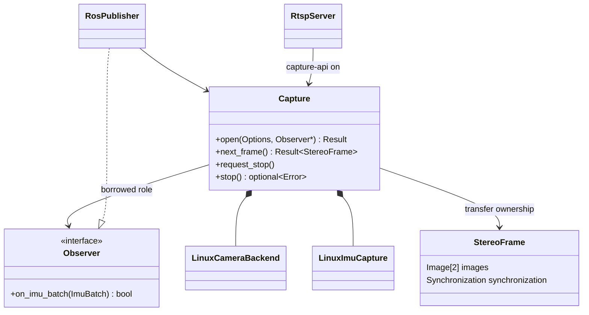

# GS130WI 共用擷取 API

共用 C++17 API 已提供雙目影像與 IMU 資料流，內部使用既有 V4L2/CCI/GPIO backend；ROS 與 GStreamer 不出現在 public header。
這版尚未實作 frame↔IMU 的共同 FSYNC 事件配對，**不輸出宣告有效的 FrameImuPacket 或 host IMU timestamp**。

## 介面與分層

public API 見 `include/gs130wi/Capture.hpp`。`Capture::next_frame()` 同步回傳擁有像素的 move-only StereoFrame；`Observer::on_imu_batch()` 在獨立 IMU worker 通知 SI 單位樣本。兩者的資料語意與時間域分開。



底層不呼叫 ROS/RTSP adapter。舊相機 backend 的檔案位置仍在 `stereo_h265_rtsp`，但此 library 只編譯 V4L2、影像轉換與只讀 kernel status，沒有 GStreamer 依賴。

```cpp
class Consumer final : public gs130wi::Capture::Observer {
public:
    bool on_imu_batch(const gs130wi::ImuBatch& batch) noexcept override;
};
// sink 必須活得比 capture 久；此處省略 Result 的錯誤分支。
Consumer sink;
auto opened = gs130wi::Capture::open({}, &sink);
auto capture = std::get<gs130wi::Capture>(std::move(opened));
auto frame = capture.next_frame();
auto restore_error = capture.stop();
```

## Ownership、執行緒與錯誤

- PIMPL 隱藏 Linux、V4L2、CCI、GPIO、thread 與 driver 相依。
- 相機 DMA buffer 在 backend 內完成拷貝/轉換後 QBUF；API 的 vector 由回傳物件持有，生命週期不依賴下一次擷取。
- `Observer` 是借用的協作角色，只允許短時間處理；batch reference 在回呼返回後失效。要保存資料必須複製需要的內容。
- observer 可回傳 false 或呼叫 `request_stop()`；不能在 IMU worker 回呼中呼叫會 join 自己的 `stop()`/析構。
- `next_frame()` 只允許一個 caller。`request_stop()` 可跨執行緒；`stop()` 必須在 next_frame 返回後由 owner 呼叫。搬移後原物件只允許析構/賦值。
- 明確 stop 會 join worker、關閉相機、還原 IMU 並回傳還原錯誤；析構也會嘗試 cleanup。SIGKILL/斷電不能保證還原。
- worker 失敗會停止擷取並透過下一次同步結果回報，不會靜默關掉 IMU 然後繼續宣告正常。
- `/run/lock/gs130wi-capture.lock` 與原 IMU cooperative lock 防止相同 API 重複占用。舊工具不全遵守新鎖，仍須由部署者只啟動一個硬體 owner。

同一個程序可以用 observer 分派 IMU、用 owning frame 分派影像；**這版尚未建立跨程序 broker，獨立 ROS node 與 RTSP server 不可同時占用同一組硬體**。

## 時間與格式

- 只支援已部署的 Linear、30-Hz kernel exact stereo pairing；相機 profile 與唯一 FSYNC producer 由既有平台控制流程準備，本 library 不另外建立 pulse producer。
- Mono8 為 RAW10 重建後的灰階；Mono10 為 0..1023 的 16-bit word。不是未處理 Bayer RAW，也不是深度圖。
- camera timestamp 為 host monotonic，保留 kernel session、source 與 offset。`exposure_start_estimate` 仍是估計，不能叫作物理曝光起點證明。
- IMU acceleration 是 m/s²、angular velocity 是 rad/s；保留原 sensor axes，不提供未校準的 orientation 或 TF。
- FSYNC packet 的 ODR counter 被替換，因此其 sensor elapsed 為 nullopt；FSYNC offset 為獨立欄位。IRQ/read time 不當成取樣時間。
- 沒有因同時到達就將 IMU 歸入某個 frame。`imu_association=unverified` 是目前唯一狀態，後續真正實作事件配對後才能新增有效狀態。

## 建置與消費端

```sh
cmake -S outputs/gs130wi_capture -B build-capture -DCMAKE_BUILD_TYPE=Release
cmake --build build-capture -j2
ctest --test-dir build-capture --output-on-failure
```

其他 CMake 專案可 `add_subdirectory` 此目錄並連結 `gs130wi_capture`；公開要求為 C++17，內部相機 backend 使用 C++20。
相機 producer 已啟動且原 owner 已乾淨停止後，`gs130wi-capture-probe 300` 可進行有限擷取。
板端驗證依既有 `camera_cpu_list.py` 將 consumer 排除 FSYNC timer CPU；建議沿用平台 runner 的 CPU affinity。

ROS adapter 見 `../gs130wi_ros/README.zh-TW.md`。
RTSP 新增 `--capture-api on`，只允許 Linear/Main10/30 Hz，會同時擷取 IMU 並在停止時輸出計數；網路 RTSP 仍只傳影像，不傳 IMU。
預設 `--capture-api off` 保留既有啟動行為，這次不替換正式服務的 binary。

## 驗證範圍

證據放在 `evidence-20261015/`。包含 native API 擷取、ROS 真實 DDS 訂閱、RTSP Main10 解碼與原設定還原核對。
相關 backend fixture/單元檢查、短時間板端擷取與真實 ROS topic 接收，是不同證據層級；不代表長時間可靠性、電氣 FSYNC 精度、frame-IMU 區間配對或 VIO 驗收。
