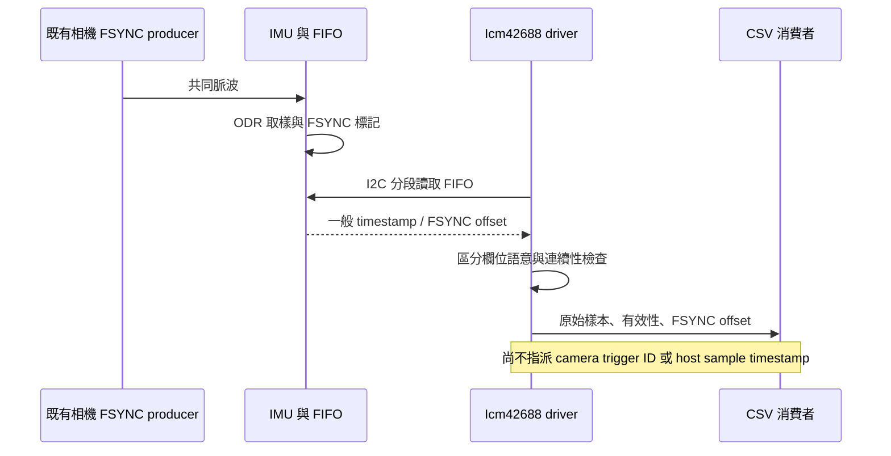

# IMU FSYNC 擷取與驗證

日期：2026-10-15，RUBIK Pi 3 / kernel 6.8.0-1084-qcom。

已完成可選 FSYNC 設定、FIFO 解析與板端擷取。尚未實作 IMU 對 CAMSS trigger 的唯一配對或 sensor→host 時鐘映射，因此 `host_sample_time_validated`、`frame_association_validated` 一律為 false。

## 使用

預設保留原本的 FSYNC-off 模式。新版 binary 與 source 獨立放在板端
`/home/ubuntu/gs130wi-imu/fsync-20261015/`，沒有覆蓋既有 build 或建立常駐服務。

```sh
cd /home/ubuntu/gs130wi-imu/fsync-20261015
sudo ./build/gs130wi-imu --seconds 60 \
  --gpiochip /dev/gpiochip4 --line 24 --fsync \
  > capture.csv 2> summary.json
```

裝置預設 `/dev/i2c-18`、位址 0x68；adapter 與 GPIO 編號是本次板端配置，換板需重新確認。
FSYNC 訊號由既有相機 producer 提供，IMU 工具不取得相機 GPIO ownership、不產生第二組脈波。
若 `--fsync` 完整擷取後少於兩筆標記，CLI 回報 `fsync_missing`，不將無標記擷取當作成功。

## 設定與 ownership

`CaptureConfig::fsync_enabled` 預設 false。啟用後設定：

| 設定 | 行為 |
|---|---|
| bank 1 INTF_CONFIG5[2:1] | PIN9 設成 FSYNC 輸入 |
| TMST_CONFIG | 開啟 TMST_EN、TMST_FSYNC_EN；保持 absolute ODR counter、內部時鐘及原解析度 |
| FIFO_CONFIG1 | 開啟 FIFO_TMST_FSYNC_EN，保留 12-byte partial-read continuation 與 IRQ watermark 策略 |
| FSYNC_CONFIG | 上升緣、TEMP LSB tag；不修改六軸資料的 LSB |

參考供應商 SDK 與 [TDK DS-000347 rev1.6](https://product.tdk.com/system/files/dam/doc/product/sensor/mortion-inertial/imu/data_sheet/ds-000347-icm-42688-p-v1.6.pdf) 的 FIFO header、TMST_CONFIG、FSYNC_CONFIG、INTF_CONFIG5 定義。
不是照抄 SDK 的 reset/deinit：本工具保存原設定、RAII 結束時還原並 readback；包含 bank 1 PIN9 mux 與 bank 0 FSYNC_CONFIG。
banked 操作失敗時先返回 bank 0，避免將還原值寫進錯誤 register bank。SIGKILL 或斷電無法執行 RAII。

public header 為 C++17，PIMPL 隱藏狀態，必要 Registers reference 與可選 Interrupt pointer 由建構子注入；單一 owner/thread，呼叫端負責序列化。錯誤維持結構化 ErrorCode。



## CSV 與時間語意

保留既有欄位順序，尾端新增 `sensor_time_valid` 與 `fsync_offset_ns`。

| packet | timestamp_raw | sensor_elapsed_ns | sensor_time_valid | fsync_offset_ns |
|---|---|---|---|---|
| header[3:2]=10 | 16-bit ODR counter | 自第一筆一般 counter 累積 | 1 | 空白 |
| header[3:2]=11 | FSYNC offset raw ticks | **空白** | 0 | raw × 32000 / 30 |

FSYNC 替換該筆的 ODR timestamp，不能把 offset 加進 counter，也不能假裝該筆具有精確取樣時間。
後續一般 counter 使用 modulo 差值跨越 FSYNC 樣本，依樣本數檢查時間跨度；允許最多八筆連續替換，超過即 fail closed，避免回繞歧義。
這維持一般 counter 的連續時間軸；FSYNC 樣本的取樣時間須由後續映射層重建，這版不插入名義 5 ms 假值。
`valid` 只代表六軸數值有效，與 `sensor_time_valid` 分開。

`host_interrupt_ns` 仍是整批通知；read begin/end 是傳輸時間。
summary 的 sensor rate 由 sensor counter 推算，不能將其 200 Hz 視為 host clock 校準證明。
既有 CSV 消費者處理 FSYNC 模式時，必須接受空白 elapsed，並依有效性判斷。

## 驗證紀錄

原始 CSV、前後 register snapshots、kernel log、獨立稽核與 decode 結果位於
`fsync-evidence-20261015/`。

| 測試 | 結果 |
|---|---|
| C++17 Release build、warnings-as-errors | 板端 GCC 13.3 通過 |
| driver fixture | FSYNC 解析、counter 回繞與跨 batch/相鄰標記、錯誤封包、overflow、banked failure 還原通過 |
| FSYNC off，10 秒 IRQ | 2,024 有效樣本、0 FSYNC 標記 |
| FSYNC on，10 秒初測 | 2,024 有效樣本、317 標記；有 17 組相鄰標記，保留原始資料，不合併 |
| FSYNC on，60 秒 IRQ | 12,148 有效樣本、1,800 標記；標記間隔 6/7 筆樣本，無相鄰標記 |
| 最終 source 重建後，10 秒 IRQ | 2,024 有效樣本、300 標記；獨立稽核通過 |
| 60 秒擷取期間 RTSP/TCP | 解碼 181 張 HEVC Main10，穩態媒體 FPS 30.00007，PTS 遞增 |
| register restoration | 各次擷取前後 bank 0 設定與 bank 1 PIN9 完全一致 |
| 結束後相機與 kernel | session=5、running=1、error=0、error_count=0；60 秒期間 dmesg 未變動；最終再次解碼 91 張 Main10、30 FPS |

60 秒資料的 sensor-counter rate=200 Hz，host-read rate 約 202.55 Hz，兩個時鐘仍需校準。
初測相鄰標記的原因未獨立確認；不能把每筆標記直接編成不同 video frame。
1,800 個標記與 30 Hz 數量相符，也不足以證明它們與 1,800 張影像逐筆唯一對應。
本驗證不是電氣邊緣精度、曝光起點、IMU 濾波延遲或 VIO 同步驗收。

獨立重算方式：

```sh
python3 audit_fsync.py fsync-evidence-20261015/fsync-60s.csv \
  --before fsync-evidence-20261015/fsync60-before.json \
  --after fsync-evidence-20261015/fsync60-after.json \
  --expect-fsync --output fsync-evidence-20261015/fsync-60s-audit.json
```

相機目前使用 `exposure_start_estimate`，不能將其 DQBUF 值直接視為 FSYNC 邊緣；後續映射須讀取當次 session 的時間來源與 offset。
