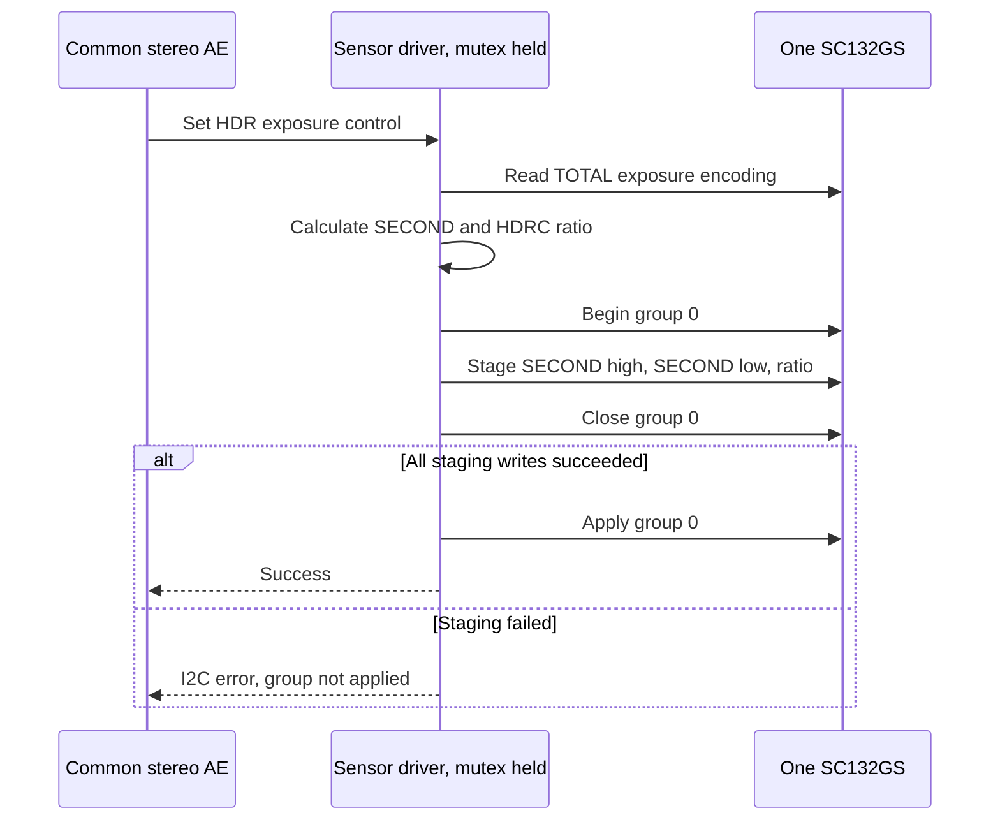
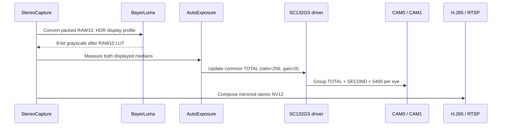

# HDR exposure and HDRC ratio

Lower-FPS extension (2026-10-12, deployed after reboot): keep TOTAL<=1492 at
30 FPS. At lower FPS add 95% of the extra frame time using the existing
135000 nominal-row/s profile. The loaded driver's register range is 4492,
but a manual 15-FPS test at that VTS-8 boundary stalled capture. The owner
therefore caps at the measured 4350: 3629 at 20 FPS, 2560 at 24 FPS and 4350
at 15 FPS. Representative ceilings decode at their requested cadence.
At target30, HDR15 uses TOTAL4350/SECOND1/gain0; Linear30 uses rows1377/gain30.
Decoded medians differ by about -2.0%/-1.4%, with clipping reduced from
4.48%/4.20% to zero. Four fixed pre-encoder patches improve contrast/residual
noise by 34-38%, with decoded improvements of 27-38%. This compares different
FPS by user choice. Global ROI mean remains 23-27% lower as HDR compresses
highlights; the identical target denotes P50, not an equal global mean.
When target luma already matches, the new sensor AE can trade up to two gain
indices per control interval for longer TOTAL if headroom and highlights allow.
These are nominal rows; physical HDR microseconds remain uncalibrated.

Latest sensor-profile target update: `sc132gs-camera apply --ae on --ae-target N`
sets and persists effective linear-signal P50 percentage, 0..100, in either mode.
Unbinned Main10 sensor profiles subtract measured pre-encoder black levels
(Linear 37, HDR 53) and normalize using
`round(1023*clamp((gray10-B)/(1023-B),0,1))`; gamma remains 1.
Target is `round(1023*N/100)`, equivalent to an uncalibrated target of
`B+round((1023-B)*N/100)`. The old 80% target scaling and Linear display inverse
are removed. Mode switches retain the target. Both modes meter the same central
80% ROI P50; original RAW buffers and RAW clipping remain unchanged. Black levels
were measured at gain indices 0, 11 and 21; binning and the opt-in B path retain
their earlier semantics. Status reports `target_kind=sensor_signal_percent`,
`signal_black_raw10`, `signal_target_luma10` and HDR's `hdr_target_raw10`.
The opt-in B profile retains darker-80% metering. Status distinguishes the target from
highlight/brightness limits; a high accepted target may still be unreachable.

2026-10-12 later user request: Main10 defaults to sensor-gray display, without
the B curve or its AE target mapping. B is now explicit opt-in via
`--hdr-display b`. Earlier manual inspection held AE off, TOTAL=1200, SECOND=1,
gain=21. The B-profile notes below describe the earlier tuning stage.

2026-10-12 Main10 B follow-up: the user-selected fixed display curve is
`round(1023*sqrt(clamp((gray10-52)/971,0,1)))`, applied after original RAW10
metering and before encoding. Manual TOTAL=1492, SECOND=1, gain=21 maps to
about 30% displayed shadow; this scene therefore uses brightness target 30.
Main10 B interprets that percentage directly, with inverse RAW target 139,
and does not multiply it by 80%. The darker-80% sampling group remains.
Original RAW clipping continues to constrain SECOND/gain; tone mapping
does not enter the clipping feedback. Enabling AE preserves the live SECOND
control instead of restoring an obsolete cached manual value.
The older target/gamma conventions documented below are historical profiles.

Dual-target follow-up (2026-10-08): the formal HDR AE sorts RAW10 samples into
fixed darker 80% and brighter 20% groups. Shadow measurement is the median of
the darker group (whole-area P40); the effective brightness target is the
configured brightness times 80%. Saturation (samples >=1020) is measured
within each eye's brighter group, not the whole metering area. Bright-group
size rounds up to whole samples, with the remainder in the shadow group.
Defaults are base brightness 40% (effective target 32%) and bright-group
saturation ceiling 5% (approximately 1% of all samples). Highlights take
priority when these cannot both be achieved. `hdr_second_exposure_ticks`
(private ID 00982a02, 0..65535) enables an independent SECOND setting. Zero
retains the ratio-derived compatibility profile. Nonzero requires managed
ratio mode and SECOND<TOTAL; TOTAL, ratio and SECOND are clustered so a
VIDIOC_S_EXT_CTRLS tuple is validated and committed together. The reported
`hdr_ratio` remains the compatibility seed, not the actual ratio while an
independent SECOND is active. `hdr_second_ticks` reports the effective value.
The group transaction recalculates 5400 for every exposure tuple.
Short-exposure analogue/digital gain registers are unchanged. Current AE
enabled / target / maximum gain are persisted through the existing camera
controller; runtime `sc132gs-ctl hdr-overexposure PERCENT` defaults to 5 after
restart. See `../stereo_h265_rtsp/diagnostics/hdr-dual-target-20261008/`.

Current Main10 follow-up (2026-10-08): HDR gain is no longer locked to unity.
The controller exposes the same device gain range as Linear and enforces the
configured maximum. Automatic exposure increases TOTAL to its validated
1492-row ceiling before increasing analogue gain. The current manual preview
uses TOTAL=1492, requested ratio=256, AE off, gain index=16 and maximum gain
index=16 (both sensors read 3e08/09=03/2d, or 1.40625x).
Main10 AE now measures sensor-linear gray without the historical display
curve below; the following display calibration records describe the earlier
8-bit / display-statistics profile. Original RAW and the Main10 encoder input
are not changed by that display calibration.

SC132GS Datasheet V2.6, page 21, table 2-3 specifies:

```
TOTAL  = { 3e00[3:0], 3e01, 3e02 }   // 1/16-line encoding
SECOND = { 3e31, 3e32 }               // 1/16-line encoding
5400   = round(255 * (TOTAL - SECOND) / TOTAL)
```

The deployed driver previously inherited the D-Robotics table's fixed
`5400=80`, while its exposure callback updated only `3e31/32`. With
`TOTAL=5d40` and `SECOND=2200`, the formula gives `A2`, not `80`.
The reference table itself also uses the fixed ratio at its initial exposure;
this is an inherited convention, not a ratio calibrated for this board.

The driver now reads the current TOTAL encoding and calculates the ratio for
every HDR exposure update, including the cached exposure applied at STREAMON.
It rejects a zero TOTAL, a SECOND at or above TOTAL, and a SECOND that does
not fit the 16-bit registers. No floating-point arithmetic is used.

Exposure and ratio writes use sensor group 0 (`3800=00`, close with `10`,
apply with `60`), as described on page 28, table 2-8. The driver holds its
existing sensor mutex for the whole transaction. Failed staging does not
launch the group; the original I2C error is returned. This grouping is within
one sensor; it does not prove simultaneous exposure changes between eyes.



## Exposure control units

The existing HDR control encoding is retained for compatibility:
`SECOND = control * 4`. Combined with the datasheet's 1/16-line register
encoding, one control step represents **1/4 nominal line**. Thus HDR control
808 encodes 202 lines, and control 2176 encodes 544 lines. Linear control
808 encodes 808 lines. The legacy status field `exposure_lines` therefore
does not have the same unit in both modes; do not copy it across modes.

These are decoded register units, not measured exposure durations. The HDR
PLL and external-trigger offsets have not been electrically characterized;
the existing rejection of a positive HDR `max-exposure-us` remains correct.
The existing 8..2176 HDR control bound is preserved. This change does not
alter TOTAL exposure, gain, trigger cadence, dimensions or Device Tree.

## Fixed-exposure RAW comparison

`hdr-ratio-check.py` captures A/B/A at the currently held common exposure and
gain with the AE process stopped. It uses A=`80`, B=the computed value, then
returns to A. Both cameras discard 60 warm-up frames and save 12 complete
RAW10 frames per condition. Its finally block stops temporary capture/FSYNC
owners and restarts the existing HDR service. Run as root on the board:

```
python3 hdr-ratio-check.py /path/to/diagnostic-output
```

The 2026-10-06 comparison used control 2176, gain index 60 and B=`A2`.
All 72 frames were complete (1,740,800 bytes each), with distinct hashes.
Statistics use original 10-bit samples. The preview applies the same fixed
0..1023 display range and 2x2 RGGB luminance conversion to all conditions.
It uses neither percentile normalization nor spatial denoising.

| Eye | Mean RAW10, A before | Mean RAW10, B | Mean RAW10, A after | Saturated %, A / B |
| --- | ---: | ---: | ---: | ---: |
| CAM0 | 411.205 | 410.868 | 411.009 | 9.109 / 9.092 |
| CAM1 | 450.586 | 450.410 | 450.232 | 10.916 / 10.910 |

Saturation is RAW10 >= 1020. Average absolute B-versus-A change was smaller
than the repeated-A difference for both cameras. This scene provides no
evidence of a meaningful highlight or noise improvement from the ratio
change. In particular, it does **not** establish that `5400` caused the
right-eye highlight difference. HDRC is documented as HDR noise calibration,
not as a standalone highlight tone-mapping control.

See `hdrc-ratio-evidence-20261006/` for readbacks, frame hashes, statistics and
the fixed-scale preview. Large original RAW captures remain on the board at
`/home/ubuntu/sc132gs-hdrc-ratio-20261006/ab-before/`.
`hdr-ratio-analyze.py OUTPUT_DIRECTORY` reproduces the statistics and preview
from those six RAW files; it requires NumPy and Pillow.

## Driver validation and rollback

`hdr-ratio-control-check.py` checks both sensors through V4L2 at controls
8, 200, 808, 1492 and 2176, with repeated transitions. It also checks the
control boundaries and restores the original exposure/gain and AE state.
This is a hardware integration check, not a claim of measured dynamic range.

The new module compiled against `6.8.0-1084-qcom` and was loaded after a reboot.
The loaded module and installed file have matching srcversion
`EF3B151E0A4E34A35BA74F1`; the deployed module SHA256 is
`0d3b2ea4a37fe6a13febbf006b324a61500eb28a42b4e2e25a8053a691bceed9`.

On both eyes, controls 8/200/808/1492/2176 produced ratios
`ff/f6/dc/bf/a2`. Repeated transitions and V4L2 clamp handling for requests
0/2177 passed, including readback of the matching SECOND/ratio pair. A prior
live group test confirmed that staged values stayed inactive until launch.

All four existing CTest cases passed. Real capture after driver installation
produced 300 contiguous pairs in each mode: HDR 30.20 FPS and Linear 59.99 FPS.
Each mode also produced three distinct full-size RAW frames per eye. The live
FDT hash was identical across these two runtime mode checks. The final HDR
RTSP stream decoded to 299 distinct 2176x1280 images over approximately ten
seconds, followed by a separate Windows RTP/TCP probe at 30.10 FPS.

Final state is HDR 30 FPS, common AE target 40%, AUTO_EXPOSURE=1. Both sensors
read `3220=c3`, `3222=32`, `3225=00`, `TOTAL=5d40`, `SECOND=2200`, `5400=a2`.
The final decoded image still shows the right-eye highlight difference; that
separate issue is not claimed fixed by this ratio correction.

## Follow-up: right-eye highlight halo

A read-only comparison covered 211 addresses: the HDR initialization table,
FSYNC configuration, all of `3e00..3e3f`, and `5400..541f`. Three independent
rounds agreed: every compared address matched except `5414`, which read
`cb` on CAM0 and `cc` on CAM1. The comparison masks only `300a` bit 3, the
live FSYNC pad status. `5414` is not defined in the supplied datasheet or
written by this driver; its function and relation to the halo are unknown.
It was not modified. This is an expanded comparison, not an assertion that
every register in the sensor is identical. Known HDR, HDRC, exposure, long/
short gain and timing settings matched. Short-gain registers `3e10..3e13`
read zero on both eyes; identical values do not establish that this vendor
single-frame HDR profile is optimally calibrated.

The user confirmed the right lens faces the scene directly, without a cover
window, protective sheet or film. Lens/internal sensor scattering and sensor
response remain unseparated possibilities; no lens-swap or cleaning A/B has
been performed.

An additional RAW sequence held exposure at control 2176 and HDRC at `a2`,
left gain at index 61, and varied only right gain: 61, 57, 0, then 61 again.
Each condition recorded 12 full frames per eye after 60 warm-up frames; all
96 frame hashes were distinct. The identical fixed display scale exposes
the whole-image brightness cost of lowering gain.

| Right gain index | Right median RAW10 | Right saturated % | Left median RAW10 |
| --- | ---: | ---: | ---: |
| 61, baseline | 396 | 11.209 | 350 |
| 57, small reduction | 367 | 9.712 | 349 |
| 0, minimum | 142 | 2.226 | 349 |
| 61, restored | 396 | 11.225 | 349 |

Saturated percentage measures full-frame RAW samples >=1020, not halo area.
The small reduction lowers saturation but leaves a visible halo; the minimum
gain reduces it while strongly darkening the whole right image. These tests
show gain contributes to clipping, but do not uniquely diagnose optical
flare versus sensor blooming/response. No per-eye compensation or image
filter was enabled in the production stream. HDR 30 FPS and common automatic
exposure/gain were restored after the diagnostic captures.

Readbacks are in `eye-register-comparison.json`; RAW capture evidence,
statistics and the fixed-scale preview are in `right-gain-*` files in the
evidence directory. Original RAWs and the temporary capture script remain
on the board under `sc132gs-hdrc-ratio-20261006/right-gain/` and
`sc132gs-mode-switch-20261006/right-gain-check.py`, respectively.

## Fixed-TOTAL HDR exposure-strength sweep

The 2026-10-06 sweep tested TOTAL/SECOND ratios 2.74265, 4, 8 and 16,
then repeated the first condition. TOTAL stayed at `5d40`, common analogue
gain index stayed at 57 (`3e08/09=23/3d`), and AE was disabled. The driver
updated SECOND and the matching `5400` through its group transaction.
Both eyes had identical verified register values before and after each
RTSP screenshot and during each RAW capture. Long digital gain and all four
short-gain registers were held at their existing values; the short-gain
registers were zero. This is a timing-ratio test of the existing profile,
not a complete gain or HDR knee calibration.

| TOTAL/SECOND | Exposure control | SECOND | 5400 |
| --- | ---: | --- | --- |
| 2.74265 | 2176 | 2200 | a2 |
| 4 | 1492 | 1750 | bf |
| 8 | 746 | 0ba8 | df |
| 16 | 373 | 05d4 | ef |

Five RTSP images were decoded at 2176x1280. A separate RAW phase collected
12 complete, distinct 1,740,800-byte frames per eye and condition, after
60 warm-up frames. All 120 RAW frame hashes were checked again after copying
to the Windows host. The two phases used matching register states; they
were not simultaneous captures. All previews use a common fixed display
scale without exposure normalization. RAW previews average 12 frames.

The fixed lamp region is x=650..1079, y=660..1059 in each horizontally
mirrored 1088x1280 eye, matching the RTSP orientation. RAW10 saturation is
defined as sample >=1020:

| Ratio | CAM0 lamp saturated % | CAM1 lamp saturated % |
| --- | ---: | ---: |
| 2.74265 before | 9.234 | 9.852 |
| 4 | 9.229 | 9.842 |
| 8 | 9.236 | 9.846 |
| 16 | 9.237 | 9.831 |
| 2.74265 after | 9.239 | 9.863 |

The lamp region and RTSP detail show no meaningful highlight recovery as
the exposure ratio increases. The right-eye halo remains visible. A person
moved at the frame edge, affecting whole-image saturation and some dark
pixels; whole-image differences cannot be attributed entirely to the
ratio. Temporal standard deviation includes illumination variation and
motion, so it does not establish a sensor-noise improvement.

This scene does not support "the ratio is merely too small" as a sufficient
explanation of the similar Linear/HDR output. It also does not prove HDR is
disabled: the light may exceed the recoverable range, and register readback
alone does not prove the intended response curve under external trigger.
The next investigations are second-stage exposure behavior in the FSYNC
profile and the existing long/short gain and HDR calibration settings.
The production exposure policy was not changed by this diagnostic.

Evidence, statistics, and full/cropped previews are under
`../stereo_h265_rtsp/diagnostics/hdr-strength-20261006/`; original RAW files
remain on the board at `/home/ubuntu/sc132gs-hdr-strength-20261006/`.
The capture finally block restored Linear 60 FPS, automatic brightness
target 40%, and validated a freshly decoded frame from the restored stream.

The previous mode-switch driver is backed up at
`/home/ubuntu/sc132gs-hdrc-ratio-20261006/sc132gs-before.ko`. To revert,
stop the RTSP service, install that file at
`/lib/modules/$(uname -r)/extra/sc132gs.ko`, run `depmod -a`, then reboot.
After reboot, `sudo sc132gs-ctl set-mode hdr` restores capture and RTSP.
Do not unload CAMSS to replace the sensor driver while its graph owns it.

## Low-gain HDR response and managed exposure profile

The follow-up sweep on 2026-10-06 found a real gain/response interaction.
With unity analogue gain (`3e08/09=03/20`) and fixed TOTAL `5d40`, increasing
TOTAL/SECOND recovered lamp structure in both RAW and decoded RTSP. Central
RAW medians stayed approximately 139–140 while the highlighted lamp changed.
Repeating both the unity-gain baseline and the original gain-57 baseline
reproduced the initial saturation. This separates the ratio effect from a
simple reduction of the entire image's exposure or a scene-lighting change.

| Profile | Gain index | TOTAL/SECOND | CAM0 lamp saturated % | CAM1 lamp saturated % |
| --- | ---: | ---: | ---: | ---: |
| Original before | 57 | 2.74265 | 9.202 | 9.867 |
| Unity before | 0 | 2.74265 | 7.120 | 8.059 |
| Unity, SECOND `00bc` | 0 | 126.97872 | 0.038 | 0.138 |
| Unity, SECOND `005c` | 0 | 259.47826 | 0.000 | 0.000 |
| Unity repeated | 0 | 2.74265 | 7.120 | 8.061 |
| Original repeated | 57 | 2.74265 | 9.196 | 9.821 |

The region and saturation threshold are the same as the earlier sweep.
Each of the six conditions collected 12 complete, distinct RAW frames per
eye after 60 warm-up frames; all 144 hashes were checked on Windows.
Sensor settings matched between the separately captured RAW and RTSP phases.
See `../stereo_h265_rtsp/diagnostics/hdr-low-gain-20261006/` for capture
evidence, statistics and fixed-scale RAW/RTSP images. Original RAW files
remain at `/home/ubuntu/sc132gs-hdr-low-gain-20261006/` on the board.
The earlier negative high-gain sweep remains valid for that profile, but
does not describe the low-gain response. These observations do not identify
the precise internal clipping stage or establish an absolute DR in dB.

Short-gain writes (`3e10..13`) were also tried through grouped and direct
transactions and read back as zero. No such writes were added to production.
The public D-Robotics `sc132gs_utility.c` single-frame 1088 HDR branch uses
`NORMAL_M` with `extra_mode==1`; it does not take the separate `DOL2_M`
short-gain write branch. A zero readback here does not establish that the
second stage is disabled. The positive low-gain RAW test provides the
response evidence.

### Driver and AE contract

Standard V4L2 `EXPOSURE` retains the old HDR meaning: SECOND=`control*4` in
1/16 nominal-row register units. A new private managed profile lets AE
adjust TOTAL independently of the requested compression ratio:

| Control | ID | Values | Meaning |
| --- | --- | --- | --- |
| `hdr_total_nominal_rows` | `00982a00` | 8..1492, default 1492 | TOTAL=`value*16` |
| `hdr_total_second_ratio` | `00982a01` | 0 or 2..256, default 0 | 0 selects legacy; nonzero selects managed |

In managed mode, SECOND=`max(1,round(TOTAL/requested_ratio))` and
`5400=round(255*(TOTAL-SECOND)/TOTAL)`. The driver stages all six register
bytes (three TOTAL, two SECOND, one HDRC coefficient), closes the group,
and launches it only after successful staging. Its existing mutex covers
the transaction. A change to the legacy `EXPOSURE` control is rejected
with `EBUSY` while managed mode is active. Setting ratio=0 restores the
original TOTAL `5d40` and the cached legacy SECOND. Unchanged standard-control
writes can be handled as a no-op by the V4L2 core.

Mode changes still require stopped capture. They clear managed ratio to 0,
reset TOTAL to 1492 and reset legacy exposure to 808. STREAMON reapplies the
mode table, verifies critical mode registers and applies the cached active
exposure profile. The HDR FSYNC `3225=00` fix is retained. Both modes use
the same two-lane wiring and Device Tree.

HDR AE activates requested ratio 256 and gain index 0 on both eyes. It
adjusts TOTAL rather than legacy SECOND and never raises gain to reach an
unattainable target. Its 1492-row ceiling is conservative for the validated
30-FPS profile; physical HDR microseconds remain uncharacterized.
Quantization means the actual TOTAL/SECOND ratio varies slightly. At TOTAL
8 rows, SECOND is one register tick and the actual ratio is 128; the
requested ratio field must not be interpreted as an exact readback.
The existing two-sensor rollback on an individual control failure remains
in use. This is not a simultaneous electrical update or exposure-sync proof.

### HDR display and feedback

Unity-gain HDR preserves highlights but has compressed midtones. Minimum
TOTAL (8 rows), 512, 1096 and 1492-row RAW captures established a common
output floor of 52. At 8 rows the central RAW medians were 52/53; at 1492
rows they were 140/142. These four profiles also used 12 RAW frames per eye,
verified on Windows, with evidence under
`../stereo_h265_rtsp/diagnostics/hdr-managed-raw-20261006/` and original RAW
at `/home/ubuntu/sc132gs-hdr-managed-raw-20261006/`.

The HDR RTSP converter therefore uses this fixed, mode-specific display
calibration on full 10-bit BT.709 grayscale, before final 8-bit quantization:

`display = round(255 * clamp((raw10 - 52) / (1023 - 52), 0, 1)^0.38)`

A 1024-entry LUT avoids per-pixel powers. Linear conversion remains unchanged.
The calibration is empirical for this board/profile, not a universal sensor
factory black-level specification. Original RAW is unchanged. Both sensor
highlight recovery and display brightness are necessary for this preview:
the curve cannot recover already-clipped RAW.

`AutoExposure::LumaEncoding` explicitly states whether luma has this HDR
display response. RTSP supplies `hdr_display`; the default raw-stream caller
uses `sensor_linear`. The AE target is the mean of the two central sampled
medians, with a tighter HDR deadband. When observing display-encoded HDR,
its exposure EV step accounts for the exponent. Status reports
`exposure_kind=hdr_total_rows`, `hdr_ratio=256`, `display_gamma_x100=38`,
and `display_black_raw10=52`, making the active units and display response
visible. Raw callers do not implicitly claim tone-mapped brightness.



### Final hardware and playback verification

The deployed module built against kernel `6.8.0-1084-qcom`, then was installed
with `depmod` and one controlled reboot. The loaded module srcversion matched
the installed file: `C3FDD2D83D5E4E732D6D835`;
module SHA256 `3f3cfcf15e4a7d7d4dd44afdd0c80ed4e4640cf599c8ee4ab5b2a39f860ad81c`.
The mode controller and one persistent VPU encoder remain in use.

Live Linear → HDR → Linear → HDR transitions passed, with actual receiver
rates about 59.9/30.0 FPS. Fresh RTSP sessions decoded 30 frames at 2176x1280
for every comparison. The same-mode request, labelled `hdr-restart` in the
recorded evidence, was a verified no-op, not a service restart. HDR target
20% reached 20%/20% at TOTAL 203 rows; target 40% reached 40%/40% at 1366 rows.
Target 60% reported `brightness_limited=1` at maximum TOTAL without raising
gain. Both eyes rejected ratio=1, TOTAL=1493 and a conflicting legacy
exposure change, with unchanged sensor register states.

The final managed RAW capture at TOTAL `5560` (1366 rows), SECOND `0055`
(85 ticks), and `5400=fe` collected another 12 distinct frames per eye.
Both the fixed lamp region and full image had 0% samples >=1020 in this
capture. Both sensors read `3220=c3`, `5001=01`, gain `03/20` and identical
exposure/coefficient fields. Actual TOTAL/SECOND was approximately 257.13.
This is highlight evidence for the tested scene, not a guarantee for every
light source or moving object.

Windows RTSP/TCP received 240 H.265 access units in eight seconds, 29.93 FPS.
CTest passed all four existing checks, with the Bayer check extended to
test the monotone HDR response, black/white endpoints, and preservation of
RAW10 increments before display quantization. The service was left in HDR
30 FPS with AE enabled and target 40%; prefs were persisted after restoration.

Final screenshots, JSON evidence, RAW hashes, analysis, reproduction scripts
and the Windows network result are under
`../stereo_h265_rtsp/diagnostics/hdr-managed-live-v2-20261006/`.
Original final RAW files remain at `/home/ubuntu/sc132gs-hdr-final-raw-20261006/`.
The RTSP binary and module from before this managed-profile change are backed
up at `/home/ubuntu/sc132gs-hdr-managed-20261006/rtsp-before` and
`/home/ubuntu/sc132gs-hdr-managed-20261006/sc132gs-before.ko`, respectively.
To revert, stop the stream, restore both files to their installed paths,
run `depmod -a`, reboot, and use `sc132gs-ctl set-mode` to restart capture.
