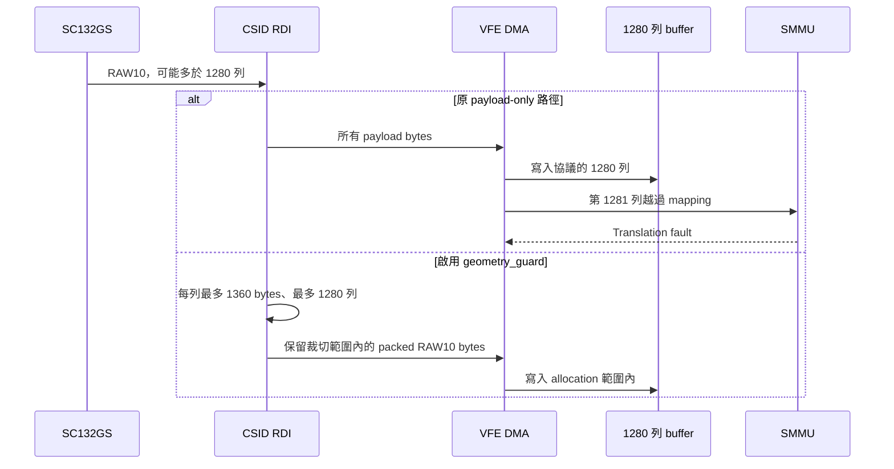

# QCS6490 / SC132GS 的 RAW10 DMA 邊界修正

已修正並部署一個可重現的 CAMSS 接收端缺陷：當收到比協議高度更多的
RAW10 列時，payload-only RDI 把額外資料交給 VFE；DMA buffer 只有
1360 × 1280 = 1,740,800 bytes (`0x1a9000`)，因此越界並觸發 SMMU。

camera 1 的多一列測試，在未限制的接收路徑重現 `SID=0x8a0`、`cb=28`、
`fsr=0x402`；byte counter 是 `0x1a9550`，恰好比 allocation 多 1360 bytes。
這確認了故障機制及 driver 邊界缺陷。原先自然發生的長時間故障是否同樣
來自額外 sensor 列，仍未取得當下的直接證據。



## 實作與適用範圍

`camss-6.8.0-1084-raw10-boundary.patch` 適用於 Ubuntu 的
`linux-qcom 6.8.0-1084.89` CAMSS source。實測 kernel 是
`6.8.0-1084-qcom`，硬體為 QCS6490 / RUBIK Pi 3 的雙 SC132GS。
正式驗證模式為 Linear、每眼 1088×1280、packed RAW10、60 FPS。
未宣稱其他 SoC、kernel 版本或相機模式已通過相同驗證。

- `geometry_guard` 預設關閉，板端以 modprobe options 啟用。
- 僅在 RAW10 RDI 路徑使用 RAW8 **byte transport** 解碼，保留 CSI
  data type `0x2b` 與 VFE / V4L2 的 packed RAW10 格式。
- RAW8 byte transport 讓 crop engine 生效；沒有把 10-bit samples
  量化成 8-bit。兩眼各三個 sensor test-pattern frame 均逐 byte 相同。
- 寬度以 payload bytes 計算，高度以列計算；crop 的起點為 0，終點 inclusive。
- STREAMON/STREAMOFF 配置時先讀取一次 guard 值，避免同一次配置內參數不一致。
- 正式版沒有 sensor 輸出修改、TPG 額外列、frame-size 比較中斷或定期重啟。

Qualcomm downstream driver 也明確指出 payload-only decode 會繞過 RDI crop：
[cam_ife_csid_core.c](https://android.googlesource.com/kernel/msm/+/b0ce5942f23d4b0e4072a2f41fa1be1d6a544a9c/drivers/media/platform/msm/camera/cam_isp/isp_hw_mgr/isp_hw/ife_csid_hw/cam_ife_csid_core.c)。
單純加入 crop registers 而仍使用 payload-only 的早期版本未能保護 DMA。

## 板端部署與回復

目前新增 override module 位於：

`/lib/modules/6.8.0-1084-qcom/updates/sc132gs-csid-monitor/qcom-camss.ko`

原廠模組仍保留於 kernel 目錄。部署工具與 exact source 位於
`/home/ubuntu/camss-dma-fix-20261013`。歷史檔名保留 `monitor`，正式內容
只包含邊界修正。

重建指令（須先準備未修改的、含 Ubuntu source delta 的 exact CAMSS source）：

```bash
ROOT=/home/ubuntu/camss-dma-fix-20261013
SRC=$ROOT/source/drivers/media/platform/qcom/camss
python3 "$ROOT/prepare_csid_monitor.py" "$SRC"
make -C /lib/modules/6.8.0-1084-qcom/build M="$SRC" \
    CONFIG_VIDEO_QCOM_CAMSS=m CC=gcc-13 -j2 modules
sudo bash "$ROOT/install_csid_monitor_coldboot.sh" update
sudo systemctl stop sc132gs-camera-restore.service sc132gs-camera-rtsp.service
sudo systemctl reboot
```

patch generator 拒絕重複套用；已修改的 source 要先恢復保存的
`camss-csid-gen2.original.c`。`update` 須已存在本次備份及 override；首次
部署使用 `install`。不使用 module 熱卸載／熱載入。

若需回復原廠 CAMSS，使用保存且會驗證 hash 的 initrd：

```bash
sudo bash /home/ubuntu/camss-dma-fix-20261013/install_csid_monitor_coldboot.sh restore
sudo systemctl stop sc132gs-camera-restore.service sc132gs-camera-rtsp.service
sudo systemctl reboot
```

此回復只移除本次新增的 module 和 options，並回復 initrd；FSYNC 排程修正
是另一項獨立改動，原 binary 保存在 `fsync-generator.original`。

## 證據

完整測試結果、限制、module hash 及串流驗證見
[RESULT.zh-TW.md](../../stereo_h265_rtsp/configuration-evidence-20261013/dma-fix/RESULT.zh-TW.md)。
幾何測試的 sensor 設定只在測試期間變動，結束後重新套用保存設定；
每項測試都有讀回值、capture exit code、前後 dmesg 與服務恢復紀錄。
短 frame 測試僅驗證持續擷取及無越界，沒有證明缺少的列具有有效影像資料。
