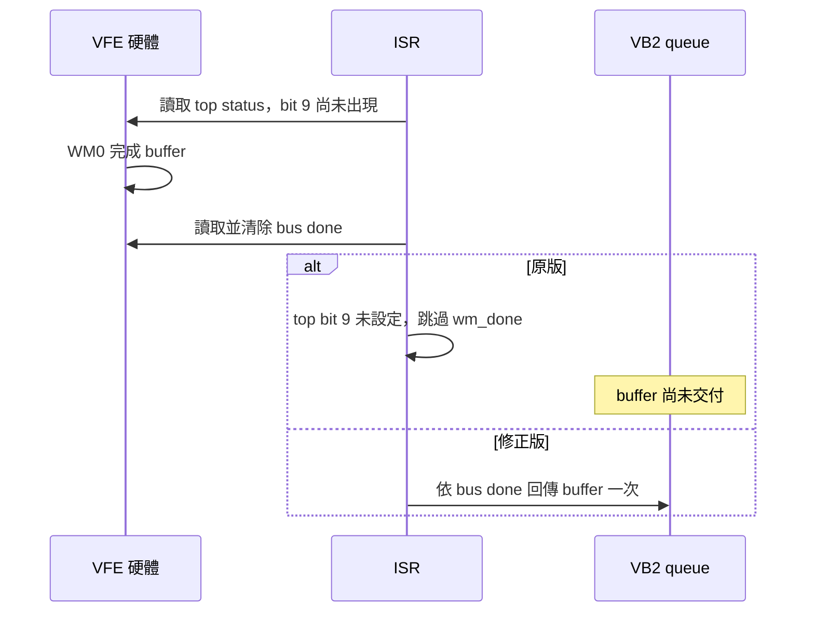

# VFE-17x 完成事件漏送修正候選

修正的是 driver 在讀取並清除 BUS_IRQ_STATUS(1) 後，仍以先前取樣的
IRQ_STATUS_0 bit 9 決定是否呼叫 wm_done。兩個讀取不是原子操作；bit 9
未出現在先前的快照時，已完成的 buffer 會被消耗但沒有回傳。

這是與原 queue 停幀相符的、可重現的 driver 缺陷；尚未證明昨晚自然故障
必定由它觸發。上游已提供相同的最小修正與 Reviewed-by：
[原始 patch](https://lists.openwall.net/linux-kernel/2026/09/28/486)、
[review](https://lists.openwall.net/linux-kernel/2026/09/28/757)。

`camss-6.8.0-1084-vfe-done.patch` 只移除該 gate，保留 BUS_IRQ_STATUS(1)
各 write master 完成位元的判斷。沒有改 DMA buffer 尺寸、地址或 RAW10 邊界修正。

`verify_vfe_done_isr.py` 從實際 source 擷取完整 ISR，使用受控的 register
fixture，在兩次 register 讀取間插入 WM0 completion。原版、修正版各通過
256 組 dispatch 對照；原版清掉事件卻回傳 0 次，修正版回傳 1 次。
這是原始程式層次的證據，並非實機 IRQ 時點重現。

板端候選已成功編譯，srcversion / SHA 與 source fixture 結果記錄於
`vfe-done-candidate-20261014.json`。目前只包含既有 geometry guard 與本修正，
**沒有**另一個聊天正在開發的 kernel FSYNC / 共同 timestamp。

整合時應將最小 source patch 套到最新 timestamp driver，再重建及冷開機驗證；
不可用此候選整顆 module 覆寫 timestamp driver。`prepare_vfe_done_fix.py`
只接受保存的 Ubuntu 原始 VFE source，對新增 timestamp 修改的 source 應檢查
patch context 後套用，保留它的改動。

本聊天另有 pending-frame / 每眼 deadline 修正與測試，已完成 legacy
30/60 FPS 元件回歸及 Release build，尚未部署。共同 timestamp 模式的
缺失、歧義、錯誤 buffer 必須維持明確錯誤語意；整合時不得把 legacy 的
丟棄過期未配對影格策略默默套到嚴格同步驗收。

完整自然故障、追蹤窗口及測試限制见
[RESULT.zh-TW.md](../../stereo_h265_rtsp/configuration-evidence-20261014/queue-root-cause/RESULT.zh-TW.md)。
