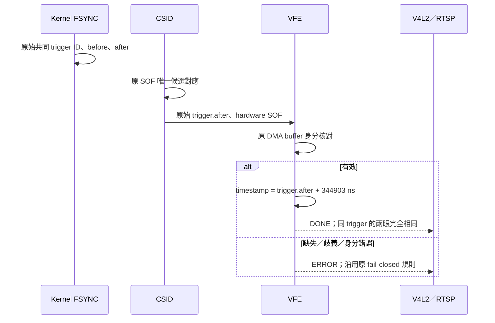

# SC132GS 共同曝光開始估計 timestamp

2026-10-15。目前選定：Linear full RAW10、30 Hz FSYNC、每眼 30 FPS、AE 保留；沿用原 FSYNC／SOF／DMA 幀身分對應，僅套用固定共同時間偏移。

## C 的定義與交付公式

本文統一符號：**T = CSI-2 SOF→EOF + EOF→原始接收時間 R = SOF→R**；`C_offset` 則專指套用在共同 FSYNC 上的 **344,903 ns**。它們也都與前一輪的 `C_residual = R−Y−B` 不同。先前討論中的 `C_transport` 即本節 T。

```text
曝光開始模型：E_est = R − T − B = SOF − B
共同交付偏移：C_offset = round(mean_eye(mean(SOF − Y − B)))
                       = round((344310.261685852 + 345496.447191533) / 2)
                       = 344,903 ns
有效 DQBUF timestamp = trigger.after + 344,903 ns
```

原始 FSYNC 可反推為 `Y ≈ SOF − B − C_offset ≈ R − T − B − C_offset`。以 SOF 起算不再扣 T，以 R 起算才扣 T。

Y 為保存的原始 GPIO-after host monotonic reference。使用每眼 R 各自計算會使兩眼時間不同，因此只使用量測結果建立一個固定共同偏移；runtime 不讀每眼完成延遲來改時間，也不調整 trigger ID 或各眼 sequence。這次取代先前 ABI 3 的 8.196429 ms 曝光中點估計。

## 量測依據與假設

固定 1377 exposure rows、名義行率 84,000 rows/sec，B=16.392857143 ms。分析使用 3698 個已核對身分的連續 trigger，原始資料與完整過程保留於 [FIXED-EXPOSURE-TIMING.zh-TW.md](FIXED-EXPOSURE-TIMING.zh-TW.md)。

| 平均值 | 左眼 | 右眼 |
|---|---:|---:|
| SOF→EOF | 15.384745076 ms | 15.384745273 ms |
| EOF→R | 18.379839 µs | 253.795226 µs |
| T = SOF→R | 15.403124915 ms | 15.638540500 ms |
| SOF−Y−B | 344.310262 µs | 345.496447 µs |

單位容易混淆：**18.38 µs 僅為左眼 EOF→R 尾端延遲，整幀 SOF→EOF 約為 15.385 ms**。共同 0.344903 ms 則是曝光開始模型的固定偏移，與前兩者都是不同量。若僅比較左右同步，這個共同偏移的取捨不改變兩眼時間差；相機／IMU 融合對此偏移的敏感程度則取決於運動速度與允許誤差。

**本版假設 SOF 近似曝光結束，並假設該共同偏移在支援的 AE 條件中維持穩定。** 名義曝光時間來自既有行率模型；尚未獨立量測真正曝光邊界或完整解碼 sensor trigger timing。因此 source 明確為 `exposure_start_estimate`，不設定或宣稱標準 V4L2 SOE，也不宣稱已消除真實曝光時間誤差。

若 SOF 比實際曝光結束晚 Δ，交付值也會包含該未知 Δ。後續取得物理校準後可更新模型；此次先套用已同意的近似，保持共同同步方法。



## 介面與版本

- sysfs ABI 4：非零 `timestamp_offset_ns` 的 source 為 `exposure_start_estimate`；零值仍為 `fsync_host_reference`。參數為載入時設定、唯讀，原有範圍限制保留。
- debugfs 事件格式仍為 ABI 2；原始 FSYNC／SOF／DMA 時間均保留，未套用偏移。
- C++17 `StatusReader` 保留 PIMPL、RAII、move-only、結構化錯誤；支援 ABI 2 的 reference、ABI 3 的歷史 midpoint、ABI 4 的 start estimate。未知 ABI 或 source／offset／版本不一致會拒絕。
- RTSP 維持零容差 exact pairing、有界 queue 與錯誤保護；未改 Main10 格式或 encoder。
- V4L2 timeval 交付精度為微秒，逐張驗證公式為 `floor((pulse.after + 344903)/1000)*1000`。微秒取整不參與 trigger 身分判定。

[timestamp-estimate.json](timestamp-estimate.json) 保存公式、假設、資料集與 SHA-256；[validate_timestamp_estimate.py](validate_timestamp_estimate.py) 會核對原始固定曝光結果和傳輸量測，再重新算出 344903，部署不接受任意未驗證 offset。

## 部署及回復

```text
options qcom_camss geometry_guard=1 fsync_mode=2 sof_min_us=341 sof_max_us=16853 timestamp_offset_ns=344903
```

以 `deploy.sh common 341 16853 344903` 準備模組、binary、設定及 initrd，另行重開機載入；不熱卸載 CAMSS。

前一個已驗收的 ABI 3／8.196429 ms 版本，另存於板端 `/home/ubuntu/sc132gs-kernel-sync-20261014/exposure-start-baseline-20261015`，含模組、initrd、設定、RTSP binary／runner 與 hash。需回復時使用 `sudo bash exposure-start-baseline.sh restore`，再重開機並驗證串流。更早的 midpoint／原始 baseline 均保留。

## 驗證狀態

離線實際 kernel 幀對應 fixture 32 項與 C++17 診斷測試通過；ARM64 模組及 userspace 編譯完成，板端 11 項 CTest 全部通過。FSYNC callback、SOF matcher、arm、fail 函式與原驗收 source 完全相同。BTF 因無 vmlinux 未產生。

板端已重開機載入 srcversion `01B137F6F5D0618518E4FCA`，ABI 4、offset=344903、source=exposure_start_estimate。新版證據獨立保存於 [evidence/exposure-start-20261015](evidence/exposure-start-20261015/)，不沿用前版通過數字。

| 本次原始 V4L2 驗收 | 結果 |
|---|---|
| 正向／反向啟動 | 589／588 組 exact pair，timestamp 差皆 0 |
| 每眼有效張數 | 18,144／18,138 |
| 每眼 timestamp 跨度 | 604.766662／604.566658 秒 |
| 每眼平均 FPS | 30.0000002315／30.0000004301 |
| exact pair | 18,138 組，差皆 0 ns |
| 原始 trigger／offset 核對 | identity errors=0、trace lost=0、同 boot/session、exit=0 |
| sequence／timestamp | 無缺口、有效時間嚴格遞增 |
| 初始與重疊區間 | 兩張已標記 startup ERROR；較早啟動的 cam0 多 6 張，重疊區間未配對 0 |
| kernel 同步狀態 | error=0、skipped=0 |

恢復後另驗證：

- AE on、Linear30、target30；設定 SHA-256 `4d5b0e100dbdab6550abb77094e50ad380ed298ac0fc3239a48566311aa0b6bd` 與備份相同。
- RTSP 狀態監測 95.203479 秒／95 樣本，boot `4b902376-2234-4c87-b725-c4c372d1b0d0`、session 5 不變、雙眼鎖定，error=0、skipped=0、NRestarts=0。producer CPU7、worker CPU0，consumer threads 限於 CPU0..6。
- TCP 90 秒接收 85,798 RTP packets／2700 H.265 access units，30.01 FPS。
- Main10 解碼 330 張：2176×1280、yuv420p10le、30 FPS，PTS 嚴格遞增、影像內容變化，左右畫面已檢視。
- kernel trace lost=0、trigger gaps=0、對應歧義=0、hardware buffer identity errors=0；實際 pulse 約 30.00000017 Hz。
- 本次開機無 SMMU／Oops，server 無 queue 錯誤、dropped FPS=0。

[逐張 RAW 分析](evidence/exposure-start-20261015/board/exposure-start-10min-raw/analysis.json)、[RTSP 監測](evidence/exposure-start-20261015/board/exposure-start-restored-monitor/result.json)、[Main10 解碼](evidence/exposure-start-20261015/restored-decode/result.json)與[最終狀態](evidence/exposure-start-20261015/board/exposure-start-final-state-result.json)保存供審閱。這些是有界功能驗收，並非曝光起點物理準確度或永久零錯誤保證。


封存 archive SHA-256 與 99 個檔案 hash 已核對；Windows 獨立逐張 RAW replay 及模型重新計算均通過，見 [verification.json](evidence/exposure-start-20261015/verification.json)。
