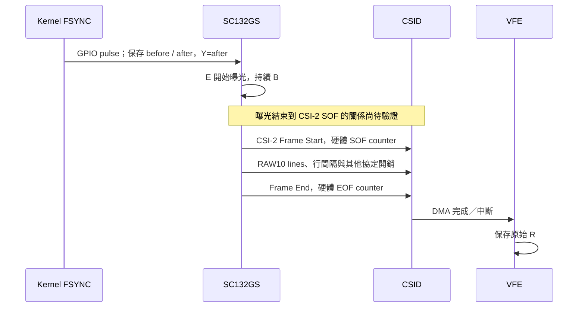

# 固定曝光量測：R − Y − B 與 MIPI 傳輸時間

> 本文件保存先前的量測／ABI 3 歷史結果。使用者隨後已確認先套用曝光開始估計；目前版本與驗收請見 [EXPOSURE-START.zh-TW.md](EXPOSURE-START.zh-TW.md)。

2026-10-15，RUBIK Pi 3／QCS6490、雙 SC132GS、Linear RAW10、30 Hz FSYNC。依使用者新要求，暫時固定曝光為 1377 rows 擷取約 125 秒，再完整恢復 AE／RTSP。沒有改動 FSYNC／SOF／DMA 身分對應，也沒有把本次 C 套入 timestamp。

## 時間模型

若曝光開始為 E，曝光期間為 B，從曝光結束到原始接收完成紀錄的時間為 T_total，則：

```text
R = E + B + T_total
C_residual = mean(R − Y − B) = mean(E − Y + T_total)
E = R − B − T_total
```

因此使用者提出的 C 可以量測，但 `R−B` 還含 T_total。它不能直接視為曝光開始；也不應把 C_residual 與此前部署的固定 offset 8.196429 ms 混為一談。

本次 Y 是原始 `pulse.after`（GPIO 操作後的共同 host monotonic reference），不是排程預定時間，亦不是電氣邊緣量測；它與使用者概念模型中的「GPIO 操作前 timestamp」位置略有不同。R 是 VFE DMA-done ISR 的 host 時間，含中斷處理時序影響；不是已改寫的 DQBUF timestamp，也不是實測的最後一個 MIPI bit 時間。B 由固定控制讀回及既有 84,000 rows/sec 模型換算，尚非獨立光學量測。



## 固定曝光結果

兩眼曝光控制定期讀回均為 1377 rows；B = 1377 / 84000 = **16.392857143 ms**。正常 raw 擷取每眼 3745／3739 張、約 30 FPS；分析剔除初始 2 秒及尾端後，使用 3698 個連續 trigger。所有幀均沿原硬體身分核對，trace lost=0，無同步錯誤。

| 量測 | 每個 trigger 最先完成的眼 | 左眼 | 右眼 |
|---|---:|---:|---:|
| mean(R−Y) (ms) | 32.139811269 | 32.140292319 | 32.376894090 |
| mean(C_residual) (ms) | **15.746954126** | 15.747435177 | 15.984036947 |
| C 標準差 (µs) | 3.787212 | 8.672363 | 27.128131 |

每個 trigger 最先完成的眼採原先討論的 min(R_left, R_right)；左右分開保存，以免把接收端差異誤當 sensor 曝光差異。

## MIPI 協定與 clock 預算

目前板端兩個 sensor endpoint 都配置 data-lanes `[0,1]`；driver 回報 link frequency **600 MHz**。D-PHY 每個 clock 的兩個邊緣傳資料，因此依此回報值，兩 lane 合計 bit rate 為 `600 MHz × 2 × 2 = 2.4 Gbit/s`。這裡的配置尚未由實際 PHY clock 量測或完整 sensor PLL 解碼獨立確認。[Linux CSI-2 時脈定義](https://kernel.org/doc/html/v5.18/driver-api/media/tx-rx.html)

```text
每幀 payload = 1088 × 1280 × 10 / 8 = 1,740,800 bytes
有效 bits 的連續傳輸時間 = 1,740,800 × 8 / 2.4e9
                         = 5.802666667 ms
```

CSI-2 長封包另有 4-byte header 與 2-byte CRC footer。假設每行一個長封包，並加 Frame Start／End 兩個各 4-byte 短封包：

```text
((1360 + 6) × 1280 + 8) × 8 / 2.4e9 = 5.828293333 ms
```

此為條件式封包序列化估計；尚未驗證實際 packetization，亦未包含行間等待、PHY 轉態、可能的其他封包及接收端時間。即使 clock 完全正確，也不能直接把它當成曝光結束到 R 的整段 T_total。[TI CSI-2 封包格式，7.4.17](https://www.ti.com/lit/gpn/ds90ub954-q1)

## 硬體 SOF／EOF 已能拆出實際幀區間

無須變更 kernel：既有 kind 7 trace 已保存 current／previous SOF 與 EOF。以每個有效 DMA buffer 的 hardware SOF、同一個 buffer 核對過的 EOF，除以已記錄的 19.2 MHz counter rate，得到整個 CSI-2 幀區間。

| 3698 張的平均值 | 左眼 | 右眼 |
|---|---:|---:|
| hardware SOF→EOF | **15.384745076 ms** | **15.384745273 ms** |
| 上列標準差 | 16.18 ns | 16.34 ns |
| mapped SOF→R | 15.403124915 ms | 15.638540500 ms |
| R−mapped EOF | 18.379839 µs | 253.795226 µs |

前兩欄使用同一硬體時鐘的差值，無 host clock 對齊誤差；EOF 到 R 則包含 counter→monotonic 映射及接收／中斷處理延遲。這證明「有效資料序列化時間」與「實際幀傳輸區間」需要分開，也顯示左右 R 的差異主要不能直接解讀成曝光時間差。幀區間大於 5.828 ms 的具體來源，仍需用實際 PHY clock／行時序與 packetization 進一步分解。

## 可供下一步驗證的估計

若額外假設 **SOF 正好代表曝光結束**，則可以用 `E_est = SOF − B`，或等價地從 R 扣除 B 與實測 SOF→R：

| 模型值，尚未套用 | 左眼 | 右眼 |
|---|---:|---:|
| mean(SOF−Y−B) | 344.310262 µs | 345.496447 µs |

這些數字仍包括曝光結束到 SOF 的未知偏移；不能當成已量測的真實曝光起點。若後續確認該偏移，便能在原同步方法之外建立固定共同校正常數，並分清「曝光開始」與「曝光中點」兩種目標。此次僅量測與建模，保留已載入的 8.196429 ms offset。

## 恢復與證據

AE 已恢復啟用，Linear30、target30；持久設定 bytes／SHA-256 與量測前完全相同。新 session 雙眼 locked=3、error=0、skipped=0；恢復後 Main10 再次成功解碼 330 張，30.000033 FPS、2176×1280，PTS 嚴格遞增。

- [固定曝光資料與結果](evidence/fixed-residual-1377-20261015/board/fixed-residual-1377-20261015/result.json)
- [硬體幀區間分析](evidence/fixed-residual-1377-20261015/mipi-hardware-span.json)
- [恢復紀錄](evidence/fixed-residual-1377-20261015/board/fixed-residual-1377-20261015/restoration.json)
- [恢復後 Main10](evidence/midpoint-20261015/post-fixed-exposure-decode/result.json)

封存 archive 及 22 個檔案 hash 均已核對，Windows 獨立 replay 與板端結果一致。量測工具為 [measure_fixed_residual.py](measure_fixed_residual.py)，counter 分解工具為 [analyze_fixed_mipi.py](analyze_fixed_mipi.py)。
