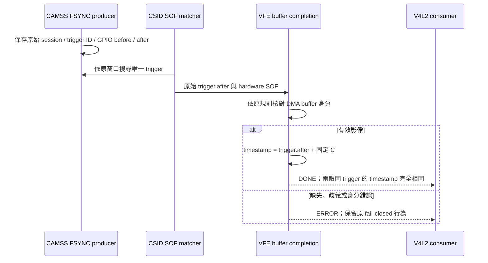

# SC132GS 固定共同 timestamp offset

> 本文件保存先前的量測／ABI 3 歷史結果。使用者隨後已確認先套用曝光開始估計；目前版本與驗收請見 [EXPOSURE-START.zh-TW.md](EXPOSURE-START.zh-TW.md)。

日期：2026-10-15。範圍：Linear full RAW10、30 Hz FSYNC、每眼 30 FPS、保留 AE。此變更沿用既有 FSYNC／SOF／DMA 身分核對，只修正有效影像交付時的共同時間。

## 時間定義與模型

```text
T_output = T_fsync_host + C
C = round(1377 rows / 84000 rows/sec / 2 × 10^9)
  = 8,196,429 ns
```

`T_fsync_host` 仍是實際 GPIO 操作後的 CLOCK_MONOTONIC 時間。C 取自既有 Linear 行率與 1377-row 參考曝光時間的一半，假設 FSYNC 到真正曝光開始的額外偏移為 0。這是曝光中點的模型估計，未經光學／電氣校準，不能證明比原本 reference 更接近每張影像的真實曝光時間，也沒有宣稱 V4L2 SOE 語意。

AE 持續運作，C 固定不隨每張曝光或 DMA 延遲變動。在較短曝光時，估計誤差可能增加。未來若取得獨立曝光開始量測，應以該校準結果取代目前的起點假設；若希望跟隨 AE，則另須建立每幀曝光控制生效對應，這次沒有加入該機制。

模型與限制保存於 [midpoint-estimate.json](midpoint-estimate.json)。行率來自 [CameraConfiguration.cpp](../../stereo_h265_rtsp/CameraConfiguration.cpp) 的既有 Linear profile，並非這次新增的物理量測結果。

## 實際量測與採用值的差別

先前依使用者要求量測 125.169 秒、3756 個 trigger：對每個已驗證 trigger，取左右眼中第一個有效 VFE DMA-done ISR 的 host 時間，減去該 trigger 的 GPIO-after。

| 指標 | 量測值 |
|---|---:|
| 首個 DMA-done 延遲平均 | 32.145787838 ms |
| 標準差 | 3.371894 µs |
| 最小／最大 | 32.134864 / 32.188777 ms |
| 左眼 SOF 平均延遲 | 16.737601612 ms |
| 右眼 SOF 平均延遲 | 16.738567120 ms |

該 32.1458 ms 包含曝光、讀出、傳輸及 IRQ 處理延遲；不是曝光長度，也不是 userspace `DQBUF` 回傳時刻。其一半 16.072894 ms 沒有曝光中點的已驗證意義，因此在澄清目的後，依使用者同意採用上述參考曝光模型的 8.196429 ms。完整資料保存於 [latency-measurement-20261015-1137](evidence/latency-measurement-20261015-1137/)。

## 實作與 ownership



- Kernel：`timestamp_offset_ns` 是載入時設定、唯讀的 module parameter，預設 0；非零只允許 mode 2，最大為 16,666,666 ns。僅 `camss_sync_done()` 成功路徑相加。raw trigger、SOF、DMA trace、trigger ID、各眼 sequence、配對窗口與排程完全保留。
- 診斷：sysfs control ABI 升為 3，新增 `timestamp_offset_ns`。零值為 `source=fsync_host_reference`；非零為 `source=exposure_midpoint_estimate`。debugfs 事件格式仍為 ABI 2，因其欄位未變更。
- Userspace：C++17 `StatusReader` 維持 move-only／PIMPL／RAII／結構化錯誤；相容 ABI 2 的零 offset，嚴格驗證 ABI 3 的 source／offset 契約。RTSP 仍只接受完全相等的有效 timestamp，未加入近似容差。
- `analyze_buffers.py` 逐張以 kernel buffer 的 trigger ID 核對 `floor((GPIO_after + C)/1000)*1000`，反映 V4L2 timeval 的微秒精度；不以時間四捨五入來決定 trigger。

## 部署與回復

使用模組參數：

```text
options qcom_camss geometry_guard=1 fsync_mode=2 sof_min_us=341 sof_max_us=16853 timestamp_offset_ns=8196429
```

`deploy.sh common 341 16853 8196429` 檢查原 SOF characterization 及模型 JSON 後，更新模組、RTSP binary 與 initrd；另行重開機載入，沒有熱卸載 CAMSS。參數省略／設為 0 可恢復共同 FSYNC reference 語意，但更換載入值仍須重開機。

本次前一版備份位於板端 `/home/ubuntu/sc132gs-kernel-sync-20261014/midpoint-baseline-20261015`，包含已驗收 E06 模組、initrd、設定、RTSP binary／runner 及 SHA-256。失敗時執行 `sudo bash midpoint-baseline.sh restore` 後重開機，再驗證串流。原始更早期 `backup` 仍保留；本次回復應使用獨立 midpoint baseline。

部署前觀察到舊 ABI 2 session 發生 error 9（buffer starvation），RTSP 依原保護停止。發生時新版尚未載入，已保存 trace／server log；尚無足夠證據確定成因。這不列為新版通過證據，亦不宣稱此次固定 offset 修正 starvation。

## 驗證

離線：實際 kernel 函式 fixture 共 32 項檢查（含兩眼共同 offset、原 trigger ID、record 模式及 ERROR 路徑）；C++17 診斷契約測試；ARM64 kernel build 及板端 11 項 CTest 全部通過。BTF 因無 vmlinux 未產生。FSYNC callback、SOF matcher、arm 與 fail 函式另與前版 source 比對完全相同。

板端已以重開機載入 srcversion `57412C1900C47CD02376039`，ABI 3、C=8,196,429 ns。證據保存於 [evidence/midpoint-20261015](evidence/midpoint-20261015/)，與 2026-10-14 的零 offset 基準分開。

| 本次驗收 | 結果 |
|---|---|
| 正向／反向啟動 | 590／589 組有效 exact pair；差皆 0 ns，無內部缺口 |
| 原始 V4L2 每眼張數 | 18,145／18,138 |
| 每眼 timestamp 跨度 | 604.799986／604.566651 秒 |
| 每眼平均 FPS | 30.0000006944／30.0000007774 |
| exact pair | 18,138 組，timestamp 差皆 0 ns |
| 逐張身分／offset 核對 | 錯誤 0；sequence 缺口 0；時間嚴格遞增 |
| 啟動／尾端差異 | cam0 早啟動多 7 張；重疊區間未配對 0；排除兩張已標記 startup ERROR |
| 原始擷取 provenance | 同 boot/session、exit=0、trace lost=0、error=0、skipped=0 |
| RTSP 狀態監測 | 95.200936 秒／95 樣本，同 session、雙眼鎖定、無同步錯誤或自動重啟 |
| RTSP/TCP | 90 秒，86,213 RTP packets／2702 access units，30.00 FPS |
| Main10 解碼 | 330 張，2176×1280、yuv420p10le、30 FPS，PTS 嚴格遞增、內容變化 |
| 最終 kernel／queue | 新開機無 SMMU／Oops；server 無 queue 錯誤、dropped FPS=0 |
| 設定恢復 | AE on、Linear30，settings SHA-256 與備份完全相同 |

[原始逐張分析](evidence/midpoint-20261015/board/midpoint-10min-raw/analysis.json)、[恢復監測](evidence/midpoint-20261015/board/midpoint-restored-monitor/result.json)、[最終狀態](evidence/midpoint-20261015/board/midpoint-final-state-result.json)、[解碼結果](evidence/midpoint-20261015/restored-decode/result.json)均已保存。證據 archive 的 SHA-256 與 95 個檔案 hash 通過核對；Windows 獨立 replay 與板端逐張分析一致。此為有界功能驗收，不是實際曝光開始／中點的物理準確度驗收。

## 後續固定曝光量測

使用者隨後提出新的時間模型 `Y → GPIO → S → exposure B → transfer T → R`，要求先固定曝光量測 `C_residual = R - Y - B`。此 residual 與本版已部署的 timestamp offset 是不同量，暫不互相代換。依該串行模型，`R-B = exposure_start + T`；要推算真正曝光開始還需獨立辨識 T。新的固定曝光量測另保存，不以已改寫的 DQBUF timestamp 當 R。


後續固定曝光 `C = R − Y − B`、MIPI clock 預算及硬體 SOF／EOF 分解，見 [FIXED-EXPOSURE-TIMING.zh-TW.md](FIXED-EXPOSURE-TIMING.zh-TW.md)。該 residual 尚未套入 timestamp；AE 已恢復。
