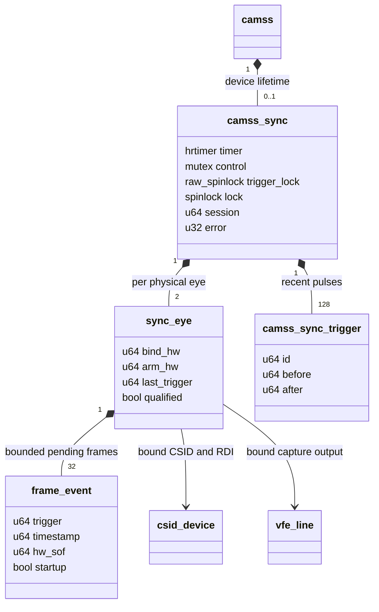
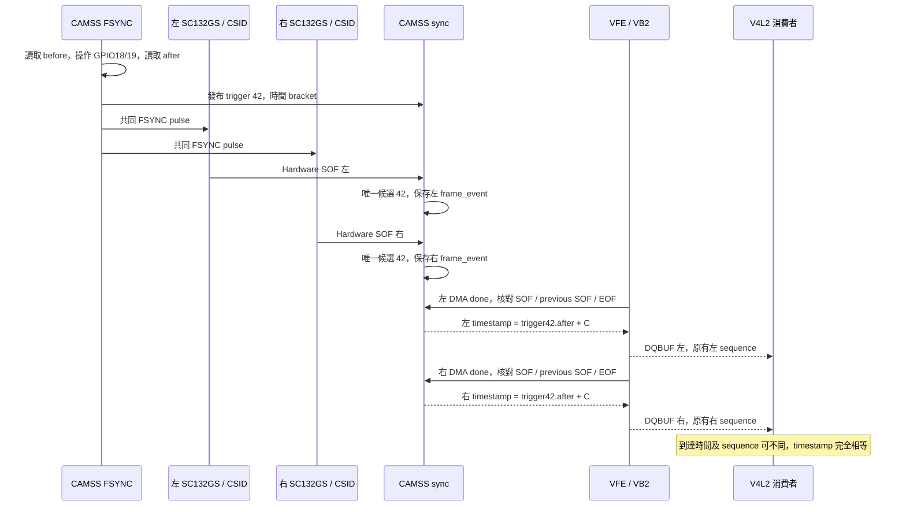
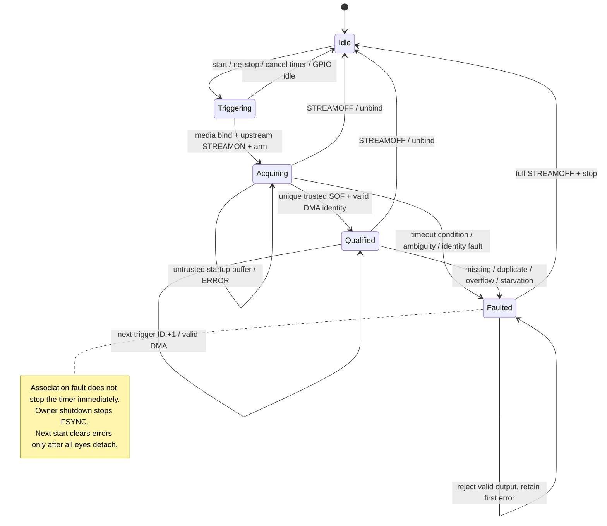
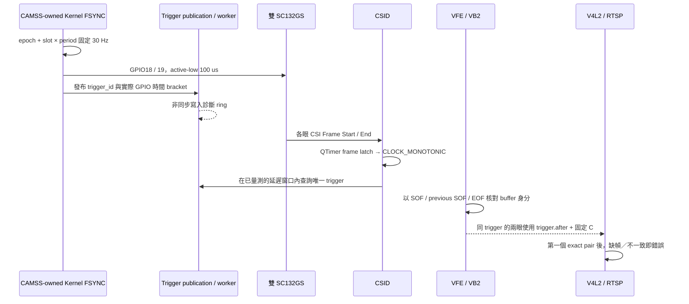
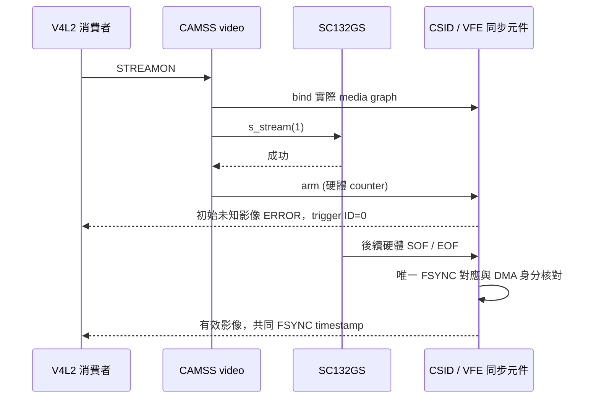

# SC132GS 雙相機共同 FSYNC timestamp 技術文件

適用：RUBIK Pi 3 / QCS6490、Ubuntu `6.8.0-1084-qcom`，Linear 1088×1280 packed RAW10，30 Hz pulse／每眼 30 FPS。此實作疊加於已部署的 geometry guard；也包含 VFE-17x 完成事件 gate 修正，以及 cold-probe early-open 的空 pads 防護。60 Hz 試驗發現短曝光輸出 60 FPS、長曝光才 30 FPS；使用者已確認改成 30 Hz，一個 pulse 對應一幀並保留 AE。

目前版本：ABI 4、`exposure_start_estimate`，共同 timestamp 為 `FSYNC reference + 344,903 ns`，設計與驗收見 [EXPOSURE-START.zh-TW.md](EXPOSURE-START.zh-TW.md)。先前 ABI 3 的曝光中點估計與驗收保留於 [MIDPOINT.zh-TW.md](MIDPOINT.zh-TW.md)。原始 2026-10-14 零 offset 基準驗收保留於 [RESULT.zh-TW.md](RESULT.zh-TW.md)，60 Hz 失敗試驗見 [HISTORY-60hz.zh-TW.md](HISTORY-60hz.zh-TW.md)。

## 1. 設計本質：共同事件、可驗證的幀身分、共同時間

原本的 `vfe_isr_wm_done()` 在每眼 DMA 完成時各自執行 `ktime_get_ns()`。兩眼的傳輸、中斷與 DMA 完成時間不同，因此即使同一 FSYNC 觸發，原始 `DQBUF.timestamp` 仍不同。SC132GS sensor subdevice 本身不負責交付 V4L2 capture buffer，僅修改 `sc132gs.c` 無法解決時間來源問題。

本版把責任分成三步：

1. CAMSS 擁有唯一 FSYNC producer，替實際發出的 pulse 保存共同 `(session, trigger_id, before, after)`。
2. 同步元件使用每眼 CSID 提供的硬體 Frame Start（SOF）時間，分別搜尋共同 FSYNC 紀錄中的唯一候選；VFE 再核對該 SOF 是否真的屬於這個完成的 DMA buffer。
3. 核對成功後，將 `trigger.after + timestamp_offset_ns` 寫入 `vb2_buffer.timestamp`，再透過 VB2 交付。兩眼若對應同一 trigger，自然取得相同時間；RTSP 的配對容差設為 0。

**kernel 不等待左右 buffer 同時完成，也不把兩眼的 sequence 改成相同。** 同步的契約是「各自交付的有效影像指向同一共同事件」，不是 DMA 同時完成。

| 名稱 | 定義 | 在本版的用途 |
|---|---|---|
| FSYNC reference | 實際 GPIO 操作完成時的 host monotonic time | 原始共同事件時間，offset=0 時直接交付 |
| Exposure start estimate | FSYNC reference 加固定共同 offset | ABI v4 opt-in；offset=0.344903 ms，假設 SOF≈曝光結束，尚未物理校準 |
| Hardware SOF | CSID 鎖存的影像輸入開始 counter | 找 trigger、核對幀身分 |
| DMA done | VFE 完成寫入 buffer 的時刻 | 交付時機、診斷；共同模式不把它當有效影像時間 |
| Exposure start | 感測器實際開始曝光的時刻 | 本版未獨立量測，不等同上述任一欄 |
| Local sequence | 每個 VFE output 的獨立計數 | 每眼連續性檢查、trace 索引；不比較兩眼數值判定同幀 |

## 2. 實作位置與 ownership

| 檔案／函式 | 責任 |
|---|---|
| `camss.c` / `camss.h` | CAMSS probe/remove 與同步元件 lifetime |
| [camss-sync.h](camss-sync.h) | 小型 kernel C hook 介面，隱藏內部狀態 |
| [camss-sync.c](camss-sync.c)：`tick()` | GPIO、30 Hz 排程、實際時間 bracket 與 trigger 發布 |
| `camss_sync_bind()` / `camss_sync_stream_started()` | media graph 綁定、sensor profile 檢查、STREAMON 後 arm |
| `camss-csid-gen2.c`：`csid_isr()` | 讀取硬體 SOF latch，呼叫 `camss_sync_sof()` |
| `camss_sync_sof()` | counter 映射、唯一 trigger 比對、每眼 pending frame queue |
| [camss-sync-match.h](camss-sync-match.h) | 純 C slot、候選計數、hardware frame 比對規則 |
| `camss-vfe-17x.c`：`vfe_isr_wm_done()` | 完成 buffer 交付前呼叫 `camss_sync_done()`；選擇 DONE／ERROR |
| `camss-video.c` / `camss-vfe.c` | 成功 STREAMON 後 arm、停止後 unbind |
| [KernelSyncStatus.hpp](../../stereo_h265_rtsp/KernelSyncStatus.hpp) / `.cpp` | C++17、PIMPL、RAII、move-only 的只讀診斷介面 |
| [StereoCapture.cpp](../../stereo_h265_rtsp/StereoCapture.cpp) / [StereoPendingFrames.hpp](../../stereo_h265_rtsp/StereoPendingFrames.hpp) | ERROR 分類、exact pair、有界 queue、每眼逾時與連續性 |
| `RawSyncProbe.cpp` / `analyze_buffers.py` | 直接保存原始 DQBUF，逐筆核對 trigger；獨立於 RTSP |

以下 UML 用 class 表示 kernel C struct 的組成與參照，沒有把 kernel 實作改成 C++：



GPIO descriptor、timer、worker 與紀錄屬於 CAMSS device；`sync_eye` 的 CSID/VFE 指標只參照既有 media entities，在 unbind 清除。userspace reader 只擁有自己的唯讀 fd，不擁有 GPIO、timer 或 session；capture owner 負責 STREAMOFF，runner 負責 start/stop。

## 3. 一組影像如何取得相同 timestamp



### 3.1 先產生共同 FSYNC，保存實際操作時間

`tick()` 的核心操作如下；錯誤檢查、鎖與排程分支省略，只呈現時間來源：

```c
before = ktime_get_ns();
values = 0;
ret = gpiod_set_array_value(2, s->gpio, NULL, &values);
after = ktime_get_ns();
/* pulse = { id = slot + 1, before, after } */
```

兩條 GPIO 使用同一次 array API 操作；不宣稱兩條電氣邊緣完全同時。2026-10-15 穩定性修正將兩個邊緣放在同一次 pinned hard hrtimer callback：兩條一起拉低後，保持至 `after + 100000 ns`，再一起拉高回到 idle。短脈波期間保持本 CPU IRQ 關閉，不取得 frame lock、不做 trace 格式化；恢復 IRQ 狀態後才發布紀錄。`before/after` 是 host 對操作的時間包絡，沒有用預定 deadline 冒充實際觸發時間。

排程以 `deadline = epoch + slot × 33333333 ns` 固定 epoch。`trigger_id = slot + 1`，所以漏掉過期 slot 會留下 ID 缺口；不以「現在時間 + 一個 period」反覆重設基準，也不密集補發。

同極性邊緣的保守 bracket 間隔至少 32,833,333 ns。若上一個合法延遲會讓下一個邊緣太近，先 rearm 到最早安全時間，仍使用原 epoch／slot；超過 500 µs admission budget 才真正跳過 slot 並保留 trigger gap。500 µs 由本 profile 的 readout 空間限制，不是放寬 SOF 配對窗口：`16.853 ms + 15.5 ms + 0.25 ms = 32.603 ms < 32.833333 ms`。2026-10-16 將完整 pulse 外包絡（low.before→high.after）上限由 150 µs 改為獨立的 `PULSE_ENVELOPE_NS=200000`；high release 超過 `low.after + 100 µs` 的部分仍保留獨立 25 µs 上限，任一超出時回報 error 14 並停止 producer。probe 的 SOF 最小延遲檢查同步使用 200 µs，確保完整包絡仍早於校準 SOF 窗口。名義保持時間仍為 100 µs。第一輪 low command 25 µs 單項門檻的歷史修正與結果保留於舊 evidence。忙等成本約為單 CPU 的 0.3%，不是硬體 PWM，也不構成電氣脈寬保證。重播新版 trace 時使用 `audit_stability.py --pulse-envelope-us 200`；預設 150 保留歷史稽核語意。

### 3.2 在 CSID 取得真正的硬體 SOF 時間

`csid_isr()` 在 RDI Input SOF bit 出現時，用 high／low／high 重讀方式取得一致的 64-bit latch，再呼叫 `camss_sync_sof(csid, rdi, hw_sof)`。它保存的是硬體事件時刻，不以 ISR 被 CPU 執行的時刻直接判定 trigger。

本板 QTimer latch 與 ARM counter 使用 19.2 MHz timebase，映射為：

```text
sof_monotonic_ns = irq_monotonic_ns
                 - (counter_now - hardware_sof_counter) × 1e9 / 19,200,000
```

實際整數換算為 `div_u64(delta_ticks * 10000, 192)`。程式檢查頻率、非零 counter、counter 先後及小於一秒的差距；舊於 bind 的 latch 只記錄，不交給新 session。這是目前板端／kernel 的實作條件，不是任意平台可直接沿用的假設。

### 3.3 每眼獨立搜尋唯一 trigger

對 recent pulse ring 的每筆實際紀錄檢查：

```text
341,000 ns <= sof_monotonic_ns - pulse.before <= 16,853,000 ns
```

這裡的「找到」是 **kernel 軟體依校準後的延遲窗口建立時間關聯**。CSID 只提供硬體 SOF counter，影像／CSI 封包沒有新增我們的 FSYNC trigger ID；該 ID 由 FSYNC producer 在 host 端產生。「每眼獨立」表示左右都查詢相同的共同 pulse ring，各自得到候選，不用另一眼的 sequence 或到達時間推算。

簡化示例（以下為說明用數字，單位 ms，`before` 都表示實際 GPIO 操作前時間）：某眼映射後的 SOF 是 `1050.000 ms`。

| Pulse ID | pulse.before | SOF − before | 是否在 0.341..16.853 ms |
|---:|---:|---:|---|
| 100 | 1000.000 | 50.000 | 否，太早 |
| 101 | 1033.333 | 16.667 | 是 |
| 102 | 1066.667 | 負值 | 否，在 SOF 之後 |

因此這眼恰有一個候選 101。另一眼 SOF 即使是 `1050.010 ms`，仍可獨立找到同一個 101；兩眼之後採用同一筆 `pulse101.after`，不是把兩個 SOF 時間平均。若候選為 0／多筆，不能指派有效共同時間；啟動未知影像只適用後述的有界 ERROR 處理。

唯一候選不是 sensor 直接回傳的身分證明：它依賴已量測的 Linear30 profile 與曝光操作範圍。窗口不重疊、後續 ID +1 及 DMA 硬體身分是互補檢查；換模式或改變時序條件，須重新確認 trigger→SOF 因果關係，不能只保留相同窗口就沿用保證。

`camss_sync_match()` 回傳符合數量；可信幀必須恰好一筆。沒有候選、多筆候選、ID 重複，或第一筆可信幀之後 `new_id != last_id + 1`，都不輸出有效同步影像。首筆可信幀可因左右啟動先後不同而從不同 ID 開始；各自連續後，consumer 對齊首組共同 timestamp。

匹配窗口使用 `pulse.before`，最後交付的 timestamp 使用 `pulse.after`，兩者有意分開。選中的資料進入該眼 32 筆 pending queue：

```c
struct frame_event {
    u64 trigger;    /* selected FSYNC ID */
    u64 timestamp;  /* selected pulse.after */
    u64 sof;       /* mapped hardware SOF time */
    u64 hw_sof;    /* original hardware identity */
    bool startup;
};
```

### 3.4 DMA 完成時再核對硬體幀身分

SOF queue 的順序只是候選關聯。`camss_sync_done()` 取出 queue head 後，還要讀硬體的 current SOF、previous SOF、EOF，執行 `camss_sync_hardware_frame()`：

| 硬體狀態 | 可接受條件 |
|---|---|
| `EOF >= current SOF` | pending frame 的 SOF 必須等於 current SOF |
| `EOF < current SOF` | 新一幀已開始，pending frame 必須等於 previous SOF，且 previous < current |
| SOF／EOF 為零，或 pending SOF > EOF | 拒絕 |

因此較晚的 DMA interrupt 可以對應剛結束的前一幀；若中斷合併、SOF 遺失或 queue 已失去身分對應，就回報錯誤，不繼續猜 FIFO 中哪一筆是正確影像。未預先測過的所有中斷合併情形並不保證可恢復。

### 3.5 最後才改寫 VB2 timestamp 並交付

`vfe_isr_wm_done()` 仍先保存原有 DMA done 時間與每眼 sequence，再呼叫同步 hook。共同模式中，只有 `s->error == 0`、`trigger_error == 0` 且 frame 有有效 trigger 時，才執行：

```c
buffer->vb.vb2_buf.timestamp = frame.timestamp + timestamp_offset_ns;
```

hook 回傳有效／無效，VFE 以 `VB2_BUF_STATE_DONE`／`VB2_BUF_STATE_ERROR` 交付。錯誤 buffer 可能保留原來的 DMA timestamp，**不能把 ERROR buffer 的時間當共同 reference 使用**。`DQBUF` 透過 `timeval` 呈現時，納秒資料會轉成微秒精度；驗收逐筆核對了這個取整。

例如同一 trigger 42 的 `after = 10,000,002,600 ns`，左 DMA 在 10.020 s 完成、右 DMA 在 10.021 s 完成；當 C=344,903 ns，兩張有效 DQBUF 都呈現 `10,000,347,000 ns`（微秒取整）。C=0 時則都呈現 `10,000,002,000 ns`；DMA 完成差不會進入影像 timestamp。這是說明用數字，不是額外板端量測。

## 4. 為何改成 30 Hz，AE 如何保留

60 Hz period 約 16.667 ms，但實測不是固定二分頻：8／32 rows 的短曝光可輸出約 60 FPS，較長曝光才約 30 FPS；AE 又會改變 FSYNC→SOF 延遲。以每兩個 pulse 算一幀、依 local sequence 奇偶數或用完成時間四捨五入，都無法建立穩定身分。

使用者因此選定 30 Hz、一個 pulse 一幀，保留 AE。原有 Linear30 readout budget 使 AE 上限為 1377 rows；本版未停用 AE，也沒有把 exposure 固定在某個值。kernel profile guard 檢查 full-resolution Linear RAW10 與 sensor control 範圍，但 **8..1377 的操作上限由現有 AE policy 管理，不是 kernel 新增的 S_CTRL clamp**；不應把任意手動曝光或其他 profile 當成本版已驗證範圍。

量測與 [characterization-passed.json](evidence/30hz-final/characterization-passed.json)摘要：

| Exposure rows | FSYNC→SOF median（約） |
|---:|---:|
| 8 | 0.445 ms |
| 32 | 0.731 ms |
| 808 | 9.969 ms |
| 1330 | 16.187 ms |
| 1360 | 16.542 ms |
| 1377 | 16.744 ms |

校準程序以已量測的 1330-row causal anchor、sensor control readback 與 84,000 rows/s 的 profile 做靜態交叉核對，反覆切換曝光；對每筆 SOF 搜尋實際 pulse，取得涵蓋測試範圍並留 margin 的 341..16853 µs 窗口。runtime 不需每張讀 exposure register，也不把 exposure 值直接換成最終 timestamp。

窗口寬 16.512 ms，小於受保護的最小 period 32.833333 ms；最大延遲也小於該 period。這避免相鄰 pulse 的候選窗口重疊，但幾何上唯一仍需配合已驗證的 sensor profile、SOF／EOF 身分與 trigger +1，不能單靠窗口寬度證明因果關係。

## 5. 啟動與錯誤狀態

以下是控制與每眼條件的概念狀態圖，實作使用 flags／counters，沒有對外公開同名 enum：



arm 前與 arm 後第一個硬體 SOF 一律視為未知影像，即使剛好落在時間窗口內，也不套用 trigger ID。kernel 的啟動辨識條件限於 bind 後 1 秒；完全沒有幀事件時另由 consumer 的每眼 deadline 偵測。pending frame 可容納未知啟動影像的 ERROR 紀錄，首次可信 SOF 後不能因失配退回啟動模式。

`qualified` 是每眼有可信 DMA buffer 交付後的旗標。兩眼不必同時進入 qualified；`locked_mask=3` 表示兩眼都已 qualified，仍須搭配 `running/error` 判斷 session 健康，不能只看 mask。

錯誤鎖住整個 session，後續 buffer 不再得到有效共同 timestamp。association 錯誤不為了恢復而重設 timer epoch；GPIO failure 或 pulse width 超時會停止 producer。完整 STREAMOFF／unbind 停止 timer、排空 worker、釋放 QoS 並回復 GPIO；新的 `start` 在無 capture binding 時才清空錯誤並建立新 session。

## 6. 時間語意與 public API



零 offset 的 timestamp 是共同 FSYNC **host reference**：取 GPIO 操作完成時間，並保存操作前後 bracket。它不是電氣邊緣量測，也不等於已驗證的曝光開始時間。這是明確 opt-in 的私有 timestamp 語意；沒有設定或宣稱標準 V4L2 `TSTAMP_SRC_SOE`。標準 buffer timestamp source bits 不能單獨識別這項擴充，消費者須檢查版本化狀態。ABI v4 offset=0 時 source 為 `fsync_host_reference`；offset>0 時 source 為 `exposure_start_estimate`，兩者都未宣稱 SOE。C++ reader 仍相容 ABI 2 與 ABI 3 的歷史資料。

每眼原有 `sequence` 保留。核心以實際 media graph 找到 CSID/RDI/VFE，並以 CSIPHY1 / 4 識別兩眼；不以 `/dev/video*` 名稱或兩眼本地 sequence 判定同幀。RTSP 不改寫 timestamp。

新增 `stereo_rtsp::sync::StatusReader` 是 C++17 public API，以 move-only PIMPL 隱藏 Linux descriptor，RAII 關閉資源；同步讀取回傳 `variant<Status, Error>`，含版本、session、trigger ID、時間來源與錯誤計數。它只讀取診斷，不持有 FSYNC lifecycle；同一 instance 的 read 由 caller 序列化。RTSP 開始共同模式時驗證 ABI、running 與 driver error，無效狀態回報結構化 `CaptureError`。既有內部 capture adapter 維持 C++20。

## 7. 模式、診斷 ABI v4 與排程隔離

- `fsync_mode=0`：原有 userspace FSYNC 與接收完成 timestamp。
- `fsync_mode=1`：kernel FSYNC、Frame Start / DMA 記錄；原始 buffer timestamp 維持接收完成時間。
- `fsync_mode=2`：只限通過 characterization 的 Linear 30 FPS；還需提供 `sof_min_us` / `sof_max_us`。不存在合法 fallback。`timestamp_offset_ns` 為唯讀 module parameter，預設 0；只允許 mode 2 使用非零值，範圍 0..16,666,666 ns。目前部署選用 344,903 ns，完全不參與幀對應。

控制節點：`/sys/bus/platform/devices/acb3000.camss/fsync_control`。寫入 `start` 建立新 session、100 ms 後開始 pulse；寫入 `stop` 結束觸發。任一 capture 尚未 STREAMOFF 時，拒絕重新 start。狀態包含 ABI、timestamp_offset_ns、trigger_hz=30、frame_step=1、mode、running、session、最新 trigger ID、跳過週期、timer / worker CPU、首個 error、error_count、source，以及 locked_mask、startup_dropped、startup_end0/1、node0/1。

**`pulses` 與 C++ `Status::trigger_id` 都是最新 producer ID，不是剛剛 DQBUF 那張影像的 ID。** 每個 buffer 的 trigger ID 位於 debugfs kind 3 紀錄，以 `(session, physical eye, local sequence)` 核對；標準 V4L2 buffer 未增加 trigger ID 欄位。離線保存資料時也要保存 session／時間來源，避免把不同 session 的診斷混在一起。

只有 kernel 同步元件持有 GPIO；啟動腳本在存在此介面時不啟動舊 generator。probe 前先使用既有工具核對兩個 fixed regulators 的名稱、disabled 狀態與零 users，再釋放 GPIO。timer 固定在最後一顆 online CPU，以 `epoch + slot × period` 排程，不因 GPIO 操作耗時、matcher 或診斷 worker 改變 epoch。完整過期的 slot 跳過；deassertion 延誤後選擇至少半個 period 以後的固定 slot，不補發密集 pulse。trigger ID 為 slot + 1，跳過 slot 留下 ID 缺口；實際 FPS 必須另外通過量測。

GPIO 操作不持有幀對應／診斷鎖，實際 bracket 透過獨立短鎖發布到 128 筆 trigger ring，另有 256 筆 producer→worker queue。SOF 一次複製一筆 trigger 後計算，worker 非同步記錄 pulse 診斷。matcher 失配與 publication overflow 使共同 buffer 無效，但不調整 scheduler；擷取流程收到 ERROR 後，經 STREAMOFF 結束整個 session。GPIO 操作失敗或 pulse release 超時會停止 timer。停止／移除會取消 timer、排空 worker，再釋放 QoS 與 GPIO。

worker 以 `queue_work_on` 固定在第一顆 online CPU（目前 CPU0），與 timer CPU7 分離；只剩一顆 online CPU 時拒絕啟動。這避免 worker 等待 frame lock 時遮蔽 producer CPU 的 IRQ。此板端 CAMSS CSID / VFE IRQ 亦在 CPU0；其他 kernel 的 IRQ-off 區間仍可能造成 deadline miss，這是偵測後停止輸出的保護，不能宣稱一般 Linux 的硬即時保證。

kernel opt-in runner 另以 `camera_cpu_list.py` 讀取 online CPU 與 producer CPU，透過 `taskset` 讓 RTSP／encoder／capture threads 使用其餘 CPU（目前 0–6），避免 consumer 的 ioctl／kernel critical section 跑在 CPU7。這不改變其他應用的全系統 CPU policy。

assertion 的允許遲到預算為 500 µs；另以實際 bracket 檢查下一個 assertion 與預計 deassertion 相對於前一次同極性的間隔下界至少 `period − 500 µs`。間隔不足時先 rearm 到最早安全時間，仍保留相同 absolute slot；超過 admission budget 才跳到未來固定 slot 並記錄 kind 10，不先發遲到 pulse 再追準時 pulse。此 budget 由第 3.1 節的 readout margin 約束，不能當作已量測的感測器電氣容差。

FSYNC 運行期間持有 50 µs CPU latency QoS；停止、STREAMOFF、移除時釋放。板端 CPU7 的深度睡眠退出延遲為 1767 / 2380 µs；沒有此約束時，低負載 RAW 的 pulse／frame 速率會低於驗收門檻。WFI（標示 1 µs）仍可使用。

`/sys/kernel/debug/sc132gs_sync/events` 是 8192 筆有界 ring。每列為 `serial session kind eye ns a b c sequence error`；eye 0/1 為實體左右相機，2 為群組。kind：

| kind | 事件 | a / b / c |
|---|---|---|
| 1 | pulse | trigger ID / GPIO 操作完成 ns / skipped |
| 2 | SOF | trigger ID（record 模式可能為 0）/ hardware SOF / 最新 pulse ID |
| 3 | DMA buffer | trigger ID / hardware SOF / mapped SOF ns |
| 4 | 首次錯誤 | 保留 |
| 5 | bind | CSID ID / RDI / VFE ID；sequence 欄為 line ID |
| 6 | unbind | 保留 |
| 7 | buffer hardware check | current SOF / previous SOF / EOF |
| 8 | hardware clock mapping | mapped SOF ns / ARM counter / counter Hz |
| 9 | deassertion | trigger ID / GPIO 操作完成 ns / 預期 pulse-end ns |
| 10 | deadline / spacing miss | skipped slot ID / 檢查時刻 ns / 原定 deadline ns |
| 14 | 上游 STREAMON 完成後 arm | hardware counter / 保留 / 保留 |
| 12 | pre-bind 舊 SOF latch（不計入當前幀） | hardware SOF / bind hardware counter / 保留 |

`collect_events.py` 每秒持久化並檢查 serial 缺口；`finalize_events.py` 收集擷取結束的尾端。ring 覆寫是診斷容量限制；Frame Start→DMA 的 pending queue 另有 32 筆界限，溢位會使共同模式失敗。

Error code：0 OK、1 GPIO、2 找不到 trigger、3 多個 trigger、4 重複 trigger、5 pending overflow、6 缺少 SOF、7 hardware 回退、8 未運行、9 buffer starvation、10 trigger gap、11 保留的舊 60 Hz phase error、12 hardware frame 身分不符、13 啟動辨識中（trigger ID=0、ERROR buffer）、14 pulse 總包絡／release 超時。error code 14 與 trace kind 14（arm）是不同欄位。

共同模式要求每眼正常相鄰幀對應 trigger ID +1，一個 pulse 對應一幀。未知／丟失／重複的幀、不唯一對應、starvation 或 SOF/EOF 無法核對，都停止共同輸出，回傳 ERROR buffer，必須完整 STREAMOFF 後重新建立 session。bind 前的舊 hardware SOF latch 只記錄，不可關聯當前 DMA；bind 亦拒絕 HDR、非 full-resolution RAW10 或未校準的 sensor 控制範圍。

## 8. 重建、驗收與回復

`camss-baseline.tar.gz` 保存修改前的 exact guarded source。`rebuild_hooks.py` 還原 baseline source 再套用 hooks，保留新增 sync source；`make_patch.py` 產生可審查的 `camss-6.8.0-1084-fsync.patch`。新增實作在 `camss-sync.c`，共用且可測試的對應規則在 `camss-sync-match.h`。

`verify_absolute_tick.py`、`verify_trigger_publication.py`、`verify_frame_association.py` 分別抽出實際 callback、publication/worker 與 SOF/DMA 函式，以虛擬 clock/MMIO 驗證固定節拍、遲到／提前／跳過 slot、獨立錯誤、queue overflow、單眼缺幀、重複、相位歧義及合併中斷。這些是實際 source 的 fixture，不是電氣或板端壓力測試；板端另測 starvation、停止重啟與反向啟動。

板端工作目錄：`/home/ubuntu/sc132gs-kernel-sync-20261014`。

```bash
make -C /lib/modules/6.8.0-1084-qcom/build \
  M=/home/ubuntu/sc132gs-kernel-sync-20261014/source \
  CONFIG_VIDEO_QCOM_CAMSS=m CC=gcc-13 -j2 modules
```

先在 mode 1 執行 `profile_exposure.sh exposure-30hz`，核對 8、32、808、1330、1360、1377 rows 及曝光上下限反覆切換；以 `analyze_exposure.py --name exposure-30hz` 從已驗證的 1330-row causal anchor 與靜態控制 readback 建立全 AE latency window，再核對每個實際 pulse 的唯一候選、trigger step +1、30 FPS 與硬體 buffer 身分。窗口最大延遲與寬度均必須小於受保護的最小 period；不使用最近 pulse 取代曝光條件下的因果關聯。`deploy.sh common <min_us> <max_us> [offset_ns]` 會檢查 characterization JSON 的 pass 與參數相符，才準備 mode 2。

在 mode 2，`run_raw_probe.sh <unique-name> 605` 直接擷取 DQBUF 值；`analyze_buffers.py <raw-directory> <event-directory>` 要求每眼實際時間跨度 ≥600 s、30 FPS ±1%、嚴格遞增、零內部缺幀、所有共同時間戳與 kernel trigger ID 一致。工具另外保存一組 timestamp 完全相同的左右 RAW10。不能以 RTSP composite 的 PTS 代替驗收。

回復本次工作開始前的 guarded module、initrd、設定、runner 和 binary：

```bash
sudo bash /home/ubuntu/sc132gs-kernel-sync-20261014/deploy.sh restore
sudo reboot
```

備份有獨立 SHA-256，回復前會核對；只移除本次新增的 restore-service drop-in。driver 切換以重開機重新載入；本版沒有熱卸載 CAMSS。實際電源操作與驗收紀錄以 RESULT 為準。

實際部署狀態、測試數字及未完成項目以本資料夾的 `RESULT.zh-TW.md` 為準。

2026-10-15 的持續運行修正使用另存的 exact backup：`stability_deploy.py save/install/restore`，板端根目錄 `/home/ubuntu/sc132gs-stability-20261015`。`restore` 核對並還原該次備份的 module、initrd、設定與原 binary，接著須完整 reboot；不要以更早的部署備份代替本次 rollback。`stability_monitor.py` 執行有限時間原 RTSP＋IMU 觀察，不重啟失敗 owner；`audit_stability.py` 逐行重播 trace、獨立核對硬體幀身分及完整 log 窗口。新部署與驗證進度見 [穩定性證據](evidence/stability-20261015/README.zh-TW.md)，不能以歷史 RESULT 數字代替新版長測。

## 9. Consumer 的啟動 ERROR 分類

每眼沿 media graph 綁定後，等待所有上游 `s_stream(1)` 成功才 arm。arm 前影像及 arm 後第一個硬體 SOF 一律不可信，即使剛好落在量測窗口，也不指派 trigger ID 或共同 timestamp。最多 1 秒內以後續唯一候選取得同步；窗口歧義、硬體身分錯誤或溢位仍立即失敗。首次可信幀後任何缺失對應都鎖住錯誤，不能回到啟動丟棄模式。

ABI v2 的 `startup_end0/1` 是每個實體 video node 已標成啟動 ERROR 的 sequence 前綴上界；`node0/1` 來自實際 VFE video device。消費者僅在首對有效影像前、同 session、全域 error=0、buffer 位於該診斷前綴時丟棄。sequence 僅辨識 ERROR buffer，不作 stereo pair 身分；有效影像仍只以完全相等的共同 FSYNC timestamp 配對。AE 原有 30 FPS readout budget 保留，最大 1377 rows；本版校準 8..1377 rows。



## 10. RTSP exact pairing 的實際行為

`StereoCapture` 在 mode 2 驗證 ABI、running、driver error、capture mode 與 30 FPS，保存 session，將 `max_delta_ns` 設為 0。每眼 DQBUF 先驗證 ERROR／幾何，再分別入 queue：

- 第一對有效影像前，可丟棄明確列在啟動 ERROR 前綴的 buffer；其他 ERROR 仍終止。有效影像的起點若不同，queue 可移除較早的未配對影像，直到出現首組完全相等的 timestamp；沒有近似時間配對。
- 第一對有效影像後啟用 `require_contiguous_pairs()`；timestamp 不等、queue overflow、每眼 sequence 缺口或共同時間不遞增都回報結構化錯誤，不能靜默跳到下一對。
- `StereoPendingFrames` 每眼容量 32；`CaptureProgress` 為每眼獨立追蹤進度，本模式預設 3 秒 deadline。一眼持續可讀不會重設另一眼的逾時。
- queue 由 capture thread 使用，不共用跨執行緒可變資料；`StatusReader::read()` 同 instance 需 caller 序列化。Linux fd 隱藏在 PIMPL 並由 RAII 關閉。同步元件不依賴 RTSP／GStreamer，也不回呼 userspace。

既有 `RawOpticalCapture::Observer` 新增同步 `on_invalid_buffer()` policy，預設 abort；raw probe 才在核對同 session 的啟動 ERROR 前綴後選擇 discard。錯誤影像不會流入 `on_frame()` 或有效 CSV。此既有 adapter 內部仍用 C++20；新 `KernelSyncStatus` public API 可獨立以 C++17 使用。

## 11. 驗收與證據閱讀順序

1. [RESULT.zh-TW.md](RESULT.zh-TW.md)：最終 605 秒 raw、605 秒 RTSP、Main10、hash、部署與限制。
2. [原始 DQBUF 驗收 JSON](evidence/30hz-final/armed-10min-raw/analysis.json)：18,139 組 exact pair、0 ns 差、無內部缺幀與 identity error。
3. [30 Hz exposure calibration](evidence/30hz-final/characterization-passed.json)：一個 pulse 一幀、各曝光點的延遲與唯一候選檢查。
4. [RTSP trace](evidence/30hz-final/rtsp-armed-10min-trace/analysis.json)與[狀態監測](evidence/30hz-final/rtsp-armed-10min-monitor/result.json)：持續性與硬體身分。
5. [後續一小時 log 核對](../../stereo_h265_rtsp/configuration-evidence-20261014/queue-root-cause/sync30-20261014-1857/hour-final/result.json)：720 個完整統計窗口／3609.1335 秒，capture／encoder 加權平均約 30 FPS。原 observer 曾因瞬時 encoded FPS 誤判而結束，control sampling 有間隙；這是完整 server log 加兩段狀態取樣的補充證據，不是連續一小時逐筆 raw timestamp 驗收。

原始零 offset 基準依 2026-10-14 source／證據核對；2026-10-15 已另行部署及驗收 ABI 3，並續作 ABI 4 曝光開始估計。各版本結果分別見對應報告，勿將歷史數字當作新版結果。未量測電氣邊緣偏差、絕對曝光開始時間或任意場景下的長期零錯誤；HDR、其他 FPS／解析度需要重新校準和驗收。


## 12. 歷史 ABI 3 曝光中點估計（2026-10-15）

新增規則為 `T_output = T_fsync_host + C`。原先 trigger ID、SOF 唯一候選、DMA 身分核對與 fail-closed 規則均維持；C 只在交付有效 buffer 前相加。raw trigger、SOF、DMA 診斷值維持原始 monotonic 時間。

先前 ABI 3 的 C = round(1377 / 84000 / 2 × 10^9) = **8,196,429 ns**，源於既有 Linear 曝光時間模型的參考條件，假設 FSYNC 到曝光起點偏差為 0；它不是實測曝光校準。AE 保留，曝光 rows 改變時 C 不跟隨，因此不能承諾每張影像的真實曝光中點誤差。V4L2 timeval 的微秒取整亦須保留於逐筆驗證。詳細量測、限制及 rollback 見 [MIDPOINT.zh-TW.md](MIDPOINT.zh-TW.md)。


後續固定曝光 `C = R − Y − B`、MIPI clock 預算及硬體 SOF／EOF 分解，見 [FIXED-EXPOSURE-TIMING.zh-TW.md](FIXED-EXPOSURE-TIMING.zh-TW.md)。該 residual 尚未套入 timestamp；AE 已恢復。


## 13. 目前 ABI 4 曝光開始估計

使用者確認先採用已量測的 `C_transport = SOF→EOF + EOF→R = SOF→R`。目標公式為 `E_est = R − C_transport − B = SOF − B`。為保留完全相同的 stereo timestamp，將固定曝光資料中每眼的 `mean(SOF−Y−B)` 取共同平均並四捨五入，得到 **344,903 ns**；kernel 仍僅於有效 buffer publication 寫入 `trigger.after + timestamp_offset_ns`。不依每眼 R 改寫，不改 FSYNC／SOF 幀對應。

這是固定的曝光開始模型，假設 SOF 近似曝光結束，並假設該偏移在支援 AE 範圍穩定；未設定 V4L2 SOE。原始量測、版本介面、部署與驗收見 [EXPOSURE-START.zh-TW.md](EXPOSURE-START.zh-TW.md)，可重現模型保存於 [timestamp-estimate.json](timestamp-estimate.json)。
