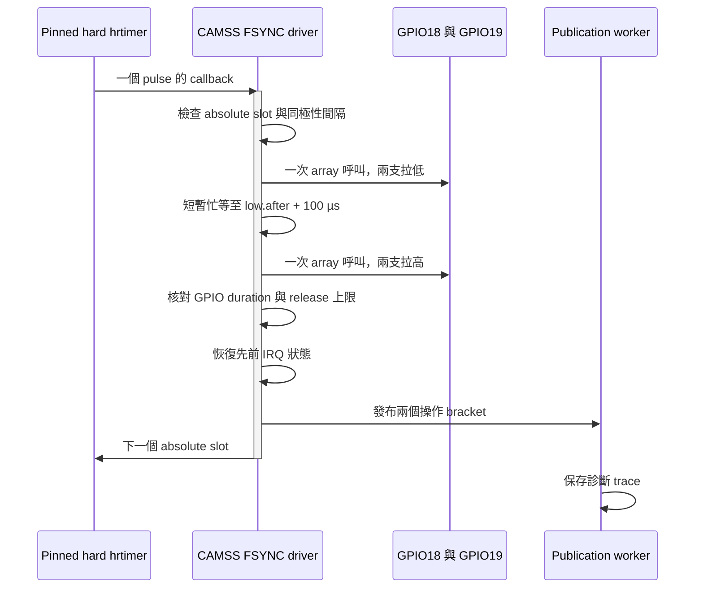

# 2026-10-15 持續運行穩定性修正與驗證

第一輪 CAMSS 修正在約 117.9 分鐘因過度嚴格的 low command guard 停止，**兩小時驗收失敗**；完整紀錄保留於 [attempt-01](attempt-01/long-run/result.json)。目前 guard 已修正，revision-02 通過三組實際 source fixture、module 建置、完整 reboot 與 Main10 解碼。第二輪 RTSP＋IMU 長測在 1077.280 秒時依使用者要求手動中止，尚未完成最終驗收。下列前段結果不可代替兩小時長測，也不可沿用舊版一小時的通過數字。

2026-10-16 10:17:58（Asia/Taipei）已排除相機使用權阻礙，重新開始 7200 秒長測；10:21:50 依使用者「下班前再繼續」要求停止，這輪只運行 232.078 秒，**目前測試已暫停，仍未完成最終驗收**。原始中止目錄已移存為板端 `revision-02/paused-20261015-1847/`，其 tar.gz 與 SHA-256 維持不變，不合併不同測試時數。

## 10/16 重新開始長測

深度服務 `stereo-gpu-live.service` 已於 10/15 20:17:22 結束，其 owner 記錄 `ORIGINAL_RESTORED True`；原 RTSP 主程序從 20:17:21 起運行。10/16 續測前，兩個 video nodes 均由原 `stereo-h265-rtsp` 持有，沒有存活的深度或 IMU client，深度服務亦為 `Restart=no`。本次未停止其他工作或重啟相機。

[開始紀錄](revision-02/resume-20261016-1017/start.json) 核對相同 boot ID、revision-02 loaded srcversion、module/source SHA-256、六個原設定／runner／binary hashes。[Client 檢查](revision-02/resume-20261016-1017/live-client-check.json) 核對 84 個 source、5 個 binary，以及 IMU `/proc/PID/exe` 與預期 binary 的 inode、SHA-256 均相符。

- 長測 unit：`sc132gs-stability-long-20261015.service`，invocation `b5c57f1376fe4892b0f7f238e2864f5a`，本 boot 啟動 PID 25219／IMU PID 25246。
- 資源監測 unit：`sc132gs-stability-resources-20261015.service`，啟動 PID 25251，從新長測第一筆起每分鐘取樣，最長 7300 秒。
- 新長測目錄：板端 `/home/ubuntu/sc132gs-stability-20261015/revision-02/long-run/`；不沿用先前的 invocation 或 progress。
- [外部解碼](revision-02/resume-20261016-1017/decode-start/result.json)：330 幀 Main10、2176×1280、PTS 嚴格遞增，穩態媒體 FPS 約 30，11 個不同取樣 hash。此項是有界解碼證據，不能代替兩小時及後續 DQBUF／API／ROS 驗收。
- [10:21 手動暫停紀錄](revision-02/resume-20261016-1017/pause-request.json)：長測及資源監測均已終止、MainPID=0；沒有剩餘 IMU client，46690 筆 IMU 全部 valid，register snapshots 相同且 restored=true。原 RTSP MainPID=22467 持續運行，session=23、error=0、skipped=0。本輪 [result](revision-02/resume-20261016-1017/paused-result.json) 為 `monitor interrupted`，不能算作通過；下班前的具體續測時間待使用者指定。

先前中止資料另外完成獨立稽核：[IMU](revision-02/resume-20261015-2000/imu-audit.json) 通過 217896 筆與 register restoration；[完整 camera auditor](revision-02/resume-20261015-2000/event-audit.json) 正確拒絕不足兩小時的 monitor、sample／log 覆蓋與 trace duration，沒有把部分 trace 升格為完成結果。

## 20:00 續測前檢查

2026-10-15 20:00（Asia/Taipei）排程觸發後，確認 boot ID 與 revision-02 loaded module 相符，六個原設定／runner／binary hashes 亦與備份完全一致。但相機已由 `stereo-gpu-live.service` 的 `board-live-depth`（PID 20183）持有 `/dev/video0` 與 `/dev/video3`，同時監聽 8554／8556；原 `sc132gs-camera-rtsp.service` 於 19:25:05 被正常停止。這是另一項即時深度工作接管，不能當成原 RTSP 長測的 driver 故障，也不能把其輸出混入原測試。

本次只讀取現況與封存紀錄，尚未啟動新的相機／IMU 測試，沒有停止深度服務、重啟原 RTSP 或改動 FSYNC。先請使用者選擇保留深度串流延後長測，或暫停深度串流切回原 RTSP。

- [續測前狀態](revision-02/resume-20261015-2000/result.json)、[身分與持續設定核對](revision-02/resume-20261015-2000/identity-check.json)。
- [18:47 中止測試完整封存](revision-02/paused-20261015-1847.tar.gz)：SHA-256 `a29e8769e2b4bfec9b1bef053ff8d28ecf7206cb2f4568b826806c3a80fa7c3e`；板端原 `long-run/` 亦保留原狀。這份中止測試的 IMU 有 217896 筆有效資料、registers 已還原，不能合併時數或提升為兩小時通過。

## 故障與修正

原正式 RTSP binary 在沒有使用新 Capture API 時也會停止。三次實際故障的 kernel trace 分別保存在 [原始故障](../../../../gs130wi_capture/evidence-20261015/board/original-failure-events.txt)、[恢復後故障](../../../../gs130wi_capture/evidence-20261015/board/post-restore-failure-events.txt)、[第三次故障](../../../../gs130wi_capture/evidence-20261015/board/third-failure-events.txt)。證據包括第二個 callback 遲到造成 release 超時，以及 callback 遲到約 238.603 µs 後被舊 100 µs admission gate 跳過。

兩支 GPIO 原本就各在同一個 array 呼叫一起切換。缺陷在同一個 pulse 的兩個邊緣由兩次 timer callback 排程，第二次可能延遲；不是分別排程 GPIO18 與 GPIO19。

實作見 [camss-sync.c](../../camss-sync.c) 與 [camss-sync-match.h](../../camss-sync-match.h)。兩個邊緣在同一次 callback 完成；脈波期間不碰 frame lock／workqueue。忙等約佔單 CPU 的 0.3%，本機 timer CPU 為 7，worker CPU 為 0，既有 consumer affinity 排除 timer CPU。此成本與硬體 PWM 不同，尚未量測電氣偏差。

保持原 epoch、不補發密集 pulse；合法延遲造成下一個邊緣太近時 rearm 到安全時刻。500 µs admission budget 仍受兩個同極性邊緣的最小 32.833333 ms 間隔限制。支援 profile 的 worst-case SOF window 16.853 ms、readout bound 15.5 ms、guard 0.25 ms，總和 32.603 ms，仍有 0.230333 ms margin。SOF 配對窗口維持 341..16853 µs，沒有放寬。

完整 pulse 外包絡上限為 150 µs，high release 超時另有 25 µs 上限，超過即 error 14。第一輪另外檢查 low command ≤25 µs，最後一次 low command 33.227 µs、release overrun 2.755 µs、總包絡 135.982 µs，兩眼 SOF delay 16.769042／16.769344 ms 均在原窗口內，hardware identity 亦有效，卻被單項門檻誤停。詳見 [診斷](attempt-01/diagnosis.json)；revision-02 改為原定總包絡檢查，沒有提高 150 µs 或 release 25 µs 上限。真正超出 admission budget、缺幀、重複、overflow、starvation 或硬體身分不符仍鎖住錯誤，不靠重啟隱藏中斷。

## 部署與回復

板端根目錄 `/home/ubuntu/sc132gs-stability-20261015`。`stability_deploy.py save` 先保存當時 exact module、initrd、options、settings、runner、原 RTSP binary 與 SHA-256；備份目錄權限 0700。三組 fixture source hash 與 vermagic 核對後才 install，接著完整 reboot，沒有 hot-unload CAMSS。

| 項目 | 第一輪部署身分（已失敗） |
|---|---|
| Kernel | 6.8.0-1084-qcom |
| Module srcversion | 6DAE0AB4751E7CC1599D922 |
| Module SHA-256 | feecb67bcdd64d2d8a57b32ebaf9c8c9fbaa207c753f3d91d58e0e57b8e23e6a |
| camss-sync.c SHA-256 | ea56dce9ab809491dcba7e5d4732d6a79f905649218a47d3859420963995613b |
| 新 boot ID | 459a220b-8a57-4c74-9f44-cc1fd67cc2e1 |
| 時間語意 | ABI 4 / exposure_start_estimate / offset 344903 ns |

原正式 RTSP binary、profile 與 AE 設定維持備份中的值。`source` 仍是曝光開始估計，這次不重新校準或提升它的物理證明等級。

revision-02 的實際部署：

| 項目 | 第二輪部署身分 |
|---|---|
| Module srcversion | C243ABE8CAC3FA872B2A08C |
| Module SHA-256 | 89e0f15a9e96614d41b4ab2da68827758df55259b90f4e91eef186a4fd19be70 |
| camss-sync.c SHA-256 | eefca6876e83038f81484986d0806185ec2343cc70c9d617854453a1b60ea35f |
| Boot ID | c5c9582b-15bc-42d1-a61a-976a368933fd |
| 板端工作根目錄 | /home/ubuntu/sc132gs-stability-20261015/revision-02 |
| 長測 | 原 unit 名稱，新的 invocation 08f37006bdc04ffeabb975b275787983 |
| 初始長測／IMU PID | 3827／3939，僅適用此 boot，後續以實際 unit/progress 為準 |

[新版 callback fixture](revision-02/atomic-fixture.json) 包含實際 33.227 µs low／2.755 µs release 案例、150 µs 正好邊界、150.001 µs 拒絕與 release 25.001 µs 拒絕；沒有提高原定 150 µs 總包絡或 release 25 µs 上限。[重開機後實際解碼](revision-02/decode-after-driver/result.json) 通過 181 幀 Main10、約 30 FPS。配置到新根目錄的診斷腳本副本保留於 `revision-02/`，第一輪腳本與結果不覆寫。

[第二輪第一份前段重播](revision-02/prefix-replay-01/audit.json) 通過每眼 19,799 幀、659.934 秒、約 30 FPS；low command 最長 14.061 µs、release overrun 最大 9.688 µs、總外包絡最大 118.490 µs，沒有配對缺口或 hardware identity error。這份報告明確標示 `partial_trace_only=true`，仍不能代替完整兩小時結果。

需要回復時，使用本次備份，執行 `sudo python3 /home/ubuntu/sc132gs-stability-20261015/stability_deploy.py restore`，再完整 reboot；不可用更早版本的備份代替本次起始狀態。

## 已完成的檢查

1. 實際 callback source fixture：26,000 個 pulse、6,000 個抖動案例、固定 epoch、邊界 rearm、真正過期 slot、GPIO failure／duration 超時、停止清理。
2. 實際 publication／worker source fixture：producer queue 有界、overflow 與 frame-lock 隔離。
3. 實際 SOF／DMA source fixture：32 個啟動、反向眼序、缺幀、重複、歧義、starvation、overflow、restart 等案例。
4. Kernel module 編譯通過，reboot 後核對實際 loaded srcversion；外部 RTSP/TCP Main10 解碼 181 幀通過。長測期間另一次重新連線解碼 181 幀通過，見 [decode-reconnect-01](decode-reconnect-01/result.json)。
5. [前段獨立重播](prefix-replay-01/audit.json)：約 457.967 秒、每眼 13,740 幀，共同 trigger 區間連續，約 30 FPS。GPIO 操作外包絡的 pulse width 為 103.856..111.616 µs，SOF→EOF 為 15.384687..15.384791 ms；這些是 host bracket／硬體 counter，並非示波器量測。
6. [同一 auditor 重播舊故障](negative-replay.json) 能拒絕三份實際失敗 trace，分別抓到 release 超時、跳過 pulse、frame 連續性錯誤。
7. IMU CSV auditor 改為逐行處理，對三份既有實測 CSV 的 JSON 結果與原 auditor 完全相同，不再一次載入全部兩小時樣本。
8. 後續回歸程序的 [板端 gate 檢查](followup-guard.json)：原長測 MainPID=4405 仍為 active 時，`stability_followup.py --check` 確實拒絕取得硬體，camera session 與 running/error/skipped 維持原值。語法檢查亦通過；這只證明拒絕 gate，不代表後續硬體場景已通過。
9. [Client source／binary 核對](deployment/live-cli-source-check.json)：84 個 client source 與 5 個 binary hashes 均相符；相較原 API build，唯一 C++ 變更是 IMU CLI 的執行時間上限由 3600 秒提高至 86400 秒並重新建置。運行中的 IMU PID 4442，其 `/proc/4442/exe` 與新 CLI 檔案為相同 inode、SHA-256 相同；原 API／RTSP／ROS library binary hashes 維持原值。原設定／runner／正式 binary 等 6 個持續檔案亦與本次備份相符。
10. [第二份前段重播](prefix-replay-02/audit.json)：約 1422.467 秒、每眼 42,675 幀，約 30 FPS，無 trace 稽核錯誤。長測中的第二次 [RTSP 重新連線解碼](decode-reconnect-02/result.json) 亦通過 181 幀 Main10；仍不是完整兩小時結果。
11. 約 45 分鐘時的 [第三次重新連線解碼](decode-reconnect-03/result.json)：181 幀 Main10、穩態 media／wall FPS 約 30，PTS 遞增；[重新連線後狀態](decode-reconnect-03/after-state.json) 核對原 RTSP PID 2928／start ticks 3238、IMU PID 4442／start ticks 25467 維持不變，kernel session=1、error=0、skipped=0。此檢查點不代表完整兩小時驗收已完成。
12. [一小時檢查點的前段重播](prefix-replay-03/audit.json)：每眼 109,855 幀、3661.800 秒、約 30 FPS，沒有 pulse／frame ID／sequence 缺口或硬體幀身分錯誤。low bracket 最長 15.209 µs、high release 超時最大 9.167 µs，均在各 25 µs 上限內；pulse 外包絡 103.594..117.553 µs。這是保存至當時的 trace 重播，仍標示 `partial_trace_only=true`；不是兩小時完成結果，也不是電氣脈寬量測。

另自本次長測約 33.6 分鐘起，使用 [snapshot_resources.py](../../snapshot_resources.py) 記錄指定程序的 RSS／peak RSS、threads、fd 數量、PID 與 start ticks；先前時段沒有相同的週期資源取樣，不宣稱涵蓋完整兩小時。第一份 RTSP process snapshot 為 PID 2928、RSS 152876 KiB、peak RSS 157476 KiB、11 threads、18 fds；IMU PID 4442 為 RSS 3384 KiB、1 thread、6 fds。`sc132gs-stability-resources-20261015.service` 每分鐘追加 `long-run/resource-samples.jsonl`，最多 5400 秒，原長測 unit 結束時便退出。它只讀 `/proc`／service 狀態，不開啟相機或 IMU 裝置；資料仍須在結束後核對，不能以單一 snapshot 證明沒有長期資源增長。

## 尚待完成的驗收

- `sc132gs-stability-long-20261015.service`：原正式 RTSP 與一個 IMU CLI 同時連續運行 7200 秒。紀錄位於板端 `long-run/`，保留同一 boot、module、camera PID、session，每秒收 trace、每五秒收狀態；不自動重啟失敗 owner。
- 完整 trace／server windows／IMU CSV 獨立重播，核對漏事件、每眼 trigger／sequence 連續性、hardware SOF／EOF identity、全部統計窗口平均速率與 IMU counter／register restoration。
- 新 driver 的直接 DQBUF 驗收、反向啟動／starvation fail-closed，以及共用 Capture API 的持續運行回歸；測完恢復原 owner，再核對解碼、設定與 binary hashes。

第一輪已結束，`long-run/result.json` 的 `passed=false` 必須保留；它的 IMU 獨立稽核通過 1,431,936 筆及 registers restoration，不代表相機長測通過。revision-02 使用另存的板端根目錄 `/home/ubuntu/sc132gs-stability-20261015/revision-02`，新 module、backup、fixture 與下一輪 `long-run/` 分開保存，重新從零累積完整 7200 秒。第一輪 source／patch 亦封存於 `attempt-01/`。

`audit_stability.py --trace-only` 僅檢查已複製的 trace 前段，輸出明確標記 `partial_trace_only=true`，不能作為整段驗收。完整模式還要求已完成的 monitor result、狀態取樣與 server log，不以單一瞬時 encoded FPS 判斷失敗。

後續 [stability_followup.py](../../stability_followup.py) 在長測 unit 已終止，且 `long-run/result.json`、`event-audit.json`、`imu-audit.json` 均完整通過後才取得硬體。場景依序為 605 秒直接 DQBUF、95 秒反向啟動、刻意暫停 dequeue 的 starvation、1200 秒共用 API RTSP＋IMU、18000 組 ROS frame／約 600 秒真實 DDS；正常場景各自保存並重播 trace。程序以 `finally` 關閉自己啟動的 client／container，啟動原 restore service，核對設定／binary hashes 與 IMU registers。執行前與長測 unit 同時運行的 gate 拒絕已實測，真正場景仍待長測結束後執行。

revision-02 後續另補 65 秒 exposure=8 rows 的直接 DQBUF 檢查（有效跨度至少 60 秒），確認短曝光仍在原 SOF 窗口；先保存兩眼當時 exposure 值，關閉該次 raw client 後逐眼還原並讀回核對，不改 durable settings。其餘既有場景保留。

共用 API RTSP 場景使用 `rtsp://192.168.137.226:8555/stereo`；另由 Windows verifier 在該場景期間實際重新連線解碼，將兩次結果分別保存至板端 `followup/rtsp-api-decode-01.json` 與 `rtsp-api-decode-02.json`。程序要求兩份解碼結果通過，不能以建立 RTSP listener 代替實際影像解碼。ROS 訂閱端另要求每種資料的有效接收跨度至少 590 秒、最大到達間隔不超過 3 秒，仍如實報告 best-effort index gaps。

這次範圍不包含 frame↔IMU 事件配對、IMU→host 時鐘映射、電氣邊緣／絕對曝光起點校準或 VIO；IMU 中相鄰 FSYNC-marked packets 仍保留為兩筆原始觀察，不合併或指派 frame ID。
