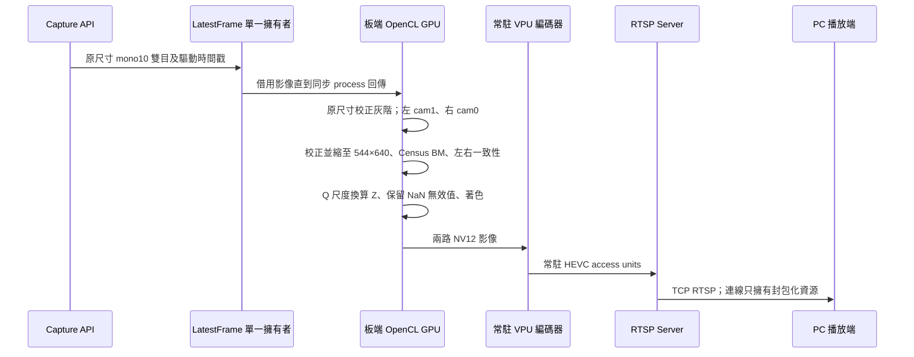

# 板端 GPU 校正與深度 RTSP 預覽

非 binning；直接使用 `gs130wi::Capture` 的板端原生 mono10 雙目影像，不經 PC 或 RTSP 取圖後再計算。OpenCL 在板端 GPU 執行魚眼校正、立體對齊、深度用縮放與 Census BM；VPU 編碼兩路 HEVC。這是實驗用 consumer，沒有新增產品 public API。

## 輸出

| 用途 | RTSP | 尺寸 |
|---|---|---|
| 校正灰階 | `rtsp://192.168.137.226:8554/stereo` | 2176×1280；每眼 1088×1280 |
| 彩色深度 | `rtsp://192.168.137.226:8556/depth` | 544×640 |
| PC 瀏覽器橋接 | `http://127.0.0.1:8765/` | PC 僅解碼、JPEG 與顯示 |

灰階合併後左半為 **cam1**，右半為 **cam0**，兩眼不再做舊 RTSP 的水平鏡射。此交換只影響呈現位置，深度仍以 cam1 為參考。

「cam1 是左眼」來自候選校正的幾何推定：`X_cam1=R X_cam0+T`，cam1 中心在 cam0 座標為 `-RᵀT ≈ (-70.212,0.433,0.551) mm`。目前沒有遮鏡頭的獨立硬體確認；video node、I2C 位址與畫面排列本身都不能證明物理左右。

## UML 流程



## 重現與生命週期

Windows 使用 `../depth-preview-venv/Scripts/python.exe deploy.py` 產生並部署兩種解析度的 map，凍結 Capture header/static library，編譯獨立 consumer。所有工具與 map 均在本目錄；候選 NPZ 沒有修改。

有限測試：

```sh
sudo python3 /home/ubuntu/board-live-depth-20261015/board_run.py UNIQUE_NAME 300
```

會保存原服務環境、設定與執行檔 SHA256、日誌及同步狀態；在 `finally` 關閉測試 owner 並恢復原 Main10 服務。`client_probe.py NAME 120` 以兩路真實解碼及時間戳水印量測，`verify.py NAME` 獨立 CPU 重算。

持續預覽（不設定開機自動啟動）：

```sh
sudo systemd-run --unit=stereo-gpu-live.service --property=KillMode=mixed --property=TimeoutStopSec=35s /usr/bin/python3 -u /home/ubuntu/board-live-depth-20261015/board_owner.py
```

停止並還原原服務：

```sh
sudo systemctl stop stereo-gpu-live.service
```

owner 異常退出也會先恢復原服務；此時 `/depth` 消失，`/stereo` 回到原影像。PC 預覽會隱藏失效的板端 GPU 畫面，避免把原影像標成已校正。`active-run.txt` 指向當前證據目錄。持續模式保存最新預覽及深度，CSV 每檔約 8 MiB 輪替一次，只保留一份前檔。GPU consumer 與 VPU server 使用 C++17 PIMPL、move-only RAII；擷取執行緒持有像素，GPU 呼叫同步借用，串流提交複製到有上限的 GstBufferPool。

PC 以 `start-viewer.ps1` 啟動；`stop-viewer.ps1` 停止。舊 PC SGBM viewer 需先透過其 `stop.ps1` 關閉，避免對已校正影像再次校正。

## 幾何、品質與證據邊界

- 使用未修改的 `stereo-candidate.npz`，SHA256 `819d0befaabe1973d299107b0a181e6ec93853a641840e3c9da04e1c84d4732b`。原始 cam0→cam1 外參反向為 cam1 參考；native 輸入不做鏡射。
- 校正 map 以 OpenCV fisheye 產生，GPU 使用 1/32 像素固定座標雙線性取樣。原尺寸與縮小尺寸各自直接映射原始影像；沒有先校正再單獨 resize。
- 深度是光軸方向 Z，`Z=fB/disparity`；尺度依賴 20 mm 棋盤格假設。不是射線距離，也沒有測距精度驗收。
- 96 格整數視差、5×5 Census、5×5 Hamming 聚合、10% uniqueness、左右誤差 ≤1 px。此為 Census BM，並非 StereoSGBM。無效／遮蔽／不一致點保持 NaN；色圖黑色，不補洞。通過檢查仍可能有錯配，尤其無紋理天花板、飽和燈具與重複線條。
- NV12/HEVC 有色度降採樣及有損壓縮，邊界可能有色滲。彩色 RTSP 只供觀察，不可由顏色還原精確公尺值。
- **此 native consumer 是 8-bit HEVC 預覽，沒有掛接原服務的自動曝光控制與 Main10 路徑。** 原設定及 Main10 binary 保留；停止預覽會回到原服務。不能把這個實驗 consumer 當成原服務全部功能的替代品。
- 有限測試以 16-row 互補水印攜帶完整來源 CLOCK_MONOTONIC timestamp；UDP 最小 RTT 估計 PC/板端時鐘偏移，前後偏移做線性內插，誤差範圍至少為 RTT/2。Windows 必須用 `perf_counter_ns()`（QueryPerformanceCounter，100 ns 解析度）；此 Python 3.12 的 `monotonic_ns()` 使用 GetTickCount64，解析度 15.625 ms，舊輪次的 PC 延遲只能粗估。`latency_analyze.py` 會將每個解碼水印與板端 CSV 精確 join，驗證沒有偽造／重複來源影格。延遲終點是 PC decoder-ready，起點為驅動 `exposure_start_estimate`，不是光學曝光或螢幕顯示完成的實測。持續模式移除水印。
- 五分鐘 `live96-repeat`：擷取 9061 對、處理／兩路編碼各 9003 張、取代 58 張；擷取 30.0 FPS，處理 29.809 FPS，不能宣稱零掉幀穩定 30 FPS。GPU p50/p95 22.885/23.462 ms；含上下載 process 28.379/29.876 ms。
- 五分鐘 `pool-final`：擷取 9061 對、處理／兩路編碼各 8927 張、取代 134 張；擷取 30.0 FPS，處理 29.561 FPS；GPU p50/p95 23.345/23.921 ms，含上下載 process 29.030/30.082 ms；有效像素比例中位數 27.37%。兩輪訂閱與負載條件不同，不能用此差異斷言緩衝池造成退步或提升；結果都未達零掉幀 30 FPS。最終程式另加入失敗時先完成 OpenCL 傳輸的 RAII，確保借用輸入及讀回緩衝區在錯誤路徑仍存活，並以 `release-check` 驗證正常路徑。
- `latency-qpc`：QueryPerformanceCounter 重測 1035 張，水印全部精確對到板端實際影格、沒有重複。驅動 exposure-start **estimate** 至 PC decoder-ready 延遲 p50/p95/p99 約 **175.5/187.6/196.2 ms**；前後最小 RTT 的一半最大約 0.786 ms，時鐘偏移差 0.554 ms。這不是曝光至螢幕的光學實測。舊輪次 GetTickCount64 的 PC 延遲不作精確結果使用。
- 較早的 `live96` 約 60 秒遇到 Capture `timestamp` 錯誤，已自動還原；未保存當刻控制狀態，不能斷言根因。後續測試新增連續同步狀態與錯誤當刻快照，沒有關閉同步檢查。
- CPU replay 對全部原尺寸灰階像素及半尺寸左眼逐像素一致；Census BM 有效遮罩完全一致，深度最大誤差約 2.4e-7 m。這驗證實作一致性，不代表校正精度。

每輪 `analysis.json`、`runtime.json`、`client.json`、`sync-monitor.jsonl`、原始 mono10 快照及數值深度是實際證據。最終緩衝池版本的資料另見 `pool-final/`。

目前兩路 RTSP 分別呈現各自的最新影格；瀏覽器將它們並排時不保證兩張來自同一來源時間戳。
