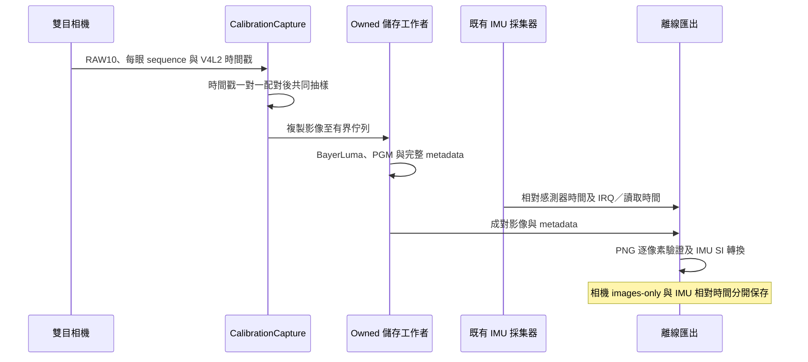

# SC132GS 雙目標定採集

已完成實體採集與格式驗證，並從這顆模組 EEPROM 讀出 UNION V1.2 出廠內參。參見 [原始影像內參](../factory-calibration-20261013/raw-intrinsics.yaml)：未旋轉的 1088×1280，pinhole + equidistant 魚眼模型，cam0 為右眼、cam1 為左眼。兩次讀取一致，官方原始解析器已交叉核對全部內參／畸變數值。下一步先用標定板影像驗證出廠幾何精度；是否重標定由殘差決定。相機–IMU 外參仍需核對方向、單位、共同時間與 IMU 雜訊模型，不能直接視為 live VIO 已完成。

## 1. 準備標定板

使用 `output/pdf/sc132gs-checkerboard-a4-20mm.pdf`，A4 橫向、實際大小／100% 列印，關閉「符合頁面」。貼在平整硬板上，實際量測格邊為 20 mm、下方尺長為 50 mm。若印表機縮放，先修正列印設定或把實測尺寸寫進 `checkerboard.yaml`，不能假設紙上尺寸正確。

此板為 **9×6 內角點、10×7 格子**，設定檔每格 0.020 m。棋盤必須在兩眼都完整可見；Kalibr 也支援此目標，若日後需要部分可見的採集，可換成官方建議的 Aprilgrid，並一起換目標設定。來源：[Kalibr 標定板說明](https://github.com/ethz-asl/kalibr/wiki/calibration-targets)。

## 2. 相機內參／雙目外參採集

先保持相機／IMU 模組與板子固定。將標定板移到兩眼共同視野內，慢慢改變位置、距離、俯仰與左右傾角；涵蓋中心、四周和角落，每個位置停穩讓影像清楚。避免反光、模糊與部分棋盤超出任一眼畫面。不要改變焦距、鏡頭固定位置或相機間的剛性結構。

把板子放好後，在 RUBIK Pi 3 執行：

```sh
sudo python3 /home/ubuntu/ros2_humble_ws/slam_benchmark/capture-calibration-session.py chessboard-01 --seconds 90 --every 6
```

程序只接受目前已停止的相機服務與 Linear 模式。兩眼先以驅動時間戳在 3 ms 內做一對一配對，再每六個配對保存一組；本次實測約 30 Hz 原始捕獲、5 組／秒保存。啟動不同步的多餘幀會記為 `unpaired`，不把相同驅動幀序號假設成相同曝光。儲存佇列滿會回報失敗，不靜默丟棄。兩眼完整影像為 1088×1280，並非先前 EuRoC 752×480 的效能測試尺寸。

停止會收束相機與 IMU、關閉 FSYNC 程序、恢復驅動控制值，保持原本停止的串流狀態。相機持久設定和 runtime state 雜湊會再次核對。Ctrl+C 會執行這個收尾；不要以 SIGKILL 中斷。工具不會修改內核或 Device Tree。觸發來源仍是既有 userspace GPIO，尚未證實硬體曝光同步。

## 3. 匯出與檢查

```sh
sudo docker exec --user 0 ros2-humble python3 /ws/slam_benchmark/export-calibration-session.py chessboard-01
```

資料位於 `/home/ubuntu/ros2_humble_ws/slam_benchmark/live-calibration-20261013/chessboard-01/`：

| 檔案／目錄 | 意義 |
|---|---|
| `camera-frames.csv` | 軟體 pair_id、每眼原始 sequence／flags、驅動時間戳、dequeue 時間，均保留 |
| `cam0/`、`cam1/` | RAW10 經既有 BayerLuma 轉成全解析度線性 mono8 PGM；不走 RTSP／HEVC |
| `imu-raw.csv` | 原始 g、deg/s、感測器相對時間、批次 IRQ 和讀取時間 |
| `prepared/images-only/cam0/`、`cam1/` | PNG 以各眼原始驅動時間戳命名，沒有重寫成曝光時間 |
| `prepared/imu-si-relative.csv` | 轉成 m/s²、rad/s，仍是相對 IMU 時間；不混入相機 bag |
| `prepared/export-audit.json` | 成對完整性、時間差、PNG 逐像素、SI 單位檢查與限制 |
| `transaction.json`、`tested-sources/` | 前後狀態、來源／binary 證據 |

實際採集後還要檢查棋盤在左右眼的角點偵測、覆蓋範圍與姿態多樣性，才能求解標定。10 秒空場景 smoke test 不是標定資料。

## 4. Kalibr 輸入

`images-only` 的布局符合 Kalibr `bagcreater` 的影像資料夾格式。**Kalibr 執行環境尚未在此板安裝／驗證**；在已準備的 Kalibr 主機建立影像 bag：

```sh
kalibr_bagcreater --folder images-only --output-bag stereo-camera.bag
```

它會建立 `/cam0/image_raw` 和 `/cam1/image_raw`。相機模型應依鏡頭與全畫面重投影殘差選擇，不能拿 EuRoC 內參套用到 SC132GS。求解後須檢查重投影誤差、外參剛性一致性與獨立資料驗證，再轉為 OpenVINS 設定。來源：[Kalibr 資料格式](https://github.com/ethz-asl/kalibr/wiki/bag-format)。

## 相機–IMU 階段的門檻

現有 IMU `sensor_elapsed_ns` 是相對計數器時間，`host_interrupt_ns` 是 FIFO 批次通知。不能將同一批 IRQ 值填到每個 IMU 樣本的共同時間。還缺感測器到主機的偏移／斜率與誤差驗證、濾波／通知延遲分析，以及噪聲密度與偏置隨機游走參數；因此此匯出工具刻意不建立 `imu0.csv` 或相機–IMU 聯合 bag。

完成上述時間與雜訊工作後，才固定標定板、移動整組剛性相機＋IMU，採集各軸旋轉與平移，求解 `T_cam_imu` 和時間偏移。當前沒有可信的 `T_cam_imu`，也還不能宣稱實體 OpenVINS 定位成功。來源：[Kalibr 相機–IMU 標定](https://github.com/ethz-asl/kalibr/wiki/camera-imu-calibration)。

## UML 採集流程



公開 API 為 C++17、move-only／PIMPL，內部實作 C++23。選用的 Observer 只在儲存工作者上通知進度，與同步 `run()` 結果分開；儲存工作者先喚醒並 join，再釋放相依資源。
