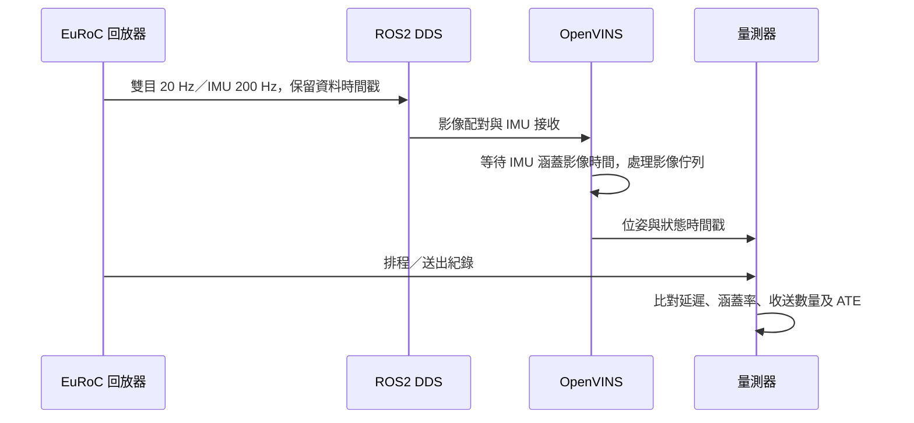

# RUBIK Pi 3：OpenVINS 特徵数與延遲比較

降低追蹤特徵目標確實減少本次 20 Hz 回放的延遲與超時影格，但精度取捨依資料集、誤差指標而異。

先前的「每眼 200 個」需要修正：此版本把 `num_pts` 分給兩眼。原設定 200 是每眼目標 100 個，150 是每眼 75 個，100 是每眼 50 個。實際追蹤數會隨場景變化。

| 每眼目標／num_pts | MH 延遲 P95／最大 | V2 延遲 P95／最大 | MH ATE | V2 ATE |
|---|---:|---:|---:|---:|
| 100／200，原設定 | 72.0／133.0 ms | 69.3／116.1 ms | 10.35 cm | 5.08 cm |
| 75／150 | 56.4／93.2 ms | 55.2／107.2 ms | 9.34 cm | 4.47 cm |
| 50／100 | 43.1／66.8 ms | 49.8／70.9 ms | 12.00 cm | 5.47 cm |

上述延遲統計使用初始化後影格。全部六組退出碼 0，處理完 18,090 對雙目影格，初始化後每幀位姿均前進。全段位姿涵蓋率 MH 75.6%、V2 96.5%，其餘為自然初始化等待；不能把初始化後 100% 當作全段 100%。初始化等待 MH 44.9 秒、V2 4.1 秒。

每眼 50 個比原設定的 P95 降低約 40%（MH）和 28%（V2），最大延遲也下降。讀圖＋IMU＋估測超過 50 ms 的比例，MH 從 15.2% 降到 0.8%，V2 從 20.3% 降到 1.8%。仍有少數超時影格，不能宣稱所有影格都符合 50 ms 截止時間。

**設定選擇：**重視 20 Hz 處理餘裕時，`num_pts=100` 是本次較合適的下一階段測試候選；重視這兩段資料的整段 ATE 時，可保留 `num_pts=150` 作為對照。75 個目標在 MH 的 1 秒相對位移誤差為 4.43 cm，比原設定 2.62 cm 大，不能稱為全面更準。50 個目標的 MH ATE 比原設定增加約 16%、V2 增加約 8%；這不是一條適用所有場景的固定精度曲線。

以上比較表使用每個設定／資料集的第一輪篩選結果；`num_pts=100` 已在各資料集追加兩次完整回放，結果如下。150 與 200 仍各僅一次篩選回放。未定義產品定位誤差容許值，因此不宣稱某個設定已通過產品驗收；低紋理／快速運動场景仍待驗證。

## 候選設定的三次重複結果

| 資料集 | 三次延遲 P95 範圍 | 三次 P99 範圍 | 三次最大延遲範圍 | 服務超過 50 ms 比例 | ATE |
|---|---:|---:|---:|---:|---:|
| MH_01_easy | 42.9–43.1 ms | 51.4–52.2 ms | 66.8–71.9 ms | 0.8–1.0% | 12.00 cm |
| V2_02_medium | 49.6–49.8 ms | 58.5–59.8 ms | 70.9–77.3 ms | 1.8–2.3% | 5.47 cm |

範圍為逐次統計值的最小／最大，未把三次影格混成單一百分位數。六次候選回放均完成全部輸入，退出碼 0，初始化後每幀位姿均前進，ATE 三次一致。這支持候選設定的回放延遲改善可重現；仍不能宣稱每幀符合 50 ms 截止時間。

追加驗證後，此目錄共 10 組回放、30,150 對雙目影格。三次測試使用相同 `num_pts=100` 設定雜湊 `92b82dce6932b3289c0cd7152068219b87e21c585419908f7ee3558e2b66ec10`。逐次統計見 [confirmation.json](confirmation.json)。第一輪篩選報告／統計／雜湊保存在 screening-report.md、screening-evaluation.json 與 screening-evidence-sha256.json，原始逐次回放資料未修改。

此次只更改隔離的實驗 YAML 中 `num_pts`，已驗證其他 YAML 內容相同；未修改原校正檔、原基準設定或硬體時脈策略。OpenCV 4 執行緒、原 schedutil、CPU affinity 0–7 保持不變。沒有並行資料下載、解壓或編譯；已完成組的少量結果以 SSH/scp 取回，可能與下一組回放短暫重疊，其他既有主機程序未隔離。

量測是 EuRoC PNG＋IMU 的原生循序回放，延遲由影格排程時間算到估測返回，包含讀圖／解碼及 IMU feed。未包含實體相機曝光、驅動、相機–IMU 同步或 ROS DDS；不能直接當成實機曝光到位姿延遲。ATE 為不縮放的全段 SE3 對齊，RPE 為 1 秒，沒有使用真值初始化。

完整逐組統計見 [report.md](report.md)，機器可讀結果見 [evaluation.json](evaluation.json)，設定一致性檢查見 [config-verification.json](config-verification.json)。原始 frames、trajectory、internal timing、CPU／RSS／溫度紀錄在 results 各組目錄，證據雜湊見 evidence-sha256.json。

## 下一階段：ROS2 主動輸入測試，尚未執行

沿用 `num_pts=100` 與 EuRoC 校正，先測資料集經 ROS2 進入估測器的完整管線。新增成本包含影像訊息建立／複製、DDS 傳輸、雙目配對及影像佇列等待。實機校正和相機–IMU 時基仍為後續工作。

先確認影像與 IMU 的 QoS 相容，並用保留的 EuRoC 感測時間對照資料真值。以共用單調時鐘記錄排程、發布、接收及位姿到達；資料集歷史時間不能直接與系統現在時間相減。位姿時間包含相機–IMU 校正偏移，須還原對應影格後再計算排程到輸出延遲。

記錄完整輸入／輸出數量、雙目配對、佇列等待、掉幀與自然初始化等待。檢查持續輸入期間的正常退出與背景執行緒生命週期。現有原生回放沒有涵蓋這些 ROS2 行為，先前 idle-node 退出測試也不能代替主動輸入驗證。

原始 ROS2Visualizer 的 `update_dt = 100.0 * (timestamp_imu_inC - camera_timestamp)` 卻以 ms 顯示；此外它比較的是感測時間落差，而不是單調牆鐘下的排程到位姿延遲。新量測不使用此印出欄位當作延遲證據。
