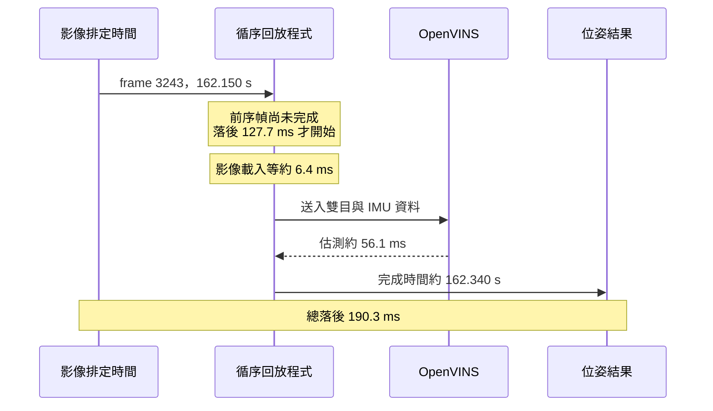

# OpenVINS 延遲尖峰分析

已分析沒有並行資料準備的 MH 最後一輪與 V2 三輪原始紀錄。**尖峰主要呈現為多幀處理超過 50 ms 後的積壓；特徵追蹤是最大的內部耗時階段，MSCKF 更新與特徵初始化會再推高個別幀耗時。** 目前尚不能把追蹤較慢直接歸因於特徵數、場景、CPU 排程或降頻。

本次只讀取既有紀錄，沒有改板上設定、演算法參數或重新回放。

## MH 的 190.3 ms 如何形成

峰值位於 frame 3243，影像排定時間為序列開始後 162.15 秒：

| 項目 | 耗時 |
|---|---:|
| 開始處理前，已落後影像排定時間 | 127.7 ms |
| 本幀影像載入／PNG 解碼與 mask 建立 | 6.4 ms |
| 本幀 IMU 資料送入 | 0.008 ms |
| 本幀 OpenVINS 估測 | 56.1 ms |
| 合計播放到位姿延遲 | **190.3 ms** |

OpenVINS 本幀的內部階段：追蹤 30.18 ms、IMU 傳播 0.29 ms、MSCKF 更新 15.40 ms、SLAM 更新 6.17 ms、SLAM 特徵初始化 0.08 ms、重新三角化與邊際化 3.67 ms。內部時間點以外的返回、紀錄等工作約 0.31 ms。

峰值前的積壓從 frame 3208 延續至 3243，這 36 幀平均服務耗時 **53.7 ms**；每幀預算是 50 ms。之後的較快幀逐步追上，在 frame 3272 開始時落後已降回約 5 ms 的正常 IMU 前視等待。

其中幾個加重積壓的幀：

| frame | 本幀總服務時間 | 追蹤 | MSCKF 更新 | SLAM 特徵初始化 |
|---|---:|---:|---:|---:|
| 3219 | 78.5 ms | 36.9 ms | 15.0 ms | 11.8 ms |
| 3231 | 69.4 ms | 35.7 ms | 15.6 ms | 1.4 ms |
| 3243 | 62.5 ms | 30.2 ms | 15.4 ms | 0.1 ms |

圖上方為全序列延遲，中間把本幀服務時間與開始前落後分開，下方為尖峰區段各階段耗時。堆疊圖未包含很小的 IMU 送入與內部計時以外工作。

## 跨資料集的共同現象

| 測試 | 初始化後超過 50 ms 的服務幀 | 追蹤占已記錄內部總時間 | 峰值：開始前落後＋本幀處理 |
|---|---:|---:|---:|
| MH paced-3 | 17.1% | 69.6% | 127.7＋62.5＝190.3 ms |
| V2 paced-1 | 10.5% | 71.4% | 48.9＋53.6＝102.4 ms |
| V2 paced-2 | 10.8% | 71.5% | 33.6＋58.2＝91.8 ms |
| V2 paced-3 | 10.6% | 71.2% | 39.1＋56.0＝95.1 ms |

V2 三輪最大積壓都發生在約 14 秒附近，尖峰前區段中追蹤占內部時間約 88–89%。這支持先研究追蹤負載；不能僅憑相同區段就證明特定場景因素是根因。

MH 初始化後影像載入 p95 約 7.9 ms；V2 約 3.9–4.0 ms。影像載入對預算有影響，但在上述尖峰幀中，耗時最大的是估測內部的追蹤與更新。

## CPU 時脈與計時限制

- 尖峰附近的每秒採樣顯示 CPU7 約 2.7072 GHz；MH 的 CPU4–6 採樣為 691.2 MHz。這是不同核心的採樣值，不代表估測執行緒實際在哪一個核心執行。
- 熱感測器原值已保存，但這次沒有量到降頻原因或 thermal throttling 狀態。
- 回放計時與平台採樣各有起點，沒有共同同步標記。利用總執行時間只能給出約 0–1 秒的起點差範圍；圖中平台關聯採寬鬆時間窗，不能做單幀 CPU 時脈因果判定。
- OpenVINS 內部以 wall clock 計時，外層以 steady clock 計時。內部時間戳為帶線上時間偏移的 IMU 時間，採最近影像一對一匹配，最大差約 1.1–2.0 ms；4 輪所有已初始化位姿都能匹配。
- MH 外層估測時間減去內部總時間的 p95 約 0.29 ms；V2 約 0.28–0.31 ms，沒有顯示大量耗時遺漏在估測呼叫返回區段。
- 開始前落後主要可以由前幀完成時間解釋，剩餘差的最大值約 5.9–6.3 ms，包含正常 IMU 前視等待、sleep 喚醒與回放迴圈工作。這不等於 OS 排程對各運算階段沒有影響。

## 有依據的下一個實驗

優先測 **num_pts 總目標 200→150→100（每眼目標 100→75→50）**，其餘設定保持一致；同時比較追蹤、MSCKF 尾端、總服務超過 50 ms 的比例、播放延遲 p95／p99／最高值及 ATE／涵蓋率。追蹤負載最大，降低特徵數是值得測試的假設，尚未證明會按比例加速。特徵數語意修正見 `../feature-count-erratum.md`；本次後續測試見 `../feature-sweep/report.md`。

如果特徵數變更仍留下明顯尖峰，下一個獨立實驗再比較 OpenCV 執行緒數與 CPU 綁定；測試前補上共同 steady-clock 標記與執行緒所在 CPU 紀錄。一次只改一項，才能辨認哪項調整有效。

詳細逐幀區段、階段統計、CPU 時脈與熱感測器原值範圍見 [analysis.json](D:/projects/collision_avoid/outputs/slam_benchmark/latency-analysis/analysis.json)。

