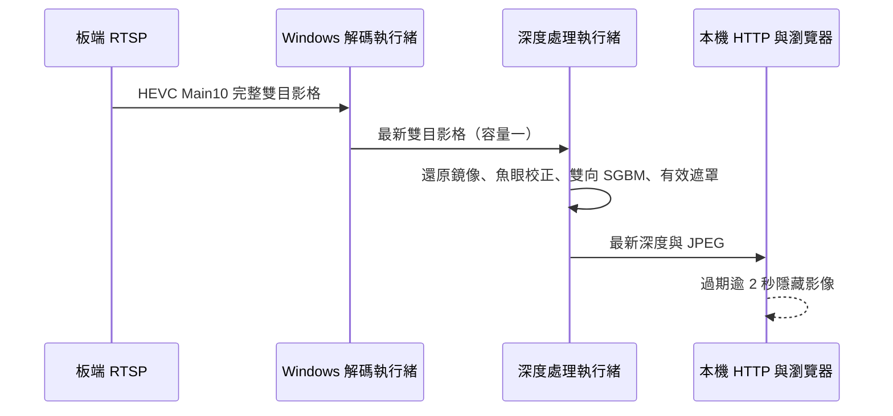

# SC132GS 即時深度預覽

在 Windows 上讀取既有 RTSP，計算深度後以 HTTP MJPEG 提供本機預覽：
[即時預覽](http://127.0.0.1:8765/)。板端程式、設定與校正參數不變。
這是沿用離線實驗的 Python 工具，未新增產品 C++ public API。



## 執行與停止

專案根目錄 PowerShell：

```powershell
# 第一次建立環境時（若已有離線深度環境可略過建立步驟）
python -m venv outputs\slam_benchmark\depth-preview-venv
outputs\slam_benchmark\depth-preview-venv\Scripts\python.exe -m pip install -r outputs\slam_benchmark\live-depth\requirements.txt
# 啟動隱藏背景程序
& outputs\slam_benchmark\live-depth\start.ps1
# 停止；不會停止板端原有 RTSP
& outputs\slam_benchmark\live-depth\stop.ps1
```

啟動前應先停止既有的本工具實例。日誌為 `stdout.log`、`stderr.log`；
結束時寫入 `last-run.json`。停止檔於下次 start.ps1 啟動時移除。
亦可前景執行 `server.py --seconds 40 --report smoke-run.json` 作有界檢查。

## 介面及語意

- `/stream.mjpg`：1088×730 左影像／深度對照；`/snapshot.jpg` 為單張。
- `/depth.npy`：float32、640 列 × 544 欄，公尺，對齊校正後實體左眼 cam1；光軸 Z，無效 NaN。
- `/mask.png`：544×640，255 有效、0 無效。各下載請求各取最新結果，不保證跨端點同一影格。
- `/status.json`：處理 FPS、已解碼／處理／略過數、有效比例、重連次數、錯誤代碼及本機影格年齡。
- 無輸出或解碼後超過 2 秒，數值／快照／新 MJPEG 請求回 503；既有 MJPEG 連線關閉，頁面隱藏舊影像並重試。
- 只監聽 `127.0.0.1:8765`；未設定自動開機啟動。RTSP 斷線以 1–8 秒退避重新連線。

左右影像來源假設與離線版相同：2176×1280，左半 cam0／實體右眼，右半 cam1／實體左眼，逐眼水平鏡像。
尺寸改變時拒絕計算；未自動偵測同尺寸下的鏡像或眼別變更。
直接在原始 1088×1280 座標計算魚眼映射，輸出到每眼 544×640，使用相應 P/Q，沒有直接沿用原解析度焦距。
SGBM 搜尋 128 視差、5×5 視窗、唯一性 10、雙向一致性 1 像素；無平滑補洞。
色尺 0.2–3.0 m，僅顯示顏色截斷，數值不因此截斷。

FPS 為最近最多 120 張完成結果的速率。影格年齡從本機解碼輸出時計算，
不包含未測量的相機／編碼／網路／解碼排隊延遲，不能稱為端到端延遲。
只處理最新完整雙目影格；慢速瀏覽器不會阻塞解碼或深度計算。
JPEG 為有損顯示，精確遮罩及深度應讀取 PNG／NPY。
距離尺度沿用 20 mm 方格假設。重複紋理、無紋理、遮蔽和校正誤差仍可能造成錯配，
有效遮罩不是準確度保證；此版本未接受為避障測距來源，也未宣稱 30 FPS。

## 驗證

```powershell
outputs\slam_benchmark\depth-preview-venv\Scripts\python.exe -m unittest discover -s outputs\slam_benchmark\live-depth -p test_server.py -v
```

測試包含：無紋理影像不補造深度、錯誤尺寸拒絕、過期端點 503、有效端點回傳及斷線立即清除結果。
實機串流證據見 `smoke-run.json`、`live-preview.jpg`，它們屬於有界檢查，並非長時間可靠性驗收。
