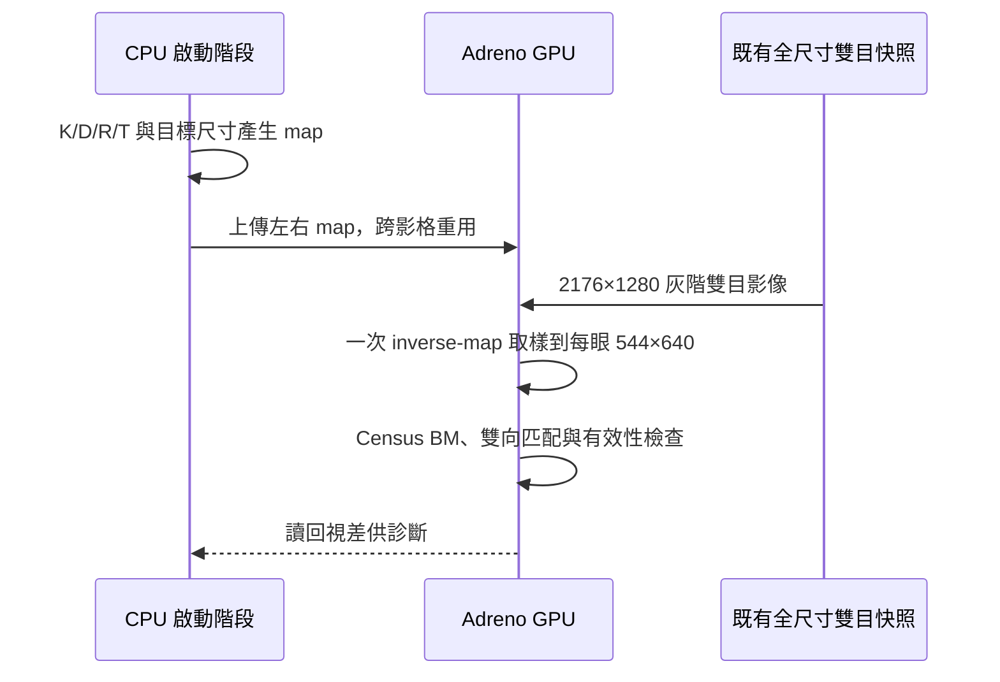

# GPU 合併去畸變、立體校正與縮放

已實作在獨立 C++17 OpenCL 測試程式，不修改相機 driver／設定，也未取代目前 PC 即時預覽。
來源仍是既有 RTSP 解碼快照，非即時 V4L2／RAW10 擷取。
完整 2176×1280 雙目影像，在 GPU 一次查表取樣後輸出每眼 544×640：
逐眼鏡像還原、魚眼去畸變、立體對齊及尺寸縮減共用這次取樣，沒有中間全尺寸校正圖。



## 校正與插值

沿用候選 K/D/R/T，以 `fisheye.stereoRectify(newImageSize=(544,640))`
及 `initUndistortRectifyMap` 建立從半尺寸輸出到原始每眼 1088×1280 的 inverse map。
P/Q 使用這個輸出尺寸；沒有將全尺寸焦距直接用於半尺寸視差。

以 OpenCV `convertMaps` 明確選擇 1/32 pixel 固定座標。
OpenCL 使用相同整數權重、四鄰點雙線性插值及零值邊界；讀取來源時直接換算鏡像座標。
實際快照的左右合計 696,320 個像素，與 CPU 固定座標 `remap` 完全一致。
另以漸層來源及人工 map 驗證負座標、影像邊界、分數座標與眼別／鏡像。

先前 OpenCV 5.0 浮點 map 路徑與本次明確固定座標路徑，在快照中每眼分別有
6,366／8,211 個像素不同，最大差異 2 灰階。因此本次精確相等的參考是
**CPU 固定座標 remap**，不能宣稱與先前浮點路徑的最終深度完全相同。
新參考的完整視差與 GPU remap + 最佳化 BM 結果完全一致；BM 仍非 SGBM。

## 30 次有界測試

| 項目 | 中位時間 |
|---|---:|
| 雙眼合併 GPU remap | 1.757 ms |
| 全尺寸影像上傳＋GPU remap＋匹配＋視差讀回 | 33.354 ms |

整段 p95 為 35.285 ms。map 僅在啟動時上傳，不計入每張時間；每張的影像上傳有計入。
不包含擷取、RTSP 編解碼／網路、map 產生與視差轉公尺，未驗證完整即時 30 FPS 或測距準確度。
本次兩組測試前後相機服務均 active、PID=2641，設定檔 SHA256 相同。
這是本次有界窗口的證據，不代表其他工作期間相機程序從未重啟。

## 重現

在專案根目錄執行（只覆寫此實驗的具名輸出）：

```powershell
outputs\slam_benchmark\depth-preview-venv\Scripts\python.exe outputs\slam_benchmark\opencl-depth-20261015\benchmark.py --fixed-remap --mode reference --label rectify-cpu-reference --iterations 3
outputs\slam_benchmark\depth-preview-venv\Scripts\python.exe outputs\slam_benchmark\opencl-depth-20261015\benchmark.py --gpu-rectify --label rectify-photo --iterations 30
outputs\slam_benchmark\depth-preview-venv\Scripts\python.exe outputs\slam_benchmark\opencl-depth-20261015\benchmark.py --gpu-rectify --rectification-case borders --label rectify-border-check --iterations 1
outputs\slam_benchmark\depth-preview-venv\Scripts\python.exe outputs\slam_benchmark\opencl-depth-20261015\rectification_summary.py
```

## Binning 的取捨

這條路徑可以先不切 binning，並且省掉獨立的縮放步驟。
感測器、MIPI、V4L2 與 CPU→GPU 仍承擔原生全尺寸資料量；binning 才能減少這些上游資料量。
之後整合即時擷取時，需再處理輸入格式、buffer lifetime、時間戳與 GPU 資料共享。
