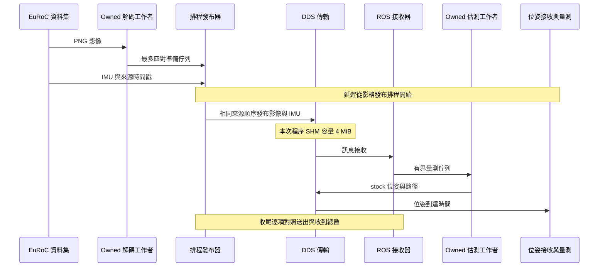

# RUBIK Pi 3：提前解碼回放通過

2026-10-13，ROS Humble／Fast DDS 2.6.12。這是 EuRoC 雙目 752×480、20 Hz 與 IMU 200 Hz 的資料集回放，沒有使用板上相機／IMU 即時資料。

## 本輪目標與結果

修正提前解碼版本的 IMU 漏收，確認資料完整後再比較精度與延遲。只將程序範圍內的 DDS SHM 容量設為 4 MiB；OpenVINS、接收器／發布器 binary、YAML 與 topic QoS 都未改。

| 資料集 | 完整回放 | 漏收 | 位姿延遲 P95 | 最大延遲 | 位置 ATE RMSE |
|---|---:|---:|---:|---:|---:|
| MH_01_easy | 2 | 0 | 48.8–49.5 ms | 86.4–97.7 ms | 12.00 cm |
| V2_02_medium | 2 | 0 | 56.5–57.2 ms | 77.6–82.2 ms | 5.53 cm |

四次共收到 12,060 對影像、120,620 筆 IMU，初始化後位姿涵蓋率 100%。ATE 與原零漏收基準完全相同。初始化前沒有位姿，不等於全段涵蓋率 100%。最大值是本輪觀測，不是產品最差延遲保證。

PNG 解碼已移到影格發布排程之前，延遲由該排程到 stock `/poseimu` 收到計算。解碼仍消耗 CPU；原版約 78 ms P95 包含排程後解碼，量測範圍不同，而且是先前板子運作期間的對照，不能把差額全歸為演算法加速。實體曝光到位姿延遲仍未驗證。

## UML 流程

工作者由所屬物件管理，停止時喚醒並 join。估測工作者仍唯一存取估測器；沒有因本輪修正改變公開 C++17 API 或核心演算法。

## 證據與檢查

- `report.html`：可閱讀報告與 CPU 資料。
- `comparison.json`：逐次延遲、精度、初始化涵蓋率及背景抽樣。
- `provenance.json`、`tested-sources/`：受測來源、binary 與 YAML 雜湊。
- `raw-sha256.json`：162 份原始證據；本機驗證通過。
- `gate-validation.json`：完整測試後改回 512 KiB 漏收 98 筆，檢查器回傳 4；4 MiB 零漏收、回傳 0。
- `../delivery-shm4m-payload/validation.json`：120 對影像逐像素、1,201 筆 IMU 數值的獨立 DDS 接收驗證。
- `full-container-shm.jsonl`：容器實際 IPC namespace 的容量觀測。`short-shm.jsonl` 只監看 host namespace，不能用來證實容器容量。

明確 512 KiB 與 4 MiB XML 只有容量不同，且反向對照重現漏收。這支持 SHM 容量是問題原因；未直接捕獲 DDS 內部覆寫事件。沒有更換 IMU best-effort 為 reliable，避免將 QoS 改變混入容量對照。

## 使用入口與狀態

容器內執行 `/ws/slam_benchmark/run-frame-ready-replay.sh DATASET/mav0 NEW_OUTPUT_DIRECTORY`。入口為本次程序載入 4 MiB XML，再執行 `ros-replay-native-checked.py`：輸入總數不符回傳 4，接收器錯誤／未收束量測回傳 5，並保留證據。完整位姿與正常退出不再取代輸入完整性檢查。

本輪開始與結束相機服務均 inactive，相機設定與 runtime state 雜湊未變，保留使用者原暫停狀態。下一階段需將實體雙目與 IMU 的標定、時間戳和同步納入即時輸入；OpenVINS 此處驗證 VIO，完整建圖與迴環校正另需驗證。

離線重建報告依序執行 `analyze-ros-replay.py`、`analyze-delivery-repair.py`、`finalize-delivery-repair.py`，使用已下載的紀錄與 NumPy，不需連線板子。`finalize-delivery-repair.py` 在精度、完整性與失敗檢查都通過後才更新本機狀態。
