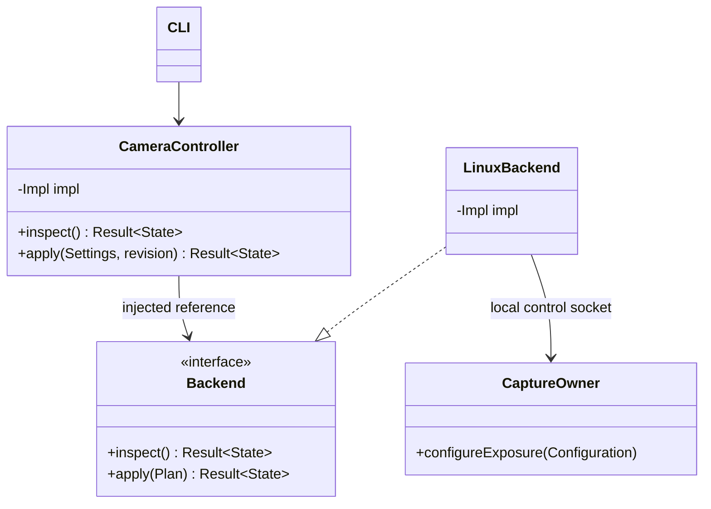
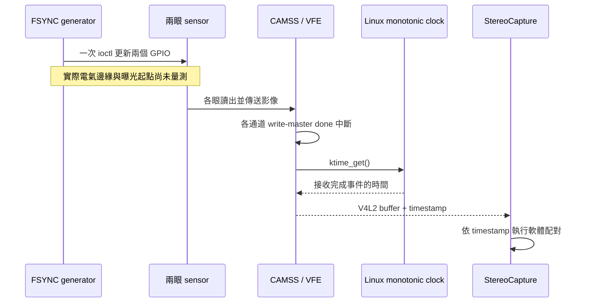
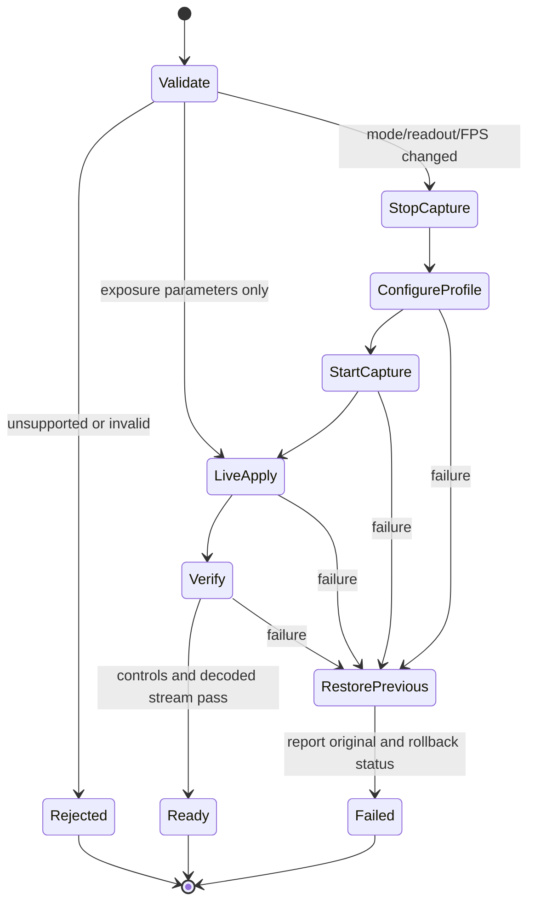
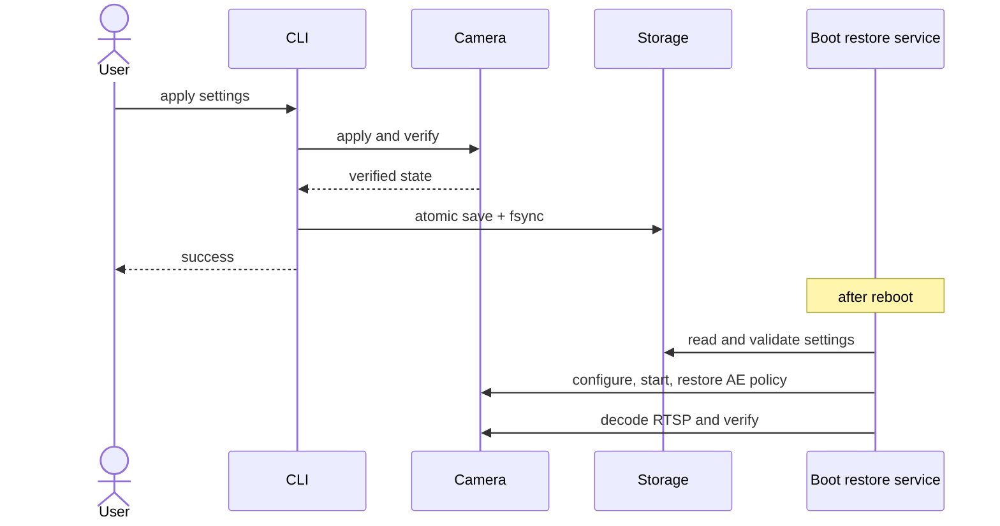

# 統一相機設定 CLI

目前預設（2026-10-12）：**Linear、全解析度、60 FPS、AE on、target30**。
`sc132gs-camera reset` 套用並保存這個設定；板子開機恢復最後保存的
`/var/lib/sc132gs-camera/settings.yaml`。初始設定範例見 `settings.example.yaml`。
使用者確認切回 Linear 看不到霧狀，HDR 調整暫時停止。

長曝光品質尚待修正（2026-10-12）：使用者回報 HDR 固定霧狀紋理。
下面的暗部品質數據只涵蓋逐幀雜訊，不能視為固定紋理已消除。
目前採用 Linear60；診斷紀錄見 `diagnostics/hdr-tuning-20261012/HAZE_RESULT.zh-TW.md`。

2026-10-12 長曝光版本已在 OpenVINS 三個套件建置完成後重開套用，
8/8 CTest 通過。已載入驅動的寄存器控制範圍是 4492；正式 owner 採
實測可出圖的保守上限 4350，因 15 FPS 手動設定 4492 曾造成停流。
HDR 在 30 FPS 保留 1492 上限；20 FPS 為 3629、24 FPS 為 2560、
15 FPS 為 4350 nominal rows，各代表曝光值皆已實機解碼與檢查 cadence。
重啟前先在 STREAMOFF 套用新曝光 seed，避免舊長曝光帶到較高 FPS。
降低 FPS 後，AE 即使已在 target 附近，也會利用新增曝光餘裕逐步降低 gain。

先前診斷使用 `sudo sc132gs-camera apply --mode hdr --max-fps 15 --ae on --ae-target 30`。
與 Linear 30 FPS 同 target 的中位亮度接近，亮部飽和由約 4% 降至 0，
四個未編碼暗部區塊的對比／殘差雜訊比提升約 34～38%。不能外推到
所有場景、target 或相同 FPS；HDR 亮部壓縮使整區平均仍比 Linear 低。

2026-10-12 HDR sensor profile：新增 `--ae-target 0..100`，與既有
`--brightness` 共用保存欄位。兩個選項不能在同一命令重複指定。
目前板端不套用顯示曲線。未 binning 的 Main10 sensor profile 扣除
實測黑位（Linear=37、HDR=53）並線性正規化到 0..1023，gamma=1。
校正公式為 `round(1023*clamp((gray10-B)/(1023-B),0,1))`；
兩種模式的 AE target 都對應校正後有效灰階中位數：`round(1023 * target / 100)`。
例如12%=123、70%=716。兩種模式都使用每眼中央80%區域的 P50，
不是全畫面平均亮度，也不是VLC顯示亮度。

```bash
# 設定並保存有效灰階 target，同時開啟 AE。
sudo sc132gs-camera apply --ae on --ae-target 12
sudo sc132gs-camera status
sudo sc132gs-ctl status
```

公開 CLI 回報 `ae_target_percent`。底層 status 回報
`target_kind=sensor_signal_percent`、`signal_black_raw10`、`signal_target_luma10`。
HDR 另回報 `hdr_target_raw10`（`B+round((1023-B)*target/100)`）、
`cam0_shadow_raw10`／`cam1_shadow_raw10`，以及
`brightness_limited`／`highlight_limited`。
設定被接受不代表場景必然能達標；亮部限制、曝光或增益上限
可能使 target 無法達到，控制器會保留限制並回報。
Linear 不再透過舊 BT.709 顯示曲線反算 AE target；切換模式時保留 target。
HDR 另以原始 RAW 過曝統計限制曝光，因此高 target 可能受限，不能保證
所有 target 都與 Linear 一樣亮。明確選用 B profile 時才使用
B 對應的 target 換算，預設 sensor profile 不啟用此功能。

已部署 `/usr/local/bin/sc132gs-camera`，支援執行中套用設定。預設為 **Linear、binning off、MAX FPS 60、AE on、有效灰階目標 30%**；使用 `reset` 恢復並保存。RTSP 位址為 `rtsp://192.168.137.226:8554/stereo`。

本質上，模式與讀出方式決定 FPS、解析度和曝光能力，不能把它們視為互不相干的寄存器開關。CLI 用完整設定交易套用，並分開回報使用者的 FPS 上限、實際採用的 FPS、接收時間戳量測 FPS，以及曝光／增益的即時值。

## 操作

日常操作統一使用 `sc132gs-camera`。舊 `sc132gs-ctl` 目前仍供底層啟動腳本使用，不建議作為第二個使用者設定入口；它不提供完整 YAML 保存交易。內部 helper 與公開 CLI 尚未完成檔案／安裝路徑的整理。

以下命令在 RUBIK Pi 上執行：

```bash
sudo sc132gs-camera capabilities
sudo sc132gs-camera status

# 指定 24 FPS；AE 會依實際幀率更新曝光預算。
sudo sc132gs-camera apply --mode linear --binning off --max-fps 24 --ae on

# 恢復預設並保存：Linear、全解析度、60 FPS、AE on、target30。
# 同時解除使用者曝光上限，增益上限恢復 index 128。
sudo sc132gs-camera reset

# Linear，半解析度，AE；亮度為顯示灰階百分比。
sudo sc132gs-camera apply --mode linear --binning on --max-fps 60 --ae on --brightness 40

# 關 AE 並設定 8 ms 曝光、最低增益。
sudo sc132gs-camera apply --ae off --exposure-us 8000 --gain-index 0

# 只關 AE：凍結當下曝光／增益，不套用另一套預設值。
sudo sc132gs-camera apply --ae off

# AE 曝光時間上限 8 ms，增益 LUT index 上限 32。
sudo sc132gs-camera apply --ae on --max-exposure-us 8000 --max-gain-index 32

# 解除使用者曝光時間限制；仍受 FPS 和感測器控制範圍限制。
sudo sc132gs-camera apply --ae on --max-exposure-us 0 --max-gain-index 128

# HDR 全解析度；requested MAX FPS=60，effective FPS=30。
sudo sc132gs-camera apply --mode hdr --binning off --max-fps 60 --ae on --max-exposure-us 0

# HDR 手動曝光。TOTAL nominal rows 與 Linear 微秒是不同單位。
sudo sc132gs-camera apply --ae off --hdr-total-rows 1000 --gain-index 0

# Linear 全解析度。
sudo sc132gs-camera apply --mode linear --binning off --max-fps 60 --ae on
```

未指定的模式、AE、亮度與限制參數保留當下設定。模式改變時，亮度目標保留，增益上限依設定交易規則採用該模式預設。手動曝光值不會跨模式以錯誤單位直接複製：Linear 讀出切換時按行時序換算時間，HDR 與 Linear 間採用各模式安全預設；如需確切手動值，必須明確指定。

AE 開啟時，`--exposure-us`、`--hdr-total-rows`、`--gain-index` 這些手動設定會被拒絕，避免同時宣告兩種控制者。AE 自動調整曝光／增益；此時使用亮度與上限參數。

`gain-index` 是目前驅動的 vendor LUT 索引，並非 dB。HDR AE 先增加 TOTAL 到上限，再增加 gain，並受增益上限與亮部保護限制；HDR 的微秒換算尚未校準，因此 `--exposure-us` 或正值 `--max-exposure-us` 在 HDR 下會被拒絕。

## 模式能力

| 模式 | Binning | 每眼解析度 | 支援整數 FPS | 曝光控制 |
|---|---|---|---|---|
| Linear | off | 1088×1280 | 1～60 | 微秒；AE 可用 |
| Linear | on | 544×640 | 1～60 | 微秒；AE 可用 |
| HDR | off | 1088×1280 | 1～30 | HDR TOTAL nominal rows；AE 可用 |
| HDR | on | 尚未驗證 | 不提供 | 整組設定拒絕，保留原串流 |

`MAX FPS` 是整數上限：Linear 設 24 → effective 24、設 50 → effective 50；HDR 設 24 → effective 24、設 60 → effective 30。上限超過模式能力時會採用模式最高 FPS，非正值或小數會拒絕。此次提供整數範圍，並以邊界及代表中間值進行實機驗證，未逐一完成每個整數的長期穩定性測試。120 FPS 尚未加入正式設定入口。CLI 同時回報 requested、effective 及接收時間戳量測 FPS；PTS cadence 與 decoder 消費速度是不同量。

Linear full 的行率為 84000 rows/sec；binning 在 3～60 FPS 為 162000 rows/sec。1、2 FPS 的 binning 將 HTS 延長 3、2 倍，以避免 16-bit VTS 溢位，AE／手動曝光換算相應使用 54000、81000 rows/sec。VTS、HTS 均會讀回檢查。

Linear AE 的曝光 ceiling 取「固定 requested effective FPS 的曝光預算、使用者最大曝光時間、感測器 2560 rows 控制上限」最小值。未 binning 且 FPS<=30 的非重疊觸發 profile，額外預留 1350 rows 的讀出／重設時間（實測 3260/61=1334 rows），再取可用曝光時間的 95%。高 FPS override 與 binning 保留原本 95% 幀週期預算。實際 FPS 由影格時間戳獨立回報；掉幀不再反過來放大曝光上限。更新頻率依 FPS 調整：60 FPS 每 4 對、24 FPS 每 2 對、低 FPS 每對影格更新。`max_exposure_us=0` 表示不加使用者限制，實際上限由 `exposure_ceiling_rows` 回報。

例如 full 60 FPS ceiling=1330 rows（約 15.83 ms）、48 FPS=1662 rows（約 19.79 ms）、30 FPS=1377 rows（約 16.39 ms）、24 FPS=2042 rows（約 24.31 ms）。30 FPS 的 1377 rows 已量到約 30 FPS；1480 rows 則掉到約 15 FPS。Binning 24 FPS 仍受 2560 rows（約 15.8 ms）限制；1 FPS binning ceiling 約 47.4 ms，不宣稱能曝光整整 1 秒。HDR 使用上述 FPS 對應的 TOTAL nominal rows 上限，不使用未校準的微秒換算。超範圍手動設定在修改串流前拒絕；AE 開啟時會將舊曝光縮限至新預算。

## C++17 public API

乾淨 API 在 [CameraConfiguration.hpp](CameraConfiguration.hpp)，政策實作在 `CameraConfiguration.cpp`，Linux 資源／程序相依藏在 `LinuxBackend` 的 PIMPL；Linux helper 只處理平台操作。CLI 與未來 GUI 可以使用同一個 `CameraController`。

```cpp
sc132gs::configuration::LinuxBackend backend;
sc132gs::configuration::CameraController camera(backend);
auto result = camera.inspect();
if (const auto* state = std::get_if<sc132gs::configuration::State>(&result)) {
    auto config = state->settings;
    config.maximum_fps = 60;
    config.exposure.automatic = true;
    auto applied = camera.apply(config, state->revision);
    // applied 是 State 或結構化 Error；不以 callback 表示同步結果。
}
```

`CameraController` 與 `LinuxBackend` 都 move-only。必要 backend 以 reference 注入，必須比 controller 存活更久。每個 controller 採單一呼叫端使用；跨程序套用由 RAII file lock 序列化。revision 防止過期的 CLI 設定覆蓋另一個已完成交易。AE 的控制提交與每幀調整以同一個 mutex 序列化。



## 套用流程

重啟／開機復原的串流驗證先量測 8 秒 H.265 access-unit PTS 幀率，再軟體解碼 5 張確認尺寸與影像內容。兩項證據分開保存為 `encoded.json`、`decode.json`；短段解碼不代表解碼器能持續消費設定 FPS。完整 60 FPS 軟體解碼曾搶占板上 capture／encode 資源，導致驗證本身造成掉幀，因此不能以該吞吐率拒絕正常的設定。2026-10-12 的 Linear60 reset、保存及同一開機復原入口已實機通過，Windows 另解碼約 8 秒、482 張、60.00 FPS；本次未重新開機。

AE、曝光、增益、亮度／上限參數在目前 capture owner 内同步套用，不建立第二個 V4L2 擷取 owner。關 AE 時，省略的手動曝光／增益會取處理交易當下的值。

模式、binning 或 effective FPS 改變時，停止已知串流 owner，確認 capture device 無其他 owner，設定兩眼與 media graph，再啟動單一新 owner。binning 先用已驗證 120 FPS PLL 表格啟動，接著讀回 VTS（60 FPS=2700、30 FPS=5400），最後才啟用 AE。過程不熱重載 CAMSS。

全解析度 Linear 31～59 FPS 先啟用高幀率讀出，再設定對應 VTS，最後才套用 AE。full 31～60 FPS 與 binning 使用半幀週期加 0.5 ms 的接收時間戳配對視窗；full 1～30 的 0.5 ms 門檻保留。60 FPS 重啟時也曾因原 0.5 ms 門檻而完全無法配對或丟棄大量影格，因此採用相同的高幀率策略。配對視窗是軟體策略，不是曝光同步規格；最近接收時間也不保證是同一次曝光。FSYNC generator 以一次 GPIO ioctl 同時更新 GPIO18、GPIO19，但接收時間戳和共同 GPIO 命令都不能證明兩眼曝光開始時間一致；本次 FPS／解碼驗證沒有證明物理曝光同步，也沒有用放寬配對門檻宣告曝光同步。

### Timestamp 的來源

`StereoCapture` 直接讀取 V4L2 buffer 的 `timestamp`，不是應用程式在 dequeue 時重新取樣。已讀取本機接收模組的反組譯，確認 `vfe_isr_wm_done` 呼叫 `ktime_get`；磁碟與已載入 CAMSS 的 srcversion 同為 `6836E35C0AA1F2FCD21FCBD`。這是 Linux 系統單調時鐘，兩眼共用時基，各自在接收完成中斷取樣。

對外的雙目 RTSP 是一張左右合成影格、共用一個 PTS；現有輸出已採第一眼的 V4L2 timestamp 作為參考，減去第一張輸入影格的參考時間。對話中的第一眼「cam1」對應程式的 `cam0`／`left`，第二眼「cam2」對應程式的 `cam1`／`right`。內部 `FramePair` 保留兩眼原始接收 timestamp，先完成配對，再使用第一眼的時間供 AE 與串流輸出；不覆寫第二眼的原始時間。共同 FSYNC 是曝光同步的設計前提，對外共用 PTS 不代表物理曝光同步已獲量測證明。

[Linux 6.8 VFE480 上游實作](https://github.com/torvalds/linux/blob/v6.8/drivers/media/platform/qcom/camss/camss-vfe-480.c#L368-L413) 在 write-master done 中斷路徑取 `ktime_get_ns()`，寫入完成影格的 timestamp。上游原始碼用於對照語意，並非宣稱取得了這台 Ubuntu 已安裝模組的完整原始碼。這個時間包含讀出、傳輸及中斷處理的影響；它不代表 FSYNC 電氣邊緣或開始曝光的時間，也不能用接收時間差推定曝光偏差。





新 owner `sc132gs-camera-rtsp.service` 的退出流程不自行啟動其他相機服務。舊 `sc132gs-ctl set-mode` 在新 owner 執行中會回覆 busy，避免兩個模式協調者同時修改相機。CLI 的檢查／回復錯誤會區分結構化 ErrorCode、系統 errno 與 rollback_failed。

## 驗證證據

- C++20 Release build 完成，CTest **6/6 通過**，包括 FPS 上限選擇、不支援組合、曝光單位／範圍及 move-only 契約。程式修改通過 `git diff --check`。
- 實機切換：Linear binning 30、Linear full 60、HDR full 30、Linear full 30、Linear binning 60；每次結構變更都經實際 RTSP 軟體解碼、解析度與 PTS FPS 檢查。
- Linear binning 手動 8000 µs → 1296 rows；4000 µs → 648 rows，雙目控制讀回符合。HDR 手動 TOTAL 1000 rows 成功。AE 開／關及曝光／增益上限可於執行中套用。
- 失敗注入僅位於獨立 `probe_configuration_rollback.py`：實際切到 full Linear 30 且解碼成功後刻意回報一次驗證失敗，再回復 binning Linear 60、AE on、原 revision；回復後再次成功解碼。結果 `rollback_failed=0`，`rollback_probe=passed`。沒有加入正式 helper 的故障開關。
- HDR＋binning、30 ms 的 binning 手動曝光被拒絕；revision 11 與原串流保持不變。舊 mode CLI 在新 owner 執行中回覆 busy。
- 最終 15 秒：**896 個不同解碼 frames，PTS 59.9987486 FPS，1088×640**；AE on、error_errno=0。最後狀態讀值為曝光 2519 rows、gain index 0，但這些會隨 AE 持續改變。
- 此流程後 kernel error 級別日誌為空。

本地實際解碼證據與 manifest 在 `configuration-evidence-20261007/`；完整模式切換／CLI 交易回應也保留於本對話工具紀錄。

### 新增整數 FPS 與 AE 驗證

2026-10-07 已部署新增範圍；政策測試涵蓋每個整數 FPS，實機選取以下代表值，每次均檢查控制讀回、實際 RTSP 解碼、解析度、非固定影像和 PTS 幀率。

| 模式 | 實機通過 FPS |
|---|---|
| Linear full | 1、2、15、24、31、48、59、60 |
| Linear binning | 1、2、3、24、47、60 |
| HDR full | 1、24、30 |

AE 實機交易亦通過：full 24 FPS 手動 28 ms = 2352 rows；保留此手動曝光直接改 60 FPS 會在修改串流前拒絕，原 revision 保留。改成 60 FPS 並開 AE 時縮限至 1330 rows；24 FPS 加上使用者 8 ms 上限時縮限至 672 rows；解除使用者上限後恢復 2560 rows ceiling。這些結果證明幀率與曝光政策生效，未證明物理曝光同步或所有整數 FPS 的長期穩定性。

24 FPS＋AE 從 YAML 重開機恢復成功，boot ID `a3a945b1-30a4-4ff8-822f-ad497503d09f`，revision 42 保留；10 秒取得 238 張不同解碼影像，2176×1280，PTS 23.998812 FPS。之後恢復 60 FPS 的兩次交易曾被原 0.5 ms 配對門檻擋住或造成大量丟幀，均成功回復 24 FPS；修正 60 FPS 的接收時間配對策略後，`reset` 成功保存 revision 43、Linear、無 binning、60 FPS、AE on、ceiling 1330 rows。最後 10 秒取得 447 張不同解碼影像、PTS 60.004126 FPS，軟體解碼速度約 45 FPS。C++ 測試再次 6/6 通過。

最後串流日誌在解碼負載期間仍有少量接收序號缺口，某個 5 秒視窗約 55.9 pairs/sec，之後回到約 60 pairs/sec。通過短期解碼與 PTS 驗證不等於全程無丟幀，也不等於同一次曝光的配對已得到證明。

這批證據位於 `configuration-evidence-20261007/integer-fps-20261007/`，包括交易回應、重開機設定比對、解碼 JSON／影像、最終串流日誌及已載入 CAMSS 時鐘呼叫的對照。`summary.json` 保留最後設定與各項交易結果；兩次未通過的 60 FPS 恢復亦保留失敗日誌。

## 重開機保留設定

每次 `sc132gs-camera apply` 或 `reset` 成功且驗證通過後，自動保存至 `/var/lib/sc132gs-camera/settings.yaml`。以暫存檔、fsync、原子替換及目錄 fsync 完成寫入；套用失敗時回復上一組設定。設定存檔失敗也會回報交易失敗。

YAML 採用安全解析器，拒絕重複／未知欄位和超範圍設定；`binning`、`ae` 可寫 `true/false`。既有 `settings.json` 會在第一次恢復時自動轉換成 YAML，原 JSON 保留備份；當 YAML 已存在時只讀 YAML，解析錯誤不退回過期 JSON。Linux helper 需要 `python3-yaml`。`/run` 的執行狀態和解碼證據仍使用 JSON。

`reset` 不接受額外選項，使用和 `apply` 相同的驗證、revision、回復及保存交易。完整預設是 Linear、binning off、MAX FPS 60、AE on、brightness 30、無使用者曝光時間上限、max gain index 128；曝光／增益由 AE 自動收斂。

YAML／reset 實機驗證：既有 JSON 自動轉換成功，重複欄位、未知欄位、非法型別／範圍與不安全 YAML tag 均被拒絕；C++ 測試 6/6 通過。`reset` 從 binning 模式成功切回全解析度並保存 revision 13，帶額外選項的 reset 被拒絕。再次重開機（boot ID `ba9da222-5ca3-4b9d-b599-adf1f2ad12e0`）自動從 YAML 恢復 Linear、binning off、AE on、60 FPS；開機 RTSP 初始化／PTS 驗證失敗後由既有 service 自動重試兩次並成功。最後 10 秒軟體解碼 200 個不同 frames，2176×1280，PTS 60.0046 FPS；此實機軟體 decoder 消費速度約 20 FPS，不能把 PTS cadence 當成軟體解码吞吐。證據位於 `configuration-evidence-20261007/yaml-reset-reboot-20261007/`。

保存模式、binning、FPS 上限、AE 開關、亮度目標、曝光／增益限制。手動曝光／增益會恢復原設定；AE 開啟時保存當次交易的起始曝光／增益，開機後繼續自動調整，不把每幀 AE 更新寫入儲存裝置。`/run` 只保存本次開機狀態。

`sc132gs-camera-restore.service` 已設定開機執行。它先檢查存檔格式與範圍，載入感測器及 CAMSS，再配置雙目、啟動串流、恢復曝光政策並實際解碼驗證。失敗會停止未完成的串流，systemd 每 10 秒重試；查詢 `systemctl status sc132gs-camera-restore.service` 可判斷是否恢復完成。沒有增加另一個會繞過曝光政策的串流重啟流程。

已驗證的 binning 感測器驅動安裝於目前 kernel `6.8.0-1084-qcom` 的 `extra/sc132gs.ko`。原驅動及雜湊留在 `/var/lib/sc132gs-camera/backups/6.8.0-1084-qcom/`。安裝與恢復不熱重載 CAMSS；未來換 kernel 必須重新編譯及安裝相容驅動。本功能不增加 HDR＋binning 或 120 FPS 支援。

實際重開機驗證：修正首次開機 media links 尚未啟用時的 owner 檢查後，再次重開機，boot ID 從 `32ea68cf-e469-46fe-a61a-f45559636ac3` 變成 `d42a9d05-2d8a-4835-ada0-73d4e6ec1936`。開機服務首次執行即成功，存檔與 `/run` 設定完全一致，保留 revision 12、Linear、binning on、MAX FPS 60、AE on、brightness 40。15 秒實際解碼得到 896 個不同 frames、1088×640、PTS **59.997676 FPS**；雙眼畫面已檢視。證據位於 `configuration-evidence-20261007/reboot-persistence-20261007/`。開機 error 級日誌有平台 remoteproc/QMI、Wi-Fi 和音效訊息，未見相機相關核心錯誤。


