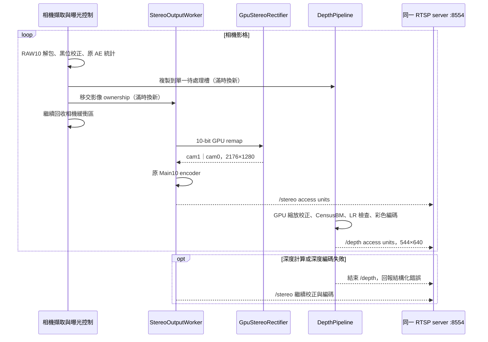

# Main10 GPU 校正與同一 RTSP server 的深度支線

`--gpu-rectification-map <file>` 啟用完整 10-bit 魚眼校正與雙目對齊，
輸出仍是 2176×1280（每眼 1088×1280），左半 cam1、右半 cam0。
GPU 直接以原生影像座標取樣，不再套用舊合成路徑的各眼鏡像。
`--depth-calibration <directory>` 在同一程序、同一 GstRTSPServer 增加 `/depth`；
預設服務埠 8554。兩個選項均為空時維持原路徑。
本輪驗證限定 full-resolution Linear/Main10/external-trigger/30-FPS 組合；
depth encoder 目前使用 30-FPS 時間基準，其他模式未驗證。



`StereoOutputWorker` 與 `DepthPipeline` 都以 PIMPL、RAII 和內嵌 Observer 協作；
相依由建構子注入，影像與 access-unit 的借用期限在 header 註明。
各自只保留一張待處理影格；處理趕不上時丟棄舊影格，保留來源時間戳間隔，
不累積延遲。擷取執行緒不等待 GPU 或 VPU，避免阻塞相機 QBUF。
深度例外只更新深度狀態及深度 EOS，不設定 stereo 的停止旗標。
GLib media callback 以 shared state 保持生命週期，不持有已銷毀的 parent pointer。

同程序可隔離一般 depth 計算／編碼錯誤，但程序崩潰、共同 GPU 驅動故障、
相機或 FSYNC 上游失敗仍會影響兩路。不能把執行緒隔離當作程序隔離。

原生曝光統計在幾何校正之前計算，沿用原曝光控制器與控制 socket。
啟用 GPU 幾何校正不會開關 AE 或改變曝光設定。
本輪開始時 AE 為 off、target 30、1377 rows、gain index 34；實測曾暫時開啟 AE、
改 target 40，再還原。Main10Encoder、相機 driver、FSYNC 保護與校正候選檔均不修改。

校正候選來自 `calibration-ready-20261014/geometry-analysis/stereo-candidate.npz`，
SHA-256 `819d0befaabe1973d299107b0a181e6ec93853a641840e3c9da04e1c84d4732b`。
cam1 為左參考的判定來自外參，尚未以遮鏡頭驗證實體左右。
距離沿用 20 mm 棋盤格假設；深度為 CensusBM 整數視差預覽，無效區域不補值。
這些變更不能證明測距準確度。

## 重現與來源邊界

工作區另有共用 Capture API 的變更。`prepare_rectification.py` 只把這次 GPU／深度
功能套到板端**實際已部署 binary 對應來源**，不把其他工作尚未部署的擷取變更一起帶上板。
原來源為 `/home/ubuntu/sc132gs-kernel-sync-20261014/userspace`，原 AE 來源為其同層 `ae`。
staging、map、測試輸出在 `/home/ubuntu/main10-rectification-20261016/`；
本地對應目錄為 `rectification-evidence-20261016/`。

- `prepare_rectification.py`：生成固定點 map、OpenCV 對照 fixture、精確來源 overlay，編譯。
- `GpuStereoRectifierCheck.cpp`：GPU identity、真實 map 對照、10-bit 低位、順序與錯誤輸入。
- `DepthPipelineCheck.cpp`：深度初始化失敗通知一次、停止及 parent 存活。
- `DepthFaultInjector.cpp`：僅有限測試 preload；第 600 次 `ring_cost` 回傳 `CL_OUT_OF_RESOURCES`。
- `test_rectification_board.py`：有限硬體測試，保存同步／AE 狀態、原檔 hash 並還原服務。
- `verify_rectified_live.py`：PC 同時解碼兩 mount，驗證像素格式、尺寸、PTS、完整觀察時間。
- `deploy_rectification.py`：通過測試後原服務原位切換；保存 binary、啟動腳本、設定與回復程序。

硬體測試與部署必須先確認沒有其他 stability monitor 占用相機。
GPU kernel 執行時間、串流解碼 FPS 與端到端延遲是不同指標；
原 8-bit 預覽的延遲數字不可當成這版 Main10 的結果。

## 2026-10-16 實測與部署

已原位替換 `sc132gs-camera-rtsp.service` 的 Main10 binary。原 camera profile、
settings.json/yaml、run-camera-profile.sh 的 hash 不變。啟動腳本只新增兩個可選
GPU 參數，systemd drop-in 保持校正啟用；沒有在 depth 失敗時退回未校正 stereo。
新版 binary SHA-256：
`0e55db0027b91a2e78a96f864a972c1fce290ee52709af9e689bbe95bc510539`。

| 證據 | 結果 |
| --- | --- |
| `fault-worker-main10` | 50 秒；注入 matching OpenCL -5，depth 結束後 stereo 持續超過 10 秒，PC stereo 約 29.75 FPS；AE on／target 40／還原均成功 |
| `healthy-worker-main10-pinned` | 300 秒板端取樣；運行期間 sync running=1、error=0；原檔與 AE 還原成功 |
| 同輪 PC 雙路解碼 | 約 269 秒；stereo 7741 張、28.74 FPS，2176×1280/yuv420p10le；depth 6420 張、23.81 FPS，544×640/yuv420p；PTS 遞增，最大來源間隔約 66.7 ms |
| `production-main10` | 常駐新版兩路連線與解碼通過 |
| `production-reconnect` | 再次連線兩路解碼通過，網頁原連線保持運行 |
| 本機預覽 `/status.json` | gray 與 depth 均 live；gray 明確回報 yuv420p10le |

前一輪 `healthy-worker-main10` 在約 84 秒遇到 FSYNC `error=14`（脈波時序保護），
已保存失敗並還原。重跑只限制測試程序於 CPU 1–6，未改 driver／保護門檻；
300 秒通過不足以證明先前時序問題已消失，也不代表雙路穩定 30 FPS。
有限測試正常關閉相機後、停止 FSYNC 前的快照可見 `error=2`；這是運行取樣結束後
的 teardown 狀態，不能與 300 秒運行期間的 error=0 混在一起。恢復／部署均以新 session
的 running=1、error=0 檢查。
這版 Main10 尚未重測端到端延遲。

板端完整備份：`/home/ubuntu/main10-rectification-20261016/production-backup/`。
需要回復時先確認相機 owner，再執行：

```sh
sudo taskset --cpu-list 1-6 python3 /home/ubuntu/main10-rectification-20261016/deploy_rectification.py rollback
```

本機彙整證據見 `rectification-evidence-20261016/summary.json`，
部署與現況分別見 `deployment.json`、`current-board.json`。
