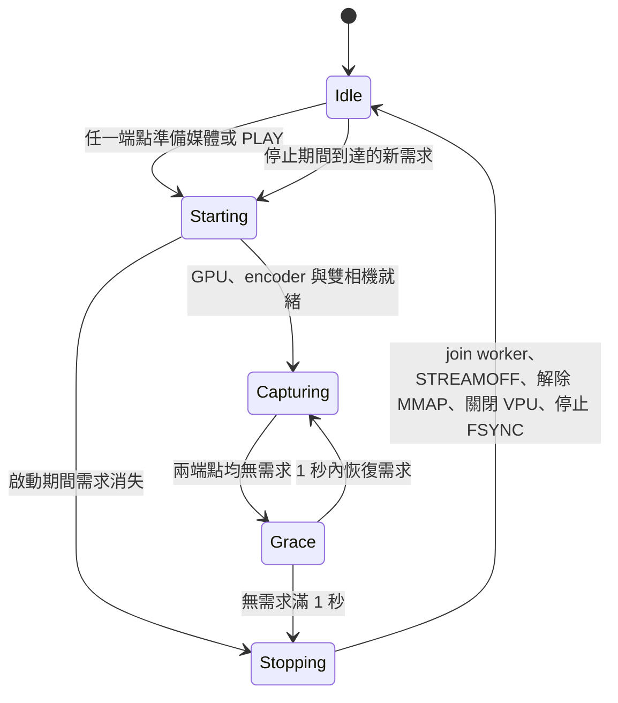

# RTSP 按需取像（2026-10-16）

部署驗證範圍是既有 full-resolution Linear 30 FPS、kernel FSYNC mode 2、shared-detail Y8 / limited-range HEVC Main，保留 GPU rectification 與 /depth。其他仍需啟動腳本在 STREAMON 後設定 timing 的 profile 保留原有持續取像行為。

`/stereo` 和 `/depth` 共用一個相機 owner。RTSP media 準備階段最多保留 10 秒暖機需求，PLAYING 期間持續保留；PAUSE 或所有使用者離開後，需求歸零滿 1 秒即要求 worker 停止。TCP ACK 與 RTCP 同樣視為連線活動；完全沒有 transport 回應滿 35 秒才關閉斷線 client，避免 TCP transport 長期保留媒體。共享媒體的狀態由 GStreamer 管理，同一路徑剩餘 client 仍播放時不能停止相機。



啟停皆經由同一個 main-context controller 協調；不在 RTSP callback 中直接 join 或銷毀硬體。取像 worker 以 RAII 管理 session 內的相機、GPU 工作與深度 encoder。停止時先結束 producer，再銷毀編碼 pipeline。AE 控制物件與 Unix socket 跨 session 保留，待命仍可讀寫控制設定。PAUSE/PLAY 在 keyframe 上接續媒體播放時間軸，避免 RTP 時間倒退或因 idle 間隔而延遲送出；相機原始時間戳保持不變。

`run-camera-profile.sh` 接受 server 的 idle-ready 訊息；待命不再被誤認為啟動失敗，也不必等到影像流動才啟用 AE。板上的 profile wrapper 使用原部署腳本的副本做同樣修改，保留原腳本中較新的 bitrate 與 GPU 選項。

## 必要的 VPU pool 修正

板上 `gst-plugins-qcom-good1.0 1.24.2-qc2~1ubuntu2` 的 `gst_v4l2_video_enc_handle_frame()` 在 pool 已 active 時漏掉一次 `gst_object_unref(opool)`。引用追蹤顯示每 frame 累積引用，NULL 狀態和 pipeline 銷毀後仍留下 VPU handle，因此單純停止取像不足以安全重複啟動。

[原始套件發布記錄](https://api.launchpad.net/1.0/~ubuntu-qcom-iot/+archive/ubuntu/qcom-ppa/+sourcepub/18010057)；下載 URL 與 package source checksum 保存於 evidence 目錄。`patches/qcom-v4l2-pool-unref.patch` 將成功路徑的 unref 移到 active 判斷之外；錯誤路徑保持各自釋放。

`build_demand_v4l2_plugin.py` 驗證原始碼／Debian archive SHA256，套用相同 Qualcomm patches，再套上此修正，只編譯私有 `libgstvideo4linux2.so`。服務透過 `GST_PLUGIN_PATH` 與獨立 `GST_REGISTRY` 使用它；沒有覆寫系統外掛、更新套件或重載 kernel driver。

## 驗收與回復

硬體驗收工具是 `DemandLifecycleCheck.py`，用真正的 RTSP/RTP client 測試，透過 SSH 讀回板上資源。待命條件同時要求：相機／codec device FD 為 0、kernel VPU instance 為 0、FSYNC running=0、兩顆 sensor suspended。GPU runtime 的 process cache、控制 subdevice FD 與 RTSP listener 可以保留，不把 process RSS 歸零當作資源釋放條件。

證據位於 `on-demand-evidence-20261016/`；最終結果以 `lifecycle-completed/result.json`、PC decode collection 及 board final-state 為準。最終結果保留同一 server process 的前 41 項成功案例，並附上單獨重測的斷網回收與最後待命案例；原始防火牆比對誤將封包計數當作規則差異，原始失敗結果與前後 snapshots 均保留。早期失敗輪次與 preexisting-fault 另外保留。首次切換前舊服務曾出現 invalid buffer / FSYNC error=9，候選程式當時尚未部署；這不是此變更已解決該長跑故障的證明。

板上候選目錄：`/home/ubuntu/rtsp-demand-20261016`。正式 service 為 `sc132gs-camera-rtsp.service`，透過 `99-on-demand.conf` 選取候選程式與私有外掛。原 binary、原 launcher 和相機設定檔均保留。需要回復時執行：

```sh
sudo -n python3 /home/ubuntu/rtsp-demand-20261016/demand_board.py rollback
```

回復工具先核對 task drop-in 的 checksum，再移除此單一 drop-in、重啟原 service 並還原保存的 AE 配置。既有 service 本身是 transient unit；此次驗收不包含重開機後的服務持久性。
