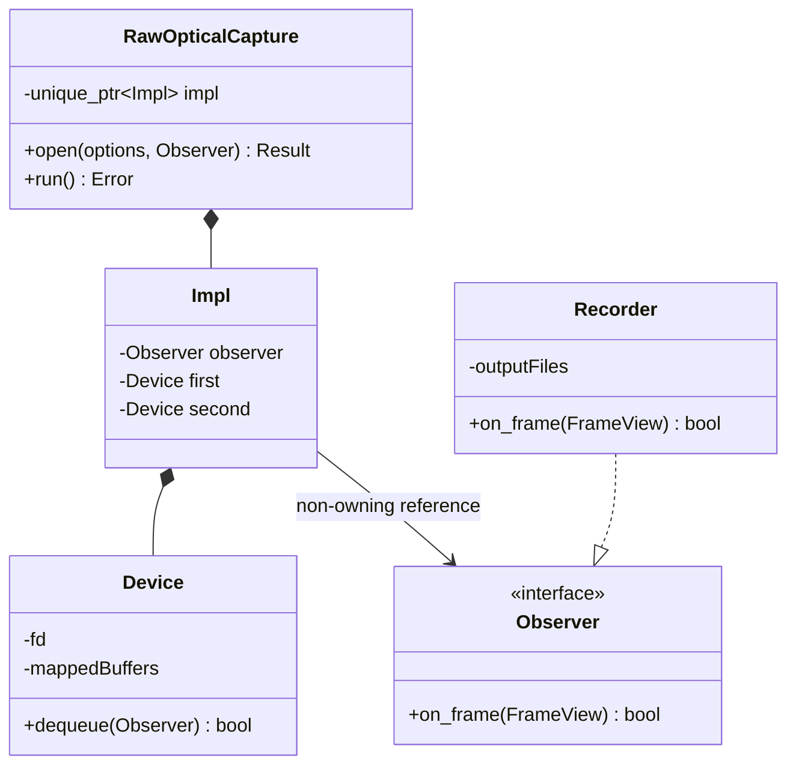
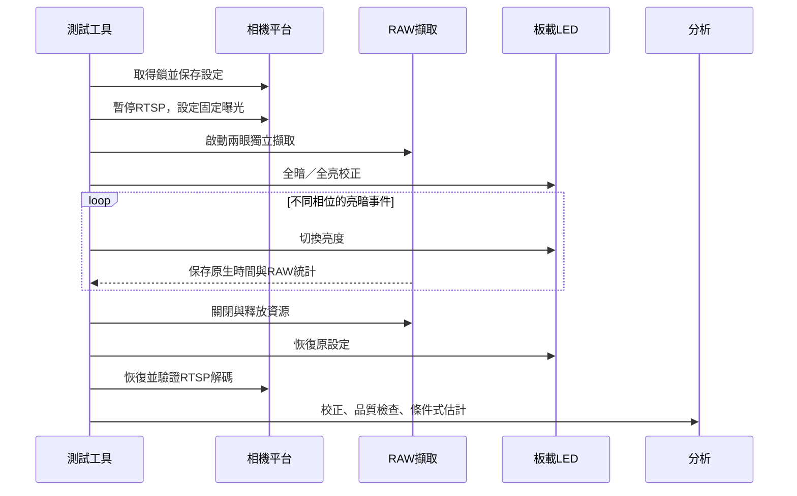

# 無示波器的雙眼曝光時序檢查

兩眼必須同時看見同一顆 RUBIK Pi 板載紅色 LED，建議用白紙散光。測試讀取線性 RAW10，關閉 AE，固定兩眼曝光與增益。以 LED 的全暗、全亮影像校正每眼亮度，再觀察切換途中曝光的影格。

這能取得**有條件的相對曝光時序估計**。LED 的實際光學上升／下降時間尚未經獨立儀器校正，因此不能證明電氣 FSYNC 邊緣同步，也不能宣稱已驗證微秒級準確度。軟體寫 LED 的時間只用來辨識事件；曝光差由影像積分亮度估計。接收 timestamp 保留原值，沒有改成相同數字。

## 執行

在板端執行，OUTPUT 必須是新的目錄：

```sh
sudo python3 /home/ubuntu/stereo-h265-rtsp/optical_exposure_test.py \
  --output /home/ubuntu/sc132gs-camera-tests/optical-new-test \
  --seconds 60 --exposure-us 2000
```

測試使用 Linear、1088×1280、無 binning、手動曝光與零增益；`--fps` 可選 30（預設）或 60。60 FPS 會在兩眼 STREAMON 後套用正式串流同樣的高速 sensor profile。分析會檢查實際接收幀率，避免只有 FSYNC 設為 60 Hz，感測器仍只輸出 30 FPS 的誤判。

結束或收到停止訊號時，恢復測試前相機與三色 LED 的設定，並以 RTSP 解碼驗證影像；RTSP 啟動暫時失敗時最多重試三次。AE 開啟時重試可改用原設定檔的啟動曝光／增益種子，AE 政策不變。測試不修改 YAML 或執行中設定檔，恢復時比對原始內容。測試持有相機設定鎖，避免其他設定指令交錯。

## 判定條件

- 每眼獨立選取 LED 附近有響應的 RAW 區域，以每眼自己的暗／亮值正規化；排除校正期間有任何飽和像素的區塊，優先使用未過曝的光暈。
- 檢查光源強度、實際像素飽和比例、校正穩定性與暗背景漂移。
- 只使用兩眼都有部分亮度，且前後影格順序連續、亮暗狀態正確的孤立事件。
- 至少八個有效事件，亮起／熄滅各至少三個，兩種方向的估計須一致。
- 不以接收 timestamp 的差值篩選雙眼影格。
- 實際接收幀率須在要求值的 5% 以內。

假設兩眼曝光長度皆為 E，光源切換夠快且 RAW 響應線性，亮起時第二眼相對第一眼的曝光開始差約為 `E × (f2 − f1)`；熄滅時反號。正值表示第二眼較晚。若上述條件失敗，`analysis.json` 的 `status` 為 `inconclusive`、`estimate` 為空。

`conditional_estimate` 表示模型條件下的估計，`calibrated_accuracy_us` 始終為空，`exposure_sync_verified` 始終為 false。分位數與雜訊尺度描述這組資料，不能當作經校準的精度保證。

## 輸出與檢查

`frames.bin` 保存每眼每幀的原生 sequence、接收 timestamp、取出時間、8×8 RAW10 平均及飽和像素計數。另保存每眼三張完整 packed RAW10 與 stride／時間 metadata。`transaction.json` 保存控制值、原設定與恢復結果，`led-events.jsonl` 記錄軟體寫入事件，`analysis.json` 保存校正與候選事件。

`inspect_optical_capture.py OUTPUT` 會獨立解包完整 RAW10，比對記錄的平均值及飽和數，輸出 PNG 預覽。預覽使用固定 RAW10 → 8-bit 映射，並未自動提高亮度。程式中的第一眼 eye0／cam0 對應使用者說的 cam1；第二眼 eye1／cam1 對應使用者說的 cam2。

`OpticalExposureAnalysisCheck.py` 使用已知 500 µs 時差、兩眼不同亮度及任意接收時間差的合成資料，並檢查過曝、弱光、沒有共同部分曝光、亮暗方向不一致、實際幀率不符時拒絕估計。這些是分析模型檢查，不能取代板端實測。

## 責任與生命週期



外部 API 使用 C++20、PIMPL 與結構化錯誤，capture 為 move-only。內部 Device 用 RAII 管理串流、映射與檔案。Observer 由呼叫者持有，生命週期涵蓋 capture；回呼在 run 的同一執行緒同步發生，FrameView 只在回呼期間有效。


