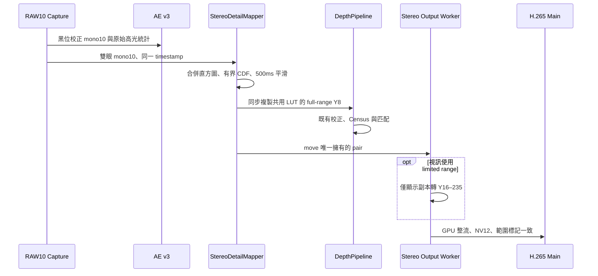
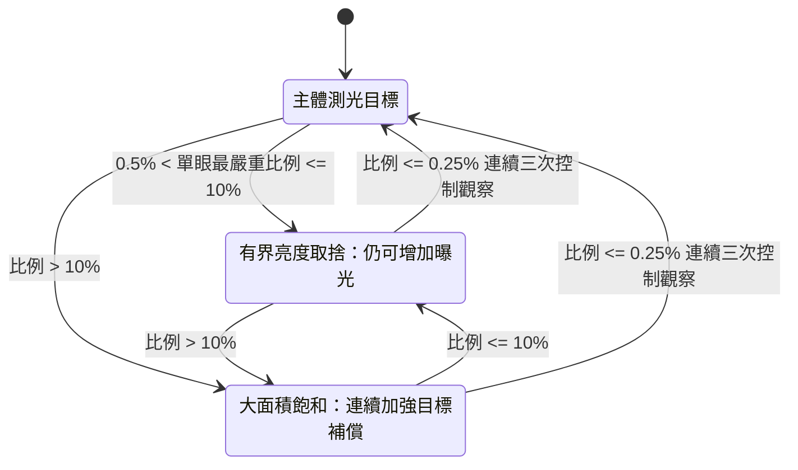

# RAW10 AE、共用映射與 8-bit 輸出

新增 `--tone-map shared-detail --hevc-profile main`，目標是保留 depth 的亮暗排序，不要求真實明暗。RAW 擷取與 AE 保留 10-bit，舊 `--tone-map shared` 不變。

## 資料與責任



`StereoDetailMapper` 統計黑位校正 mono10 的 1024-bin 直方圖，合併雙眼後使用 contrast-limited global CDF。bin 密度上限為均勻分佈的 4 倍，溢出只分給未達上限的 bin。1024 碼直接量化到完整 0–255，不先右移、不加入顯示 OETF、不在 percentile 截白。兩眼共享單調 LUT，近黑或低動態回退線性量化，曲線用 500ms 時間常數平滑。

Census 比較 5×5 鄰域的亮暗順序。重點是減少量化造成的相等，而非讓直方圖好看。仍可能放大雜訊；碼數、熵、有效點增加都不是精度證明。非線性 LUT 位於 bilinear 整流之前，兩者不可交換，須測實際 depth 結果；10-bit 匹配只能作參考，並非真值。

DepthPipeline 在 submit8 返回前完成複製；worker 之後才取得 frame 的唯一 ownership。`--display-range limited` 僅轉換顯示副本，depth 始終保留 256 階。full-range 視訊須另驗編碼器及客戶端，未通過不得預設啟用。shared-detail 要求既有 GPU 整流 map，避免未整流備援輸出錯標範圍。AE 不讀量化結果。

### Linear AE 高光保護



- 在 Bayer 混色與黑位校正前，統計完整 RAW 畫面的所有 CFA phase，含邊界、排除 stride padding。
- RAW ≥1008 視為近飽和；兩眼分別計算，採較高比例。此分母是完整 RAW 像素數，
  與既有 HDR 的「最亮 20%」分母不同。降採樣後仍保留原始計數。
- 超過 50 bp（0.5%）開始亮度取捨；若較嚴重單眼的近飽和區域仍 ≤1000 bp（10%），
  只調整線性測光目標，降亮最多 0.25 EV（保留約 84% 原目標），**不禁止暗部恢復曝光**。
  這是完整 RAW 的面積預算，不是語意上的燈具辨識，容許少量光源核心飽和。
- >1000 bp 使用連續線性面積補償，從 10% 時的 0.25 EV 增至全畫面飽和時最多 2 EV。
  兩段都透過同一主體亮度控制器驅動曝光，避免 10% 交界突然改成強制減曝、造成反覆命令。
  主體超過補償目標時先降 gain，再以每次最多 0.25 EV 縮短曝光；低於目標仍可恢復曝光。
  此策略容許高反差場景的亮部持續飽和，並不保證消除全部過曝。
- 降至 ≤25 bp 且連續三次控制觀察後解除記憶中的小幅目標補償；
  即使停在 25–50 bp 的遲滯區，控制器仍會朝有界的主體目標提高曝光，避免舊版 51-row 鎖定。
- median 是受高光、既有曝光上限與 gain 上限約束的目標。類比增益效益仍須以感測器量測確認。
- 曝光命令後預設等待三組收到的 pair 才恢復正常控制；8-bit depth 同時略過命令 pair
  及這段等待期間。這是保守節流，**不是已驗證的設定／幀關聯**。

Control status 提供 `saturation_scope=full_raw_frame`、`near_saturation_raw10`、
`linear_constraint`、`command_generation`、`command_sequence_valid`、
`remaining_holdoff_pairs` 與 `control_effect_frame_validated=0`。HDR 保留既有統計語意。
修正版另提供 `linear_effective_target_luma10`、`linear_highlight_darkening_ev_x100`、
`linear_small_highlight_limit_bp`、`linear_max_small_highlight_ev_x100` 與
`linear_max_large_highlight_ev_x100`；`highlight_tradeoff` 與大面積補償 `highlights` 分開回報。

### 既有 shared 模式的共用映射

校正後黑點固定 0；各眼高百分位只決定共同增益，不在百分位位置硬截白。
取兩眼較亮的高百分位約束增益，使用端點保持的平滑曲線：

`f(x) = g*x / (1 + (g-1)*x)`，其中 `x` 在 0–1，預設 `1 ≤ g ≤ 4`。

曲線後合成 BT.709 transfer 與 limited-range 轉換，最終才量化。
正常增益增加時間常數 500 ms，降低增益 80 ms；低動態或近全黑回退到單位增益。
小面積亮物體不會因超過 P99 被直接截白，但 8-bit 量化仍會合併部分灰階。
兩眼已有的黑位差、暗角或響應差不會被共用 LUT 自動消除。

## 使用

```bash
stereo-h265-rtsp --cam0 /dev/video0 --cam1 /dev/video3 \
  --capture-mode external-trigger --fps 30 --hevc-profile main --tone-map shared \
  --depth-calibration /path/to/depth-calibration
```

此例僅說明參數；裝置節點必須依板端 discovery 結果，並由原有單一相機 owner 啟動。
包裝腳本可設 `TONE_MAP=shared HEVC_PROFILE=main`。板端驗證使用獨立候選目錄，
依各次 evidence 報告記錄實際部署、比較與恢復結果。

第一版僅支援 Linear external-trigger。`--capture-api on` 可與此路徑使用（30 Hz）。
Depth 需要完整解析度；未啟用 depth 時可降採樣。`/stereo` 的 8-bit 輸出沿用
各眼鏡像、cam0｜cam1 佈局；depth 使用既有校正圖，內部為 cam1｜cam0。
`--gpu-rectification-map` 現在支援 shared 8-bit：使用目前相同的 Q5 校正圖，
GPU 直接對共用 LUT 後的 Y8 插值，輸出未鏡像、已整流的 cam1｜cam0。
邊界使用 limited-range 黑位16，不再做 transfer 或第二次 tone mapping。
整流由有界 worker 處理，capture 不等待 GPU；NV12 送既有 H.265 Main 編碼器。
Depth 使用選定 matching LUT 的 native Y8，獨立套用自己的校正圖，不會重複整流。
未指定校正圖時仍為原有 cam0｜cam1 鏡像預覽，不可把它當作校正輸出。

## 本機驗證

純演算法與介面檢查不需要 GStreamer、OpenCL 或相機：

```bash
cmake -S outputs/stereo_h265_rtsp -B tmp/tone-portable \
  -DSTEREO_PORTABLE_CHECKS_ONLY=ON
cmake --build tmp/tone-portable
ctest --test-dir tmp/tone-portable --output-on-failure
```

完整 Linux build 需要 GStreamer RTSP 開發套件及 OpenCL headers/loader。
新增測試涵蓋 RAW 打包與邊界、單眼高光／解除遲滯、降採樣統計分母、
左右共用 LUT、RAW10 低位細節、異常輸入交易性、BT.709 參考值，以及真正
8-bit rectification kernel 的全部灰階／插值位置。另以合成 RAW pair 驗證
AE 決策不受 LUT／輸出 profile 影響，以及 NV12 直接保留共用 Y′ bytes。

2026-10-16 本機結果：完整 WSL Ubuntu 24.04 建置完成，18 項 CTest 通過。
新增核心元件也通過 Windows MSVC 編譯／執行；新 8-bit 與既有 10-bit
OpenCL 分支通過 Clang CL2.0 語法檢查。`verify_tone_hevc_local.py` 使用
production 元件產生的 128×64 NV12，經軟體 libx265 lossless 編碼及解碼後
12,288 bytes 完全相同，ffprobe 確認 Main／yuv420p／BT.709／limited range。
此項僅驗證軟體 codec 與影像契約，不代表硬體編碼器已通過。

```bash
python3 outputs/stereo_h265_rtsp/verify_tone_hevc_local.py \
  --generator tmp/raw10-tone-build/stereo-signal-path-check \
  --output-dir tmp/raw10-tone-codec
```

本機測試不能證明 QCS6490 的 VPU range metadata、OpenCL 裝置效能、兩眼曝光生效延遲、
實景噪聲或 depth 精度。這些保留給後續有明確相機所有權的板端驗證。
