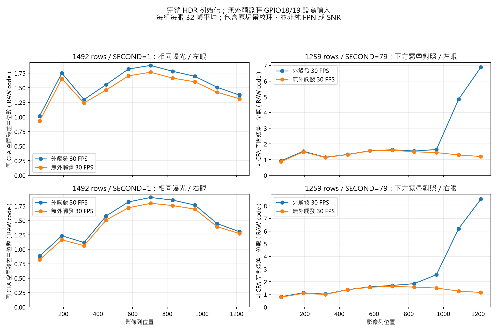
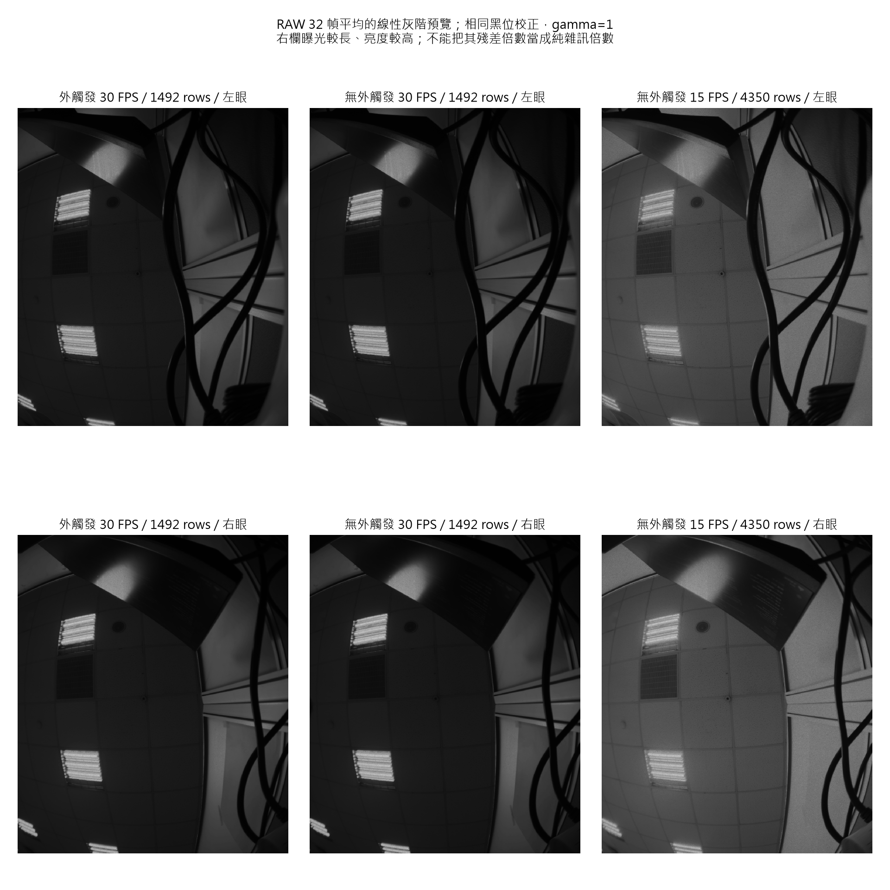

# 停止外部觸發、固定 30 FPS 的實測

2026-10-12。每組每眼保存 32 張完整 packed RAW10，所有 hash 不同；
AE off、gain index=0。原場景含天花板及線材，不當成純 FPN 校正場。

## 結論

真正停止 FSYNC 來源、使用完整 HDR 自由運行初始化後，兩眼可自行
輸出約 30 FPS。短曝光的整片空間紋理較長曝光小；但同為 1492 行
曝光時，移除外部觸發只有小幅差異。另有一組 1259/79 的外觸發
下方帶狀殘差，在無外觸發時明顯減少。

15 FPS、4350 行長曝光即使沒有外部觸發，大範圍紋理仍在。
因此下方霧帶與長曝光整片紋理須分開調查，不能把後者全歸因於
外部觸發，也不能把 30 FPS 較暗的短曝光畫面稱為已修復。

## 如何確認沒有外部觸發

- 正式 RTSP owner 暫停，持有相機／模式鎖；兩眼完整 SW reset。
- 重新寫入 132 筆 HDR 專用初始化表，省略 9 筆 slave FSYNC overlay。
- GPIO18/19 由 `hold-fsync-input` 以 INPUT 持有，程式沒有輸出寫入；
  沒有執行 pulse generator。
- 兩眼 3222=30，trigger enable bit1=0；HDR point read 保持開啟。
- 最後 32 個 V4L2 EOF timestamp 的間隔約 33.33 ms，確認自行出圖。
  這是本次短時間量測，不代替長時間穩定性或雙眼光學同步驗證。

先前只改 3222、仍讓 generator 執行的比較，不能當成「外部脈衝已
停止」的證明。本輪最初嘗試關位元再停 generator，影像在數幀後
停止，RAW=0 bytes；已保留失敗紀錄，沒有計入品質統計。完整
reset 及無 trigger source 的新六組測試全部取得有效 RAW。

## 30 FPS 與相同曝光的比較

下表的空間殘差是 x=320..831、最後 128 列、同 CFA 四鄰居高通
絕對值中位數，單位為 RAW code。包含場景本身細節，並非純雜訊。
TOTAL 單位為 nominal rows，SECOND 為 1/16 nominal-row tick；
寄存器值不能代替已校準的物理曝光時間。

| 条件 | 實測左／右 FPS | 最後 128 列殘差 左／右 |
|---|---:|---:|
| 外觸發、TOTAL=1492、SECOND=1 | 30.023／30.039 | 1.375／1.305 |
| 無外觸發、TOTAL=1492、SECOND=1 | 29.994／30.009 | 1.313／1.273 |
| 外觸發、TOTAL=1259、SECOND=79 | 29.999／30.009 | 6.883／8.523 |
| 無外觸發、TOTAL=1259、SECOND=79 | 30.006／29.999 | 1.195／1.148 |

1492/1 的中位灰階左／右：外觸發 144.86／148.40，無外觸發
141.21／144.52，差約 2.5%～2.6%。全幅殘差也只小幅降低。
1259/79 的上方多數列殘差相近，但外觸發的下方明顯增大。

原廠 HDR 表的未改動 seed（TOTAL=1492、SECOND=746、5400=80）
亦可無外觸發輸出 30.001／30.006 FPS。該 seed 的 RAW 均值圖有
約 0.555%／0.634% 飽和像素；正式品質對照仍使用 SECOND=1、
曝光相依的 HDRC ratio，並未把 seed 直接套用到直播。

## 長曝光對照與限制

無外觸發、VTS=9000、TOTAL=4350、SECOND=1，實測
14.996／15.000 FPS。中位灰階 316.29／327.19，大範圍受光區域的
固定顆粒仍可見；上方多數 128-row band 殘差約為 2.2～6.6 codes。
與 1492 行相比，曝光及亮度均增加，不能把殘差倍數當成純雜訊倍數。
這支持「移除外部觸發仍不足以消除長曝光紋理」。

## 目前驅動配置與復原

`sc132gs.c::sc132gs_write_mode()` 依 HDR mode 選擇獨立的
`sc132gs_hdr_1088x1280_regs[]`（132 筆），不會先載入 Linear
初始化表。正式 external profile 再載入 9 筆 HDR FSYNC 設定，
所以 kernel log 顯示 141 registers。

所有診斷修改均於該輪結束時復原；當時正式服務恢復 HDR 15 FPS、AE on、
target=30、TOTAL=4350、SECOND=1，讀回 gain=4、control_error=0、
revision=176。durable/runtime 設定逐 byte 未變；實際解碼驗證通過。

資料：`haze-free-static-means/comparison.json`、
`free-run-30fps-summary.json`、`haze-spatial-analysis.json`。
最初失敗：`haze-free30-attempt-logs/comparison.json` 及 capture 日誌。
板上 `haze-free-static-20261012/` 保留完整 RAW；Windows 保留均值、
變異、PNG、metadata 與日誌。自由運行僅用於診斷，未作正式 stereo 變更。

使用者後續自行切回 Linear，確認同場景看不到霧狀。最新唯讀
核對為 Linear 60 FPS、AE target30、exposure1330、gain37、error0，
保存於 `linear-user-visual-confirmation-20261012.json`；未將模式切回 HDR。
