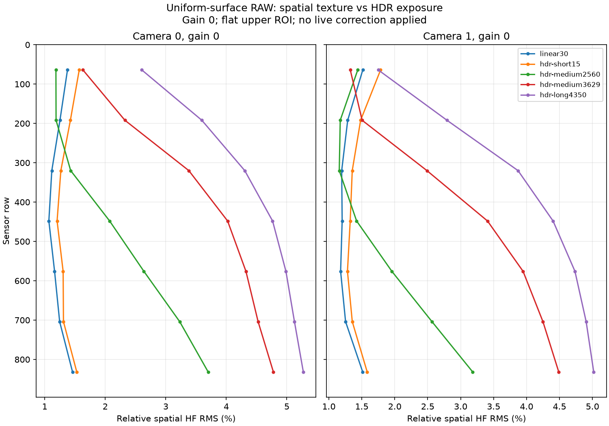

# 第三次 HDR 固定霧狀紋理調查（2026-10-12）

## 目前判斷

前一階段證明的是四個暗部區塊的逐幀雜訊改善，沒有證明固定空間
紋理消失。使用者隨後回報長曝光畫面有幾乎整片的霧狀紋理。
本輪保留所有 packed RAW，不加去霧、顯示曲線、列補償或降噪。
尚未找到能消除這次紋理的感測器設定，不能宣稱已修復。

使用者後續自行切回 Linear，確認同場景看不到霧狀。唯讀實機
核對為 Linear 60 FPS、AE target30、exposure1330、gain37、error0、
revision177。此為使用者視覺確認，未自行宣稱完成 HDR 品質修復。
最新設定及兩眼寄存器保存於 `linear-user-visual-confirmation-20261012.json`。
本文件下方 HDR15 的「復原」是先前各輪量測結束時的狀態。
使用者已決定預設 Linear60、HDR 調整先停在此，並要求提交目前修改。

均勻白色表面的新量測確認：HDR TOTAL=4350、gain=0 的受光固定
高頻紋理，左右眼分別約為有效訊號的 4.56%／4.18%；Linear 約為
1.24%／1.30%。HDR 長曝光重測的紋理相關係數為 0.991／0.989，
與 Linear 紋理的相關係數則接近 0。這支持 HDR 長曝光的固定響應
差異，不是單純隨機雜訊，也不是只靠天花板細節能解釋。
尚不能由此判定某個未公開寄存器或感測器內部電路是根因。

## 前兩次的處理及本次驗證

1. 2026-10-06：HDR FSYNC 誤用 Linear 的 `0x3225=0x04`。
   改成感測器 reset 預設 `0x00` 後，下方帶狀殘差顯著降低，但仍有殘差。
   參考 `../bottom-fifth-20261006/README.md`。
2. 2026-10-08：固定 TOTAL=1259、SECOND=79、gain=0，比較
   external/free/external 可重現下方霧帶；最後 128 列的 RAW 空間殘差
   external=7.23/8.77、free=1.46/1.38。自由運行未證明雙眼曝光同步，
   所以沒有作為正式 stereo 修正。參考 `../hdr-band-20261008/RESULT.zh-TW.md`。
3. 本次讀回兩眼 HDR `0x3220=c3`、觸發 `0x3222=32`、
   `0x3225=00`、HDRC `0x5001=01`，舊修正沒有回退。
   相同曝光的自由運行改善很小，不能照搬第二次的因果結論。
   先前 `3222=30` 比較時 generator 仍在執行，不等於物理觸發来源已停止。
   真正停止來源的新測試見 `FREE_RUN_30FPS.zh-TW.md`。

## 遮光測試

使用者確認兩顆鏡頭均有不透光遮擋。所有測試增益為 0，短曝光
1492／長曝光 4350 nominal rows。每個條件、每眼保存 32 張 packed
RAW10，1740800 bytes/frame，SHA256 皆不同。量測完已恢復服務並
通知移開遮擋；使用者確認已移開。

HDR 長曝光黑位中位数約 52.69～53.16/1023，Linear 約 36.63～36.75。
按四個 Bayer phase 分別去平均、扣除有限幀數隨機雜訊後，長曝光
dark-frame 固定空間 RMS 約 0.61～0.83 RAW code，沒有明顯整片抬黑。
此結果僅排除明顯暗電平偏差，不能排除受光時的固定響應差異。
摘要：`haze-covered-comparison.json`；完整 RAW 仍保存於板上。

## 受光測試

鏡頭朝向使用者原場景。共 21 個條件，每條件每眼 32 張 RAW，
先暫停正式服務取得 exclusive ownership，最後恢復原設定及實際解碼。
每輪確認 durable/runtime 設定內容沒有改變。

分析沿用前兩次的方法：32 幀時間平均圖，x=320..831，每 128 列
一組，同 CFA phase 的上下左右兩像素高通，RAW=40..950 的
絕對殘差中位數。**場景包含天花板本身紋理，不能把此數值直接稱為
FPN、SNR 或全部異常紋理。** 詳見 `haze-spatial-analysis.json`。

| 測試 | 觀察 |
|---|---|
| HDR 1492 行、gain=0，15／30 FPS | 整張亮度與空間殘差相近，單純減少觸發頻率未改變紋理 |
| HDR 4350 行、gain=0，15 FPS；重測 | 受光區域殘差較大，重測可重現；與短曝光的亮度不同，不把殘差倍數當成純雜訊倍數 |
| 1492 行，external/free/external | 亮度相近，free 的殘差僅略低 |
| 4350 行、VTS=9000，external/free/external | 亮度相近，free 與延長 VTS 都沒有消除紋理 |
| 4350 行，SECOND=1/16/64/272 | 高光亮度改變，但空間殘差沒有明顯改善 |
| 4350 行，HDRC 與 HDR point read 一起關閉；開回重測 | 讀出行數由 2674 降到 1338，紋理未消除；保持 HDR response 及外部觸發 |
| 4350/gain0、3629/gain9、2560/gain24、1492/gain49 | 整體中位亮度接近；短曝光部分受光區域殘差较低，但高光飽和增加，3629/gain9 的下方帶狀殘差反而更大 |

第一次 `hdr-free-long` 雖然 TOTAL 寄存器是 4350，但仍使用 4500 VTS，
輸出亮度明显較低；它不能作同曝光品質比較。已補測 VTS=9000 的
自由運行，確認與 external 同樣的中位亮度後才比較。VTS 只用於
診斷，重啟正式 profile 會恢復 4500，沒有更改正式觸發方式。

## 證據位置與恢復

板上 `/home/ubuntu/hdr-tuning-20261012/` 的
`haze-covered-20261012`、`haze-lit-20261012`、`haze-timing-20261012`、
`haze-signal-20261012`、`haze-flat-20261012`、
`haze-vendor-reset-20261012`、`haze-second-wide-20261012`
各保留原始 RAW、逐幀 hashes、完整寄存器與
V4L2 日誌。Windows `haze-*-means/` 保留均值／時間變異陣列、PNG、
JSON 及日誌；`*.mean.luma.png` 是 RAW 均值經 Bayer 灰階重建與相同
模式黑位線性校正的診斷預覽，沒有 gamma，也不是單幀直播。

正式服務已恢復 HDR 15 FPS、AE on、target=30、TOTAL=4350、
SECOND=1；最後讀回 AE gain=4、兩眼亮度 30%/32%、高光飽和比例
0、控制錯誤 0。最後 5 秒解碼取得 68 張不同畫面，2176x1280，
PTS 約 15.001 FPS。`decode.json`／`decoded.png` 保存恢復證據。
這是恢復證明，並非霧狀修復證明。

## 均勻受光表面：固定紋理與曝光長度

使用者確認兩眼朝向白色表面後，依序量測 Linear／HDR／Linear
共 7 組，每眼每組 32 幀，AE off、gain=0；HDR SECOND=1 tick。
圖中下方約 1000 列以後含線材／表面邊界，不作均勻表面標準。
總體統計及相關係數只使用 y=48..895、x=80..1007。

對四個 CFA phase 分別扣除 Gaussian sigma=15 phase pixels 的局部
背景（相當於 30 個實體像素），排除低訊號、飽和與強背景梯度。
固定高頻 RMS 近似扣除 32 幀平均仍殘留的隨機雜訊能量；相對紋理
以局部背景扣黑後的訊號正規化。白色表面由使用者擺放，並非校正
過的均勻輻射源，數字不能宣稱為感測器認證 PRNU。

| 模式／TOTAL nominal rows | 左眼固定高頻 RMS（RAW code） | 右眼固定高頻 RMS | 左眼相對紋理 RMS | 右眼相對紋理 RMS |
|---|---:|---:|---:|---:|
| Linear 30 FPS／1377 | 3.309 | 3.356 | 1.240% | 1.301% |
| HDR 15 FPS／1492 | 2.337 | 2.372 | 1.367% | 1.441% |
| HDR 15 FPS／2560 | 9.141 | 7.508 | 2.449% | 2.003% |
| HDR 15 FPS／3629 | 14.963 | 14.102 | 3.820% | 3.363% |
| HDR 15 FPS／4350 | 17.956 | 17.764 | 4.555% | 4.181% |
| HDR 15 FPS／4350 重測 | 18.097 | 17.974 | 4.585% | 4.226% |
| Linear 30 FPS／1377 重測 | 3.338 | 3.399 | 1.250% | 1.278% |

HDR 長曝光重測的相對殘差相關係數 0.9913／0.9891；Linear 與
HDR 長曝光則為 0.0079／0.0059。長曝光的固定紋理遠大於其幀間
隨機雜訊，且與短曝光／Linear 不同。延長曝光改善幀間雜訊，不能
因此宣稱整體 HDR 影像品質已改善。

資料：`haze-flat-means/`、`haze-flat-analysis.json`。
下圖只顯示上方均勻表面範圍，沒有把下方線材算成固定雜訊。

## 完整感測器重設與原廠 HDR 初始化

在原場景以 TOTAL=4350、SECOND=1、gain=0、VTS=9000，執行
external／完整 reset 後套用原廠 HDR 表的 free-run／external 重測。
三組完整 RAW 均有效，亮度及同 CFA 空間殘差相近，紋理仍可重現。
Free-run 讀回 3222=30、3226/3227=06/06，沒有 slave overlay。
這組 generator 仍在執行，因此只能證明完整 reset 後的設定對照，
不能當成外部脈衝已停止的證據；仍未證明內部根因。

原廠表是既有的 30 FPS HDR 初始化表。測試另設定長 TOTAL 及 VTS，
不能把它稱為「原廠驗證的低 FPS 長曝光 profile」。

第四組 `vendor-reset-short` 發生 RAW 長度不足，整輪留下
`RuntimeError('Truncated full RAW')`。該組及未執行的第五組不計入
影像證據。finally 已恢復正式設定及解碼，紀錄 `restored=true`。
資料：`haze-vendor-reset-means/comparison.json`。

## 更大的 SECOND：紋理與亮部細節的代價

固定 TOTAL=4350、gain=0、15 FPS，SECOND 依序為
1、1024、4096、8192、16384、1 ticks（每 tick=1/16 nominal row）。
中位灰階基本相近，部分區域空間殘差降低；未消除紋理。

| SECOND ticks | HDRC 5400 | 左眼／右眼 RAW 均值圖飽和像素比例（>=1020） |
|---|---|---|
| 1 | ff | 0%／0% |
| 1024 | fb | 0.665%／0.789% |
| 4096 | f0 | 1.392%／1.563% |
| 8192 | e1 | 1.993%／2.175% |
| 16384 | c3 | 2.657%／2.806% |
| 1 重測 | ff | 0%／0% |

本表是全部 RAW 像素在 32 幀均值圖的飽和比例，與正式 AE 的
「最亮 20% 中的飽和比例」不同。場景包含本身紋理；空間殘差變小
不等於純 FPN 降低。較大 SECOND 會明顯增加亮部裁切，因此沒有
把它套用到正式 AE。資料：`haze-second-wide-means/`。

## 下一步所需資料

使用者確認目前沒有原廠的低 FPS HDR 初始化／HDRC 校正說明。
現有 V2.6 datasheet 說明 HDRC 開關及曝光比，但未提供 0x54xx
校正參數的完整語意。公開的
[SmartSens bring-up 文件](https://developer.d-robotics.cc/x5_sdk_doc_v2.0.0/en/multimedia_development/isp_tuning_guide/SmartSens_sensor_bringup.html)
示例主要是 Linear，不能據此推導低 FPS HDR 的校正設定。
[GS130 SDK](https://github.com/D-Robotics/gs130_camera_sdk) 及
[SC132GS ISP tuning JSON](https://github.com/D-Robotics/x5-tuning-json/blob/main/sc132gs_tuning.json)
亦未提供本次所需的感測器內部 HDRC 寄存器校正流程。

原廠需要確認的條件與證據已整理於 `HDR_VENDOR_REPRO.zh-TW.md`。
維持原設定，不把去霧、列補償、顯示曲線或自由運行當成已修復。

使用者後續提供四張寄存器排查建議圖片，已逐項對照 datasheet、
原廠表與實機；47 個相關原廠設定在兩眼讀回均符合。新增 BLC
重新啟用對照仍未消除紋理；短 gain 的 1x 寫入讀回仍為 00，未確認
生效，不能當成有效增益品質對照。詳見 `IMAGE_REGISTER_AUDIT.zh-TW.md`。
正式 HDR 15 FPS 保持 VTS=4500，並非靠放大 VTS 降 FPS。

## 補測：真正停止 FSYNC 來源及 30 FPS

依使用者最新要求，以 GPIO18/19 INPUT、無 pulse generator、完整
HDR reset/init 取得六組有效 RAW。無外觸發的 1492/1 與 1259/79
皆測得約 30 FPS；前者與同曝光 external 相比只有小幅差異，後者
的下方殘差由 6.883/8.523 降到 1.195/1.148 RAW codes。

無外觸發的 4350/1、VTS9000 實測 15 FPS，長曝光整片紋理仍在。
因此移除外部來源可改善特定下方霧帶，不能消除全部長曝光紋理。
最初只關位元再停 generator 的嘗試沒有取得足長 RAW，保留失敗
紀錄且不算品質證據。全部測試後正式 HDR15/AE target30 已復原。
完整結果及線性預覽：`FREE_RUN_30FPS.zh-TW.md`。

## 使用者視覺對照：Linear 看不到霧狀

使用者回報：「我切成linear就看不到霧狀了, 看來還是HDR的關係」。
在不變更相機設定的情況下，讀回兩眼 Linear 模式與約 60 FPS。
這與既有 gain0 RAW 對照及無外觸發長曝光仍有紋理相符，支持將
主要調查集中於 HDR 受光響應／HDRC 校正及長曝光的有效 profile。
不能由模式切換單獨定位某個位元，因為曝光、時序及增益也不同。
目前保留使用者選擇的 Linear，尚未安排新的 HDR 修改或模式切換。
