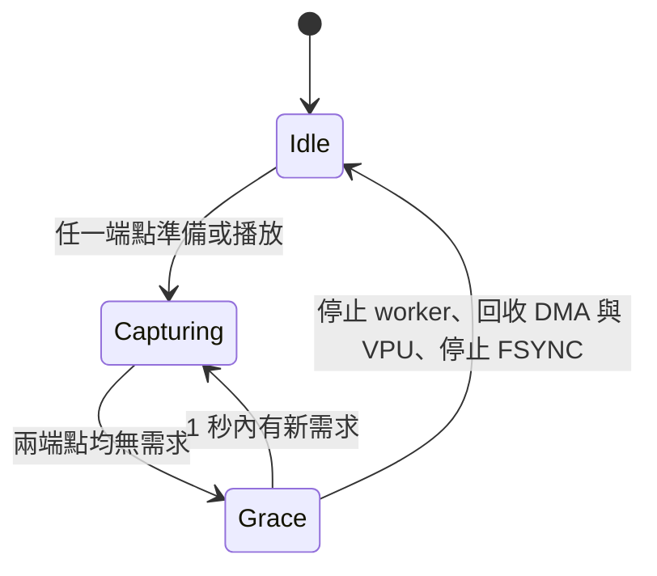

# 按需取像板上驗證 — 2026-10-16

已部署至既有 `sc132gs-camera-rtsp.service`，目前為 Linear 30 FPS、rectified shared-detail Y8、limited-range HEVC Main。`/stereo` 與 `/depth` 都沒有準備／播放需求滿 1 秒即停止硬體；RTSP listener 與 AE 控制介面持續待命。其他需要外部 post-STREAMON timing 設定的 profile 保留原有行為。

| 驗證 | 結果 |
|---|---|
| RTSP lifecycle | 43 項案例全部通過，同一個 server process |
| 正常 TEARDOWN、TCP RST、重連 | 通過，含 6 輪完整冷啟停 |
| 兩端點、同端點多 client | 其中一個離開時，其餘 client 持續收流 |
| PAUSE／PLAY | 兩路停止／恢復通過，RTP 時間沒有倒退 |
| 只做 DESCRIBE | 準備需求受 10 秒上限約束，之後釋放硬體 |
| 正常 TCP reader 無額外 RTSP keepalive | 超過 35 秒仍正常收流 |
| 單一 TCP 連線黑洞 | 35 秒無 transport 回應後關閉；觀測到待命耗時 38.062 秒（含 teardown、sensor suspend 與 SSH 讀回） |
| 防火牆回復 | 原規則與 policy 完全一致，測試規則已移除 |
| 正常離線資源讀回 | 最長 2.859 秒讀到完整待命（含 client 收尾、sensor suspend 與 SSH） |
| 電腦端解碼 `/stereo` | 601 frames，30.00 FPS，20 秒，無錯誤 |
| 電腦端解碼 `/depth` | 601 frames，29.95 FPS，20 秒，無錯誤 |
| CTest | 22 / 22 通過 |
| 待命資源 | video FD=0、video MMAP=0、VPU instance=0、兩顆 sensor suspended、FSYNC running=0 |
| 最終 10 秒待命 | pulse 沒有增加；process CPU 約 0.10% 的一個 CPU core |
| 原設定與套件 | 原 launcher／設定檔 checksum 保持；系統外掛 package 驗證通過；AE auto / target 10 保留 |
| 收尾 | service active、無 client 待命、rollback timer 已解除 |

## UML 狀態預覽

硬體 session 內的相機、深度 pipeline 和 encoder 用 RAII 回收；RTSP callback 只更新需求，由單一 controller 協調啟停。此次也修正板上 QCOM GStreamer encoder input-pool 的每 frame 引用未歸還，透過私有外掛使用修正，沒有覆寫系統外掛或重載 driver。

## 證據入口

- [43 項案例與重測來源](lifecycle-completed/result.json)
- [防火牆還原比對](lifecycle-completed/firewall-restoration.json)
- [兩路解碼結果](pc-decode/collection.json)
- [最終板上狀態與全部 checks](board/final-state.json)
- [最終 server log](board/final/server.log)
- [CTest](board/ctest-final.log)
- [部署資訊](board/deployment.json)
- [設計、私有外掛與回復方式](../ON_DEMAND.zh-TW.md)

原始 `lifecycle-verified/result.json` 的前 41 項通過；最後的防火牆還原比對曾將自然增加的封包計數誤當規則變動。該原始失敗結果與前後 snapshots 保留。僅修正驗證工具的比對方式後，在同一 server process 上重測斷網回收與最終待命，合成最終 43 項結果；production binary 沒有因這次工具修正而變更。

切換候選版本前，舊服務曾發生 invalid buffer / FSYNC error=9；證據在 `board/preexisting-fault/`。本次驗收證明啟停、斷線、重連與回收行為，未宣稱修復該既有長跑故障。既有 service 是 transient unit，此次不包含重開機後的服務持久性驗證。

Binary SHA256: `894901567e576737347466619f7a469b2c45b1354929af3e02493b1c3d13c77e`

## Commit 範圍與來源對照

只提交按需啟停、私有 VPU 修正及本次驗證紀錄。原工作區的 depth-precision-benchmark 註冊與其他測試工作未納入。板上驗證時的 CMake 包含該既存 benchmark 註冊，因此原始 deployed CMake 與 staged CMake 的內容及 SHA256 不同；`commit-scope.json` 分別保留原始、LF 正規化與 staged source SHA256。其餘三份 runtime source 在依照既有 repo 規則將 CRLF 正規化為 LF 後，內容與板上版本完全一致。

下載的第三方原始碼／archive、Meson wheel、Python cache 與重複的 raw-luma NPY 中間檔留在本機；來源 URL、checksum、文字證據、PNG 截圖與完整成功／失敗輪次紀錄納入 commit。原始證據的換行由局部 `.gitattributes` 保留，避免破壞重測來源 checksum。
